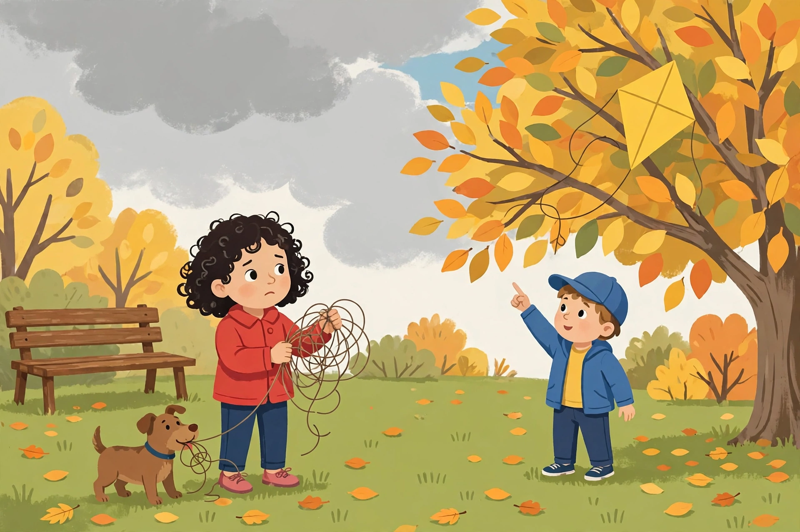

# Lesson 04 — Description: Concrete Words and Sensory Details

**Goal (learner hears):** "I can describe a person, place, or
thing with concrete words and sensory details, so a reader can
picture it — and I can describe a character in depth from what
they think, say, and do."
**Time:** 30–35 minutes · **Materials:** this lesson; a pencil and
paper (or the unit notebook).
**Standards:** W.4.3.d; L.4.3.a; RL.4.3.

## Readiness check (1–2 min)

The adult asks: "Which sentence helps you picture the dog: 'The
dog was nice.' or 'The small brown dog tugged the string with his
teeth and wagged his tail.'?" (The second one — "small," "brown,"
"tugged," and "wagged" are concrete; "nice" could mean almost
anything.) "Today we learn to trade vague words for concrete ones
and to describe with all five senses."

## Explicit teaching

- **Concrete words** name things you can point to, count, or
  measure: "yellow diamond kite," "tangled string," "wooden
  bench." **Vague words** could mean almost anything: "nice,"
  "big," "stuff," "things," "good."
- **Sensory details** describe what a character sees, hears,
  smells, tastes, or feels:
  - Sight: "the yellow kite spun once, twice"
  - Sound: "Biscuit barked at every gust"
  - Touch: "the string jerked in my hands"
  - Smell: "the air smelled like rain"
  - Taste: "the cold air tasted like pennies" (use taste rarely —
    it fits food and weather, not every scene)
- **Show, don't tell:** instead of telling the reader a feeling
  ("Mara was upset"), show what the feeling looks like from the
  outside ("My heart thumped like a drum" — the reader *feels*
  the upset without being told).
- **Describe a character in depth (RL.4.3):** use a character's
  **thoughts, words, and actions** together. One detail is a
  snapshot; three details from the text make a portrait.

### The lesson passage

Three versions of the same moment — vague, better, best:

> **Vague:** The dog did something with the string. It was a nice
> day.
>
> **Better:** Biscuit grabbed the loose end of the string in his
> mouth and tugged.
>
> **Best:** Biscuit grabbed the loose end of the string in his
> mouth and tugged, his ears flopping and his tail wagging, while
> orange leaves skittered across the grass at his feet.

### Modeled example 1 — swapping vague for concrete

*Adult models aloud:* "'It was a nice day' tells me nothing I can
picture. Ask three questions: What did the sky look like? What
did the air feel like? What could you hear? Now: 'The gray sky
hung low, the wind tugged at my jacket, and leaves rattled along
the path.' Same day — but now the reader stands in it. Every vague
word has a concrete replacement hiding behind a question: 'big'
becomes 'as tall as the maple tree'; 'loud' becomes 'a bark that
made the birds scatter.'"

### Modeled example 2 — describing a character in depth

*Adult models:* "Theo, from the anchor story, in three details.
His **words**: 'Don't pull too hard or the string will snap' —
he thinks before he acts. His **actions**: he points at the branch,
then counts 'One… two… three!' — he leads the plan. His
**feelings, shown not told**: 'His face was red from pulling, but
he was grinning' — tired and happy at the same time. One detail
says 'Theo is nice.' Three details say 'Theo is the calm one who
thinks first and cheers his sister on.' That is describing a
character in depth."

### A common trap (model it)

A learner writes: "The park was very, very, very pretty. The kite
was super cool. It was awesome."
The adult answers: "Three 'very's and two empty words — 'pretty,'
'cool,' 'awesome' — and I still cannot picture the park. Adjectives
piled on top of a vague word do not make it concrete. Replace the
pile with one picture: 'Orange leaves covered the grass like a
blanket.' One concrete picture beats five vague adjectives."

## The picture activity

Look again at the picture from Lesson 03 — or read the text-only
version below if you cannot see it.

*Caption: The moment the kite gets stuck — Mara holds the tangled
string, Biscuit tugs the loose end, and Theo points at the yellow
kite in the tree. AI-generated illustration for this unit; the
characters and scene are invented for the lesson.*

**Text-only version of the picture (same as Lesson 03):** In a
park on a windy autumn day, a big tree with yellow, orange, and
green leaves stands on the right. A bright yellow diamond-shaped
kite is caught in its branches. Under the tree, a girl with curly
dark hair, a red jacket, blue pants, and pink shoes holds a tangled
ball of kite string in both hands and looks worried. A small brown
dog with a blue collar holds the loose end of the string in its
mouth. Next to her, a boy in a blue cap, a blue jacket, and a
yellow shirt points up at the kite and smiles. A wooden bench
stands on the left. Orange and yellow leaves lie scattered on the
green grass. The sky is gray with clouds, except for one small
patch of blue.

## Guided practice (adult hints allowed)

1. Name one concrete detail from the picture for each sense:
   sight, sound, and touch. (Hint: what would the wind feel
   like on your face? What sound would the leaves make?)
2. Which sentence is concrete, and which is vague? (a) "The kite
   was up there." (b) "The bright yellow kite hung from the high
   branch, its string dangling." Explain the difference in one
   sentence.
3. Describe Theo in depth using two details from the anchor story
   — one from his words and one from his actions.
4. Rewrite this vague sentence with one concrete word and one
   sensory detail: "The dog was happy."

## Independent practice

1. Describe the picture in three sentences. Each sentence must
   have at least one concrete word (a color, a number, a shape, a
   material) and the three sentences together must use two
   different senses.
2. Sort these words into **concrete** or **vague**: *tangled,
   nice, yellow, stuff, flopping, good, wooden, things.* Write
   each vague word again as a concrete replacement.
3. Error analysis: a classmate wrote, "Mara was very sad. The
   park was very pretty. The end." Explain in two sentences why
   "very" does not fix vague writing — and rewrite the two
   sentences with one concrete picture each.
4. Show, don't tell: write two sentences that show a character is
   nervous **without** using the word "nervous" (or "scared" or
   "worried").

## Applied task

Open the project draft. Find your description of the setting or
of a character. Underline every vague word ("nice," "big," "good,"
"stuff," "things"). Replace at least two of them with concrete
words, and add one sensory detail (sight, sound, smell, or touch)
to the scene. Read the new sentences aloud — can a listener
picture the place now?

## Exit check

Without looking back: "What is the difference between a concrete
word and a vague word? Name the five senses, and give one sensory
detail from the kite story." (Concrete words name things you can
point to or measure; vague words could mean almost anything.
Senses: sight, hearing, smell, taste, touch. From the story:
"The yellow kite spun once, twice" (sight); "Biscuit barked"
(sound); "the string jerked in my hands" (touch).)

## Supports, alternate modes, extension

- **Reading support:** the adult reads the three versions of the
  lesson passage aloud with a pause between them; the learner
  points to the sentence that paints the clearest picture before
  the adult names why.
- **Alternate response mode:** the learner may draw the picture
  scene first, label three details on the drawing (color, shape,
  sound), and then dictate the three description sentences while
  the adult scribes.
- **Extension:** describe the same park scene twice — once as Mara
  would see it (worried, focused on the string) and once as Theo
  would see it (excited, focused on the kite) — and explain how
  the narrator's feelings change which details get noticed.

## Teacher note

Likely misconceptions: (1) more adjectives = better description
("very, very pretty") — the fix is one concrete picture, not a
pile of vague ones; (2) listing five senses mechanically in every
scene — teach that one or two well-chosen details beat a
checklist; (3) describing a character with looks only ("she had
brown hair") — push for thoughts, words, and actions too
(RL.4.3). Full solutions: [answer key](../answer-key.md)
§ Lesson 04.
