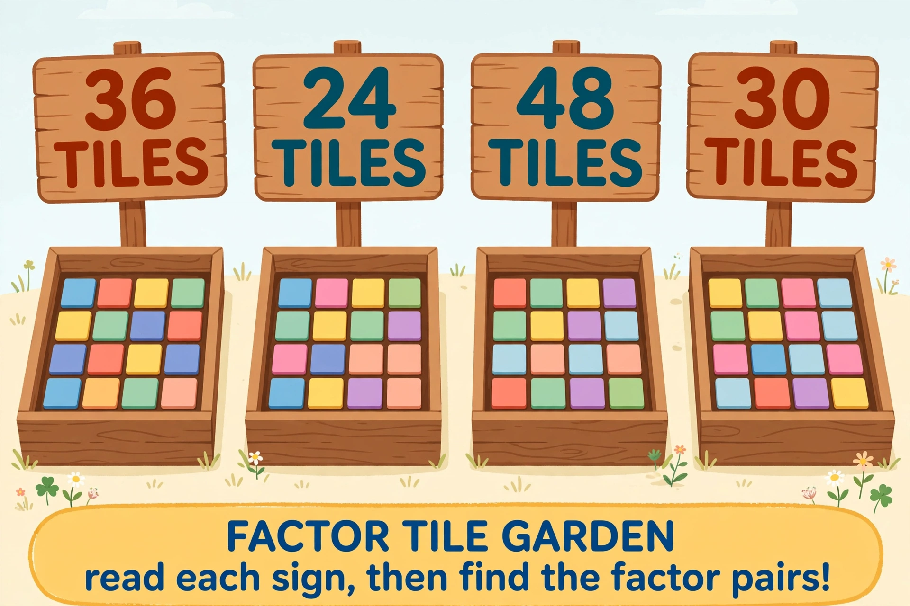

# Lesson 01 — Factor Pairs with Arrays

**Session:** 1 · **Time:** 35 minutes · **Goal:** I can find **every** factor
pair of a whole number 1–100 by building or sketching rectangular arrays of
tiles, and I can list the pairs in order without missing any.

**Materials:** square tiles (real or paper squares — at least 50), the Factor
Tile Garden illustration (below or printed), paper and pencil. The SVG
[`../assets/factor-pairs-arrays.svg`](../assets/factor-pairs-arrays.svg)
shows the four arrays of 24 with exact dimensions.

## Readiness check (4 min)

Warm-up retrieval from Unit 01: round 4,832 to the nearest hundred (4,800) and
estimate 23 × 4 (20 × 4 = 80). Then ask aloud: "Show me 3 × 4 with tiles as a
rectangle." (A 3-by-4 rectangle.) "Could you show 3 × 4 a different way?" (A
4-by-3 rectangle.) If the learner struggles to make rectangles, build 2 × 5
together before the new content.

## Explicit teaching (10 min)

A **factor** is a whole number we can multiply with another whole number to
get our number. A **factor pair** is the two factors written together:
2 × 6 = 12 means (2, 6) is a factor pair of 12.

Rectangular arrays are the perfect hunting tool, because **every rectangle you
can build with exactly your tiles is a factor pair** — its rows and columns
are the two factors.

The hunt routine (memorize this):

1. Start with the 1-by-**n** array (1 row of n tiles). That is always the
   first pair: (1, n).
2. Try 2 rows. If the tiles fill out evenly, (2, n÷2) is a pair.
3. Try 3 rows, then 4, then 5… keep going while the partner is **bigger than**
   the number you are trying. When the partner equals the number you are
   trying (a square, like 6 × 6), you have found them all.

Why stop at the square? Because after 6 × 6 = 36 comes 7 × ___, and you would
be re-listing pairs you already found (turned around). Factors after the square
just repeat.

## Worked example 1 — Factor pairs of 24

1. Start with 1 × 24: 1 row of 24 tiles. Pair: (1, 24).
2. Try 2 rows: 24 ÷ 2 = 12 — 2 rows of 12 fill evenly. Pair: (2, 12).
3. Try 3 rows: 24 ÷ 3 = 8. Pair: (3, 8).
4. Try 4 rows: 24 ÷ 4 = 6. Pair: (4, 6).
5. Try 5 rows: 24 ÷ 5 does not come out even — skip it. (This is the slip most
   people make: they list only the numbers that "work" and forget to *check*
   the ones that don't.)
6. Try 6 rows: 24 ÷ 6 = 4 — but 4 < 6, so this is the turned-around (4, 6).
   We have them all.

**All factor pairs of 24: (1, 24), (2, 12), (3, 8), (4, 6).** Four pairs, no
more hiding.

## Worked example 2 — Factor pairs of 30 (with the "square test")

1. (1, 30). Try 2: 30 ÷ 2 = 15 → (2, 15). Try 3: 30 ÷ 3 = 10 → (3, 10).
2. Try 4: 30 ÷ 4 = 7.5 — not even, skip. Try 5: 30 ÷ 5 = 6 → (5, 6).
3. Try 6: partner would be 5 < 6 — turned-around pair. Done.

**All factor pairs of 30: (1, 30), (2, 15), (3, 10), (5, 6).** There is no
square pair — 30 is not a square number, so the hunt just stops at 5.

## Activity — The Factor Tile Garden

Read the four signs in the illustration, then hunt factor pairs the way the
worked examples did.

*AI illustration: the Factor Tile Garden. The sign amounts are fictional
practice data. Read each sign, then find all factor pairs of each number.*

> **Data note:** the colored tiles drawn in each bed are decoration — they do
> not show the sign's count. The **sign numbers are the data**: 36, 24, 48,
> 30. Work from those.

**Text-only alternative** (use this if you cannot use the image — same task):
find all factor pairs of **36, 24, 48, and 30**.

For each of the four sign numbers:

1. List **every** factor pair using the hunt routine (start at 1, stop at the
   square or the turn-around).
2. Sketch **two different arrays** for the number — real rectangles with the
   correct rows and columns, labeled with their dimensions (e.g., "4 rows ×
   6 columns" for 24).

*(The verified pair lists for all four numbers are in
[answer-key.md](../answer-key.md#lesson-01).)*

## Guided practice (with hints)

Work through these together; the adult gives the hint, the learner does the
writing.

1. Find all factor pairs of **36**. *(Hint: hunt in order — 1, 2, 3, 4, 5… —
   and watch for the square pair that ends the hunt.)*
2. Find all factor pairs of **48**. *(Hint: check 5 and 7 — do they divide
   evenly? What does that tell you?)*
3. True or false: "12 has exactly 5 factor pairs: (1, 12), (2, 6), (3, 4),
   (2, 6), (4, 3)." *(Hint: count distinct pairs — which ones are repeats of
   pairs you already listed?)*
4. Which has more factor pairs, 36 or 30? *(Hint: compare the lists — then
   say why a square number can have an "extra" pair.)*

## Independent practice

5. Find all factor pairs of **40**. List them as pairs and sketch one array.
6. Find all factor pairs of **25**. What is special about the hunt's ending
   here?
7. A learner claims 18's factor pairs are (1, 18), (2, 9), (3, 6) — and nothing
   else. Agree or disagree? Show the hunt through 6 to prove it.
8. Find a number between 20 and 30 that has **exactly 3** factor pairs. Show
   its pairs and its arrays.

## Application

Tile architect: you have exactly **28 tiles** and must build one rectangular
patio. Draw **every** rectangle you could build, label each with rows ×
columns, and write the factor-pair list for 28. Then explain in one sentence
why there are no more pairs after the square test (28 is not a square — what
ends your hunt instead?).

## Exit check

List all factor pairs of **16** in order. Say aloud the rule that tells you
when to stop.

## Supports

- **Reading/language access:** read the garden signs aloud together first;
  point at each bed while saying its number. Read "factor pair" as "two
  numbers that multiply to make it."
- **Alternate response mode:** the learner may build every array with real
  tiles and narrate the hunt instead of sketching; photograph the builds for
  the record.
- **Extension:** which numbers 1–30 have **exactly 4** factor pairs? (24, 30,
  40… let the learner hunt.) What do you notice about numbers with an odd
  number of factor pairs? (They are squares: 1, 4, 9, 16, 25.)

## Teacher note

Likely misconception: stopping the hunt early ("factors of 24 are 2, 3, 4, 6,
8, 12" — the 1 × 24 pair feels "too easy" to count, and learners often lose
the 1 and the number itself). Reteach: the routine *starts* at 1, every time,
with the tile row laid out. Another: listing both (2, 12) and (12, 2) as
different pairs — arrays turned 90° are the same rectangle; count distinct
pairs once.
Answer-key reference: [answer-key.md](../answer-key.md#lesson-01).
