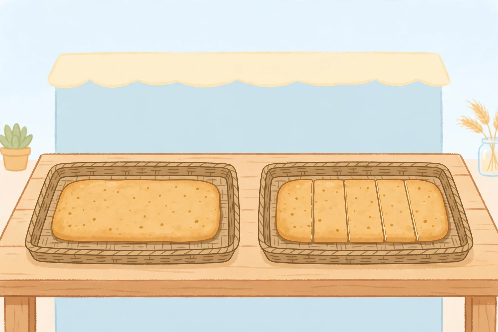

# Lesson 02 — Generating Equivalent Fractions

**Session:** 2 · **Time:** 35 minutes · **Goal:** I can generate
equivalent fractions by multiplying or dividing the numerator and
denominator by the same number, and I can use the bakery picture to find
2/5 = 4/10.

**Materials:** paper strips, colored pencils, the generated illustration
[`../assets/fraction-bakery-trays.png`](../assets/fraction-bakery-trays.png),
paper and pencil.

## Readiness check (4 min)

Warm-up retrieval from Unit 02: "Name the factor pairs of 12." ((1, 12),
(2, 6), (3, 4).) Then ask: "If I multiply the top and bottom of 1/4 by 3,
what do I get?" (3/12 — and Lesson 01 says it names the same amount,
because cutting each quarter into 3 pieces does not move the shaded
length.)

## Explicit teaching (10 min)

Lesson 01 showed the picture: cutting each piece into n smaller pieces
multiplies the numerator and the denominator by n. That gives the rule
for **generating equivalent fractions**:

> a/b = (n × a)/(n × b), for any whole number n

And it works in reverse. **Simplifying** a fraction means dividing the
numerator and denominator by the same number — joining small pieces into
bigger ones:

> (a ÷ n)/(b ÷ n) names the same amount, when n divides both a and b

Examples: 6/8 = 3/4 (divide both by 2 — join pairs of eighths into
quarters); 10/12 = 5/6 (divide both by 2).

Three rules of the road:

1. **Multiply or divide BOTH numbers, by the SAME number.** Adding,
   subtracting, or changing only one number changes the amount.
2. **Stay inside the grade-4 denominators** (2, 3, 4, 5, 6, 8, 10, 12,
   100). If multiplying takes you outside that list, pick a different
   multiplier. For example, 3/8 has no other in-list equivalent by
   multiplying (6/16, 9/24, and 30/80 are all outside the list), so you
   compare 3/8 another way (Lesson 03's benchmark) instead of forcing an
   equivalent.
3. **Check with a model.** After writing an equation, sketch the two bars
   and confirm the shaded lengths match. The equation alone is a claim;
   the model is the proof.

## Bakery-tray image activity (8 min)

Look at the illustration below (also in
[`../assets/fraction-bakery-trays.png`](../assets/fraction-bakery-trays.png)).

*Caption: Two identical loaves at a bakery counter. The left loaf is whole;
the right loaf is cut into 5 equal strips.*

**Text-only alternative:** A bakery counter holds two identical rectangular
loaves in woven trays. The left loaf is whole. The right loaf is cut into 5
equal strips. Every question below can be answered from this description
alone — you do not need the picture.

1. One strip of the right loaf is what fraction of a loaf? (1 strip out
   of 5 equal strips = 1/5.)
2. Two strips are what fraction? (2/5.)
3. Now imagine the baker cuts each fifth in half. How many pieces does
   the loaf have now? How many pieces make the same amount as 2 strips?
   (10 pieces; 4 pieces. So 2/5 = 4/10 — cutting each piece in half
   multiplied both numbers by 2.)
4. What fraction names the whole right loaf, two ways? (5/5, and after
   the half-cuts, 10/10. Both name the whole loaf.)
5. **Discussion:** the drawing's strips are only approximately equal
   (perspective makes the middle strips look narrower). Why is that all
   right here, and what would you use for an exact model? (The picture
   is a story prompt, not a measuring tool — it tells you the loaf is
   cut into 5 strips. For exact work you draw your own equal strips or
   fold paper, where you control the cuts.)

## Worked example 1 — Building a family for 3/4

Problem: "Write two fractions equivalent to 3/4, and explain each cut."

1. Multiply both numbers by 2 (cut each quarter in half):
   3/4 = (2 × 3)/(2 × 4) = 6/8. Check the denominator: 8 is in the list. ✓
2. Multiply both numbers by 3 (cut each quarter into 3 pieces):
   3/4 = (3 × 3)/(3 × 4) = 9/12. Check: 12 is in the list. ✓
3. Multiplying by 25 would give 75/100 — also valid, and a good extension
   (Lesson 05's chains reach 100).
4. Sketch check: three bars, same length, shaded 3/4, 6/8, 9/12. The
   shaded lengths match. ✓

## Worked example 2 — Simplifying 10/12 and 4/10

Problem: "Simplify 10/12 and 4/10 as far as the pieces allow."

1. 10/12: both numbers are even, so divide both by 2: 10/12 = 5/6.
   Check: 5 and 6 share no common factor except 1, so 5/6 is simplest.
   Model check: 10 twelfths and 5 sixths cover the same length. ✓
2. 4/10: divide both by 2: 4/10 = 2/5. Check: 2 and 5 share no common
   factor except 1, so 2/5 is simplest. ✓
3. Note the two directions are the same rule: simplifying joins pieces
   (twelfths into sixths), generating splits them. Both keep the amount.

## Guided practice (with hints)

1. Write two fractions equivalent to 1/4, and name the multiplier for
   each.
   *(Hint: ×2 gives eighths; ×3 gives twelfths; ×25 gives hundredths.
   All three denominators — 8, 12, 100 — are in the list.)*
2. Simplify 8/12 two ways: divide both by 2, then divide both by 4.
   What do you notice?
   *(Hint: 8/12 = 4/6 = 2/3. Both roads reach 2/3; dividing by 4 gets
   there in one step.)*
3. Simplify 5/10. Explain the joining in one sentence.
   *(Hint: divide both by 5 — five pairs of tenths join into halves:
   5/10 = 1/2.)*
4. **Error analysis:** Dana says, "6/10 = 3/5 because I subtracted 3
   from the top and 5 from the bottom." Dana's answer is right but the
   reasoning is wrong. Explain why, and give the correct reasoning.
   *(Hint: 6/10 = 3/5 because both numbers were DIVIDED by 2 (6 ÷ 2 = 3,
   10 ÷ 2 = 5). Subtracting different numbers from top and bottom does
   not preserve the amount in general — try it on 3/4 and see.)*

## Independent practice

5. Write two fractions equivalent to 2/3, and name the multiplier for
   each.
6. Simplify 9/12. Show the division of both numbers.
7. Simplify 10/100. What is the simplest name for this amount?
8. Which of these is NOT equivalent to 3/4: 6/8, 9/12, 75/100, 6/10?
   Justify each one with a multiply-or-divide-both check.

## Applied task

A baker cuts one loaf into 8 equal strips and another identical loaf into
4 equal strips. A customer buys 2 strips of the first loaf. How many
strips of the second loaf is the same amount? Write the equation and
sketch both loaves to prove it. (Answer: 2/8 = 1/4, so 1 strip of the
second loaf. Sketch check: 2 eighths cover the same length as 1 quarter.)

## Exit check

Simplify 4/6, and generate one more equivalent fraction for 4/6.
(Answers: 4/6 = 2/3 by dividing both by 2; 4/6 = 8/12 by multiplying both
by 2. If you simplified by subtracting, re-read the multiply-or-divide-
BOTH rule above.)

## Supports, extensions, teacher note

- **Reading/language support:** the "multiply or divide BOTH" card stays
  on the desk; learners point to it before writing each equation.
- **Alternate response mode:** build each equivalence with folded paper
  strips and point to the matching shaded lengths; the adult scribes the
  equation.
- **Extension:** build the full family of 1/2 (2/4, 3/6, 4/8, 5/10, 6/12,
  50/100) and explain why 7/14 is NOT in the grade-4 list (14 is outside
  the denominator list, even though the equation is mathematically true).
- **Teacher note — likely misconception:** learners who add or subtract
  the same number from top and bottom (Dana's error) have memorized
  "do the same thing to both" without the cutting picture. Return to the
  strips: cutting changes both counts by multiplication, never by
  addition. **Answer-key reference:** [../answer-key.md](../answer-key.md),
  Lesson 02.
