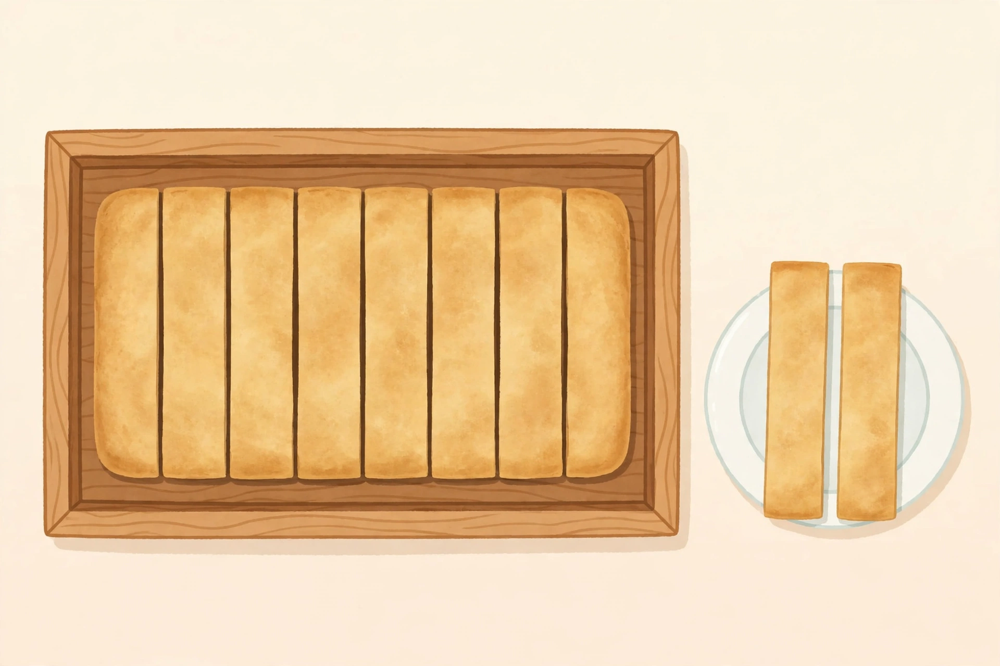

# Lesson 01 — Joining Parts: Adding Fractions with Like Denominators

**Session:** 1 · **Time:** 35 minutes · **Goal:** I can add two fractions
with the same denominator by counting the parts together, and explain why
the denominator does not change.

**Materials:** paper strips (two identical strips per learner), colored
pencils, paper and pencil, the generated illustration
[`../assets/sandwich-tray-strips.png`](../assets/sandwich-tray-strips.png).

## Readiness check (4 min)

Warm-up retrieval from Unit 04: "Draw a bar split into 8 equal parts.
Shade 3 of them. What fraction is shaded? What does the 8 mean? What does
the 3 mean?" (3/8. The 8 means the whole is split into 8 equal parts; the
3 means 3 of those parts are shaded. A fraction a/b means a parts of size
1/b.) Then ask: "If I shade 2 more eighths of the same bar, how many
eighths are shaded now?" (5 eighths — 3/8 + 2/8 = 5/8. Hold that thought
— it is today's whole lesson.)

## Explicit teaching (10 min)

Adding fractions with the **same denominator** is joining parts of the
same whole. The denominator names the **size** of the pieces — eighths,
sixths, tenths — and joining pieces does not change their size. So the
denominator stays the same. Only the numerator changes: it counts how
many pieces you have now.

> When the denominators match, add the numerators and keep the denominator.

> 3/8 + 2/8 = 5/8 — three eighths joined with two eighths makes five eighths.

Three habits for this unit:

1. **Check the wholes match first.** You can only join fractions that
   refer to the same whole. (Unit 04's same-whole rule.)
2. **Check the denominators match.** If they do not match, the pieces are
   different sizes and cannot be counted together yet. This unit only
   adds fractions whose denominators already match.
3. **Say the count out loud.** "Three eighths plus two eighths is five
   eighths" — then write the equation.

## Image activity — the sandwich tray (5 min)

Look at
[`../assets/sandwich-tray-strips.png`](../assets/sandwich-tray-strips.png).

*Caption: One flatbread, cut into equal strips. Eight strips are still in
the tray; two strips are on the plate.*

Count the strips in the picture: 8 strips in the tray and 2 strips on the
plate — **10 equal strips in all**. So each strip is 1/10 of the flatbread.

- The plate holds 2/10 of the flatbread.
- The tray holds 8/10 of the flatbread.
- Put them back together: 2/10 + 8/10 = 10/10 = **1 whole flatbread**.

The denominator stayed 10 the whole time: the strips never changed size.
Only the count of strips changed (2 + 8 = 10).

**Text-only alternative:** a flatbread is cut into 10 equal strips.
Eight strips are in a tray and 2 strips are on a plate. Every question
below can be answered from this description alone — no picture needed.

*Note for the adult: the drawn strips are only approximately equal, so
the picture is a story prompt, not a measuring tool. Exact work uses the
learner's own equal strips or folded paper.*

## Worked example 1 — 3/8 + 2/8

Problem: "A ribbon is 3/8 red and 2/8 blue. What fraction of the ribbon
is colored?"

1. Draw a bar split into 8 equal parts (the whole ribbon).
2. Shade 3 parts red and 2 parts blue. Count the shaded parts: 3 + 2 = 5.
3. The shaded parts are still eighths — the pieces did not change size.
4. Write the equation: 3/8 + 2/8 = 5/8. ✓
5. Check: 5/8 is less than 1 whole (8/8), which makes sense — part of
   the ribbon is still uncolored (3/8).

## Worked example 2 — a sum greater than 1: 5/6 + 4/6

Problem: "Sam eats 5/6 of a sandwich at lunch and 4/6 of an identical
sandwich at dinner. How much sandwich did Sam eat?"

1. The wholes are identical sandwiches, and both fractions count sixths,
   so they can be joined: 5/6 + 4/6.
2. Add the numerators: 5 + 4 = 9. Keep the denominator: 9/6.
3. 9/6 is more than one whole (6/6 = 1). Split it: 9/6 = 6/6 + 3/6 =
   1 3/6.
4. Simplify the fraction part: 3/6 = 1/2. So the answer is **1 1/2
   sandwiches**. ✓
5. Check by estimating: 5/6 is nearly 1 and 4/6 is more than 1/2, so the
   total should be between 1 and 2. 1 1/2 is. ✓
6. Common error to avoid: 5/6 + 4/6 is NOT 9/12. Adding the denominators
   would pretend the pieces got smaller — they did not. The denominator
   names the piece size, and joining does not resize the pieces.

## Guided practice (with hints)

1. Draw a bar split into quarters. Shade 1/4. Shade 2 more quarters a
   different color. What fraction is shaded now? Write the equation.
   *(Hint: 1 + 2 = 3 quarters. The denominator stays 4.)*
2. Compute 2/5 + 2/5. Draw the model and say the count out loud.
   *(Hint: two fifths plus two fifths is four fifths.)*
3. Compute 7/10 + 5/10. Is the sum greater than 1? Write it as a mixed
   number and simplify the fraction part.
   *(Hint: 7 + 5 = 12 tenths. 12/10 = 1 2/10 = 1 1/5.)*
4. **Error analysis:** Lee says, "1/3 + 1/3 = 2/6, because I added the
   tops and the bottoms." Explain why Lee is wrong, with a model.
   *(Hint: draw a bar in thirds. One third plus one third covers two
   thirds of the bar — the pieces are still thirds, not sixths.)*

## Independent practice

5. Draw a bar split into twelfths. Shade 4/12, then shade 5 more
   twelfths. Write the addition equation and simplify the answer.
6. Compute 3/8 + 5/8. What whole number does it equal? Explain.
7. Compute 2/3 + 2/3. Write the answer as a mixed number.
8. **Error analysis:** Ana says, "3/10 + 4/10 = 7/20, because 10 + 10
   is 20." Explain Ana's error and give the correct answer.

## Applied task

Make a "joining" strip pair from paper: one strip showing 2/5 shaded,
one showing 1/5 shaded, lined up at the left edge. Lay them end to end
and draw the joined bar. Label each part and write the equation
2/5 + 1/5 = 3/5 underneath. Trade with a partner or show the adult:
can they point to the 3 shaded fifths without reading your equation?

## Exit check

Fill in the blank and justify with a count: 4/6 + 1/6 = ___/6.
(Answer: 5/6 — four sixths plus one sixth is five sixths; the pieces
stay sixths. If you wrote 5/12, you added the denominators — re-read
Worked example 2, step 6.)

## Supports, extensions, teacher note

- **Reading/language support:** keep the sentence frame on a card: "___
  plus ___ is ___ — the denominator stays ___."
- **Alternate response mode:** fold paper strips instead of drawing bars;
  point to the joined shaded length instead of writing the explanation,
  with the adult scribing the sentence.
- **Extension:** add three fractions with the same denominator, for
  example 1/8 + 3/8 + 4/8 = 8/8 = 1, and explain why the sum is exactly
  one whole.
- **Teacher note — likely misconception:** learners who add the
  denominators (Lee's and Ana's error) need the strips in their hands,
  not another rule. Require the lined-up model before the equation.
  **Answer-key reference:** [../answer-key.md](../answer-key.md),
  Lesson 01.
