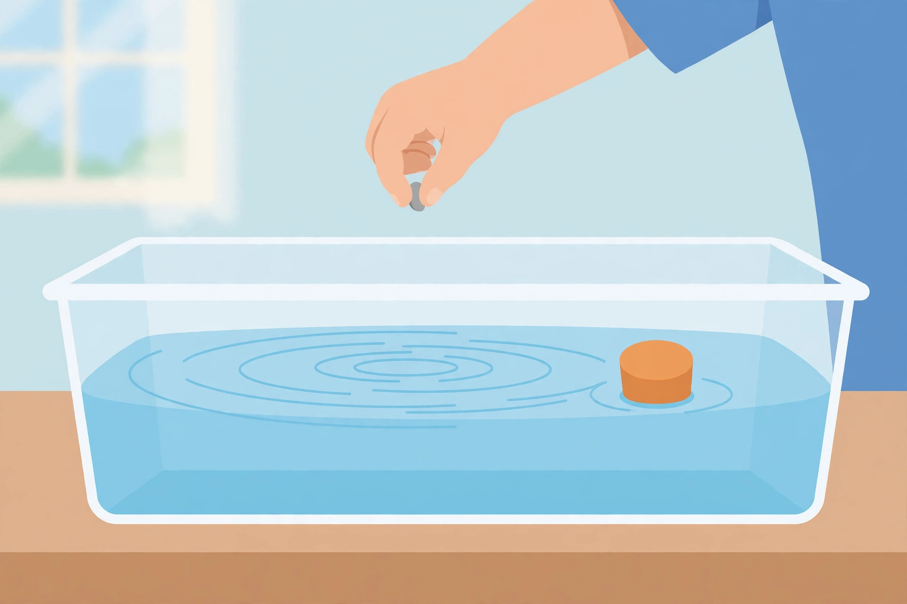

# Lesson 01 — Waves Are Patterns That Carry Energy

**Time:** 30–35 minutes · **Materials:** shallow clear tray with water,
small pebble, small cork or bottle cap, long rope, wire bent into a wave
shape (adult-made), science journal, colored pencils.

**Goal (read to the learner):** Today you will make waves, describe them
with two new words — *amplitude* and *wavelength* — and find out what a
wave does to something floating in it.

**Readiness check:** Adult asks, "What happens when you drop a stone into
a puddle?" Any answer about ripples or rings spreading shows readiness.

## Teaching (adult reads and models)

A **wave** is a repeating **pattern** of motion that carries energy from
place to place. Look at the tray: when the pebble drops, rings spread
outward across the water. The rings are the pattern. The water itself
does not rush across the tray — the *pattern* travels.

Two words describe any wave:

- **Amplitude** is how tall a wave is, from its middle up to a
  **crest** (peak). A tall wave has a big amplitude. A low wave has a
  small amplitude. In this unit we only say taller or shorter — we never
  measure amplitude with numbers.
- **Wavelength** is the spacing between one crest and the next crest.
  Crests close together mean a short wavelength. Crests far apart mean a
  long wavelength.

The bottom of a wave, between two crests, is called a **trough**.

*Caption: AI illustration — a pebble drops into a shallow tray while
ripples spread and an orange cork floats in the ripples. Used in the
activity below. See [assets/README.md](../assets/README.md) for the
generation record.*

**Activity question (look at the picture, then test it in the tray):**
When the ripples reach the cork, what will the cork do — sail across the
tray with the ripples, or bob up and down in about the same place?

**Text-only alternative:** A shallow clear tray of water sits on a
table. A hand drops a small gray pebble toward the water. Rings of
ripples spread outward across the water's surface. A small round orange
cork floats on the right side of the tray, sitting in the ripples. You
can answer the activity question from this description alone: the
ripples are a pattern moving across the water, and the cork is floating
in them.

**Worked example 1 — reading a wave drawing**

> Adult thinks aloud, pointing to the wave diagram in
> [assets/wave-diagram.svg](../assets/wave-diagram.svg): *"Here are two
> waves drawn side by side. Wave A is tall — from its middle line to
> the top of a crest is a long way up — and its crests are close
> together. Wave B is low, and its crests are far apart. So Wave A has
> the bigger amplitude, and Wave B has the longer wavelength. The
> words tell me the shape: amplitude = height, wavelength = spacing.
> If I mix them up, I ask myself: am I talking about how TALL, or how
> FAR APART?"*

**Worked example 2 — what the cork proves**

> Adult models in the tray: *"I drop the pebble. Watch the cork, not
> the rings. The rings reach the cork… and the cork bobs up, then
> down, then up again — but it stays in about the same place. If the
> water itself were traveling across the tray, the cork would ride
> along with it to the far side. It does not. So the claim is: the wave
> moves the cork up and down — the wave can move an object — but it
> does not carry the object across. The pattern travels; the cork
> stays."*

Key idea to say plainly: **A wave is a pattern that travels. Amplitude
is its height. Wavelength is its crest-to-crest spacing. A wave can bob
an object without carrying it away.**

## Guided practice (adult leads, learner answers and does)

1. Drop the pebble again. Describe, in your own words, what the cork
   does when each ripple reaches it.
2. Draw two waves in your journal: one tall with close-together crests,
   one low with far-apart crests. Label the amplitude on the tall one
   and the wavelength on the low one.
3. Make a wave with the rope: shake one end gently, then with bigger
   shakes. Which shake made the bigger amplitude? How could you tell?
4. Hold the wire wave model flat. Point to a crest, a trough, and the
   distance of one wavelength.
5. A friend says, "The wave pushed the cork to the other side of the
   tray." Use what you saw to explain why that is wrong.

## Independent practice

1. Draw a wave with three crests. Label one crest, one trough, the
   amplitude, and one wavelength. Use the diagram in the assets folder
   as your model, but draw your own wave.
2. Wave X is taller than Wave Y, and Wave Y's crests are farther apart.
   Which wave has the bigger amplitude? Which has the longer wavelength?
3. Write two sentences: one that tells what a wave is, and one that
   tells what happened to the cork.
4. Name one place outside this lesson where you have seen a wave
   pattern (a rope, water, a flag, sound — any honest example counts).

## Applied task

With the adult, set up the tray again and mark the cork's starting place
with a small sticker on the tray's rim. Drop three pebbles, one at a
time, and watch after each drop. Record in your journal: did the cork
end up far from its mark, or close to it? Write the claim your test
supports, in one sentence.

## Exit check

Tell the adult, without looking at your journal: what is amplitude, what
is wavelength, and does a wave carry a floating object across the water?
One correct sentence for each part passes.

## Supports and extensions

- **Support:** if labeling is hard, build the wave with the rope on the
  table and place word cards ("crest," "trough," "amplitude,"
  "wavelength") beside the matching parts instead of writing labels.
- **Extension:** make two rope waves — one with big shakes close
  together in time, one with small slow shakes — and describe both
  waves with both words, amplitude and wavelength, in one sentence each.

## Teacher note

Likely misconception: learners often say the wave "carries" the cork
because the ripples visibly travel. Re-run the tray test with the rim
mark (applied task) whenever this appears; the mark makes "stays in
place" observable. Do not introduce numbers, formulas, or the words
*frequency* and *electromagnetic* — all are outside the grade-4
boundary. Answer-key reference: [answer-key.md](../answer-key.md),
Lesson 01.
