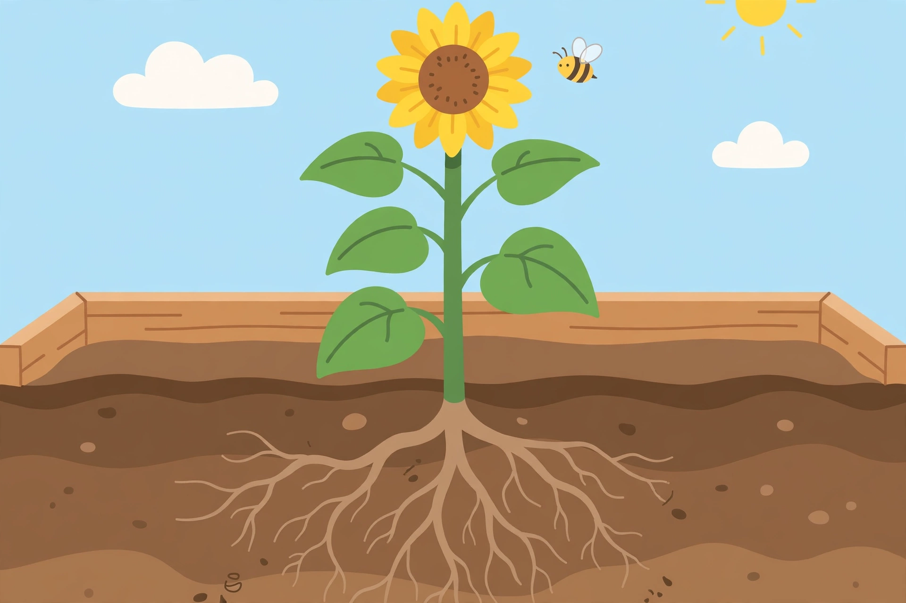

# Lesson 01 — Outside Parts of a Plant and Their Jobs

**Time:** 30–35 minutes · **Materials:** the sunflower picture in
[assets](../assets/sunflower-structures.png), a store-bought flower
and a carrot or celery stalk, a clear cup of water, science journal,
colored pencils.

**Goal (read to the learner):** Today you will name the outside parts
of a plant — roots, stem, leaves, and petals — and say the job each
part does for the plant.

**Readiness check:** Adult asks, "What parts of a plant can you name?"
Any answer naming one part (flower, leaf, root, stem) shows readiness.

## Teaching (adult reads and models)

A plant is a living thing, and like any living thing it has
**structures** — parts — and each part has a **function**, a job. The
jobs work together so the plant can survive, grow, and make new plants.

*Caption: AI illustration — a sunflower in a garden bed, with roots
visible in the soil below, a stem, leaves, a flower head, and a bee
nearby. Used in the activity below. See
[assets/README.md](../assets/README.md) for the generation record.*

**Activity question (look at the picture first, then at the real
flower):** Name each part you can see in the picture — the part under
the soil, the tall green part, the flat green parts, and the yellow
part at the top — and say one job you think each part does.

**Text-only alternative:** A sunflower grows in a wooden garden bed.
Below the soil surface, pale branching roots spread through the brown
soil. Above the soil, a sturdy green stem rises up, with broad green
leaves growing off it. At the top sits one large yellow flower head
with a brown center. A small bee flies near the flower. You can answer
the activity question from this description alone: the parts are
roots (below soil), stem (tall green part), leaves (flat green
parts), and flower petals (yellow part).

Here are the jobs, in the plant's own order from the ground up:

- **Roots** grow underground. They take in water from the soil, and
  they hold the plant steady so wind does not blow it over. Some
  roots, like a carrot's, also store food.
- **Stems** hold the plant up. A stem carries water from the roots up
  to the leaves, and carries food made by the leaves to the rest of
  the plant. Think of a stem as a road between roots and leaves.
- **Leaves** are usually flat and green. They catch sunlight, and with
  sunlight, air, and water they help make food the plant uses to
  grow. A plant with its leaves in the shade grows slowly — it is not
  catching enough sunlight.
- **Colored petals** are the bright parts of a flower. Their job is to
  attract **pollinators** — animals like bees that move pollen
  between flowers. When a bee visits, the flower can go on to make
  seeds, and seeds grow into new plants. That is how petals help with
  **reproduction**.
- **Thorns** are sharp structures on a stem. Their job is protection:
  they discourage animals from eating the plant. A thorny stem is a
  plant's way of saying "do not eat me" without words.

**Worked example 1 — reading the sunflower picture**

> Adult thinks aloud, pointing to the picture: *"Under the soil I see
> branching roots — their job is to take in water and hold the plant
> steady. The tall green part is the stem — it holds everything up
> and carries water upward. The flat green parts are leaves — they
> catch sunlight and help make food. The yellow part is the flower's
> petals — bright, so a bee comes to visit, and that visit helps the
> plant make seeds. Four parts, four jobs, one plant."*

**Worked example 2 — why the stem matters**

> Adult models with the celery stalk in a cup of water: *"Here is a
> stem standing in water. Tomorrow the water will have moved up the
> stem — you will see it if the adult adds food coloring, or you can
> simply watch the stalk stay crisp instead of wilting. Now imagine
> the stem is broken. Water cannot travel up, leaves get no water,
> and the plant wilts. The stem's job is carrying — break the road
> and the deliveries stop. That is a structure-function argument in
> one sentence: the stem supports survival because it carries water
> to the leaves."*

Key idea to say plainly: **Roots take in water and anchor. Stems
support and carry. Leaves catch sunlight and help make food. Petals
attract pollinators. Thorns protect. Each part's job helps the whole
plant survive, grow, or reproduce.**

## Guided practice (adult leads, learner answers and does)

1. Point to each part in the sunflower picture and name it: roots,
   stem, leaves, petals.
2. The adult covers the labels in the diagram in
   [assets/plant-structure-diagram.svg](../assets/plant-structure-diagram.svg).
   Name each labeled part from its shape and position alone.
3. A plant's leaves are all in deep shade. Which job is hardest for it
   now, and what will happen to its growth? Explain in one sentence.
4. A goat tries to eat a thorny stem, then walks away. Which structure
   did its job, and what was the job?
5. Put these in order from the ground up: leaves, roots, flower,
   stem. Then say one job for each.

## Independent practice

1. Draw a sunflower (or any flowering plant) with roots, stem,
   leaves, and petals. Label all four parts.
2. Write one sentence for each part giving its job. Use the words
   *roots*, *stem*, *leaves*, and *petals*.
3. A bee visits a sunflower's bright petals. What happens next that
   helps the plant reproduce? Answer in two sentences.
4. A young plant has strong roots but a broken stem. Will it survive
   easily? Explain why or why not, naming the stem's jobs.

## Applied task

With the adult, look at the store-bought flower and the carrot or
celery. The adult handles all cutting. Draw what you see: the flower's
petals and stem, and the vegetable's root or stem. Label each part and
write its job beside it. Then answer: which of your two specimens shows
a root best, and how can you tell?

## Exit check

Tell the adult, without looking at your journal: name the four plant
parts from this lesson and give one job for each. Four parts with four
correct jobs passes.

## Supports and extensions

- **Support:** if writing labels is hard, place word cards ("roots,"
  "stem," "leaves," "petals") beside the matching parts of the real
  flower instead of writing.
- **Extension:** find one more plant structure at home or in a photo
  (a fruit, a seed, or a thorn) and explain its job in the same
  pattern: *this structure does this job, which helps the plant
  survive, grow, or reproduce.*

## Teacher note

Likely misconception: learners often say "roots make the food" because
roots are busy underground. Correct with the sunlight question: food
is made where sunlight is caught — on the leaves. Do not teach cell
parts, xylem/phloem names, or the chemical steps of food-making; all
are outside the grade-4 boundary. Answer-key reference:
[answer-key.md](../answer-key.md), Lesson 01.
