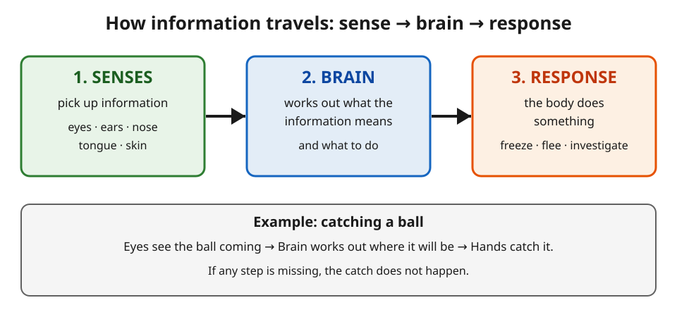

# Lesson 03 — The Path: Sense → Brain → Response

**Time:** 30–35 minutes · **Materials:** the
[sense → brain → response diagram](../assets/sense-brain-response-diagram.svg),
a soft ball, science journal, index cards labeled SENSE, BRAIN,
RESPONSE.

**Goal (read to the learner):** Today you will trace the path
information takes — from a sense, to the brain, to a response — and
explain why the brain belongs in the middle of every model.

**Readiness check:** Adult asks, "Name the five senses and one kind
of information for each." Three or more correct shows readiness.

## Teaching (adult reads and models)

A sense picks up information, but a sense does not decide anything.
Your eyes do not decide to catch a ball. Your ears do not decide to
run. The information has to travel to the **brain** — the part of the
body that works out what information means and what to do — and then
the body responds. Every sense-to-response story has the same three
steps:

**1. SENSE picks up information → 2. BRAIN works out what it means →
3. BODY responds.**

The message that travels from the sense to the brain is called a
**signal**. Think of it like a note passed along a line: the sense
writes the note ("a ball is coming fast"), the signal carries it to
the brain, the brain reads it and decides ("catch it!"), and the body
acts. If any step is missing, the response does not happen. That is
why scientists call this a **system**: parts working together for one
larger job.

You met the brain in Unit 04 as the body's control center. Here is
the same idea in its new job: the brain is the middle step. It uses
what the animal already knows — a dog that has learned the sound of
a can opener means food will run to the kitchen when it hears it —
but this unit does not teach *how* the brain stores what it knows.
That mechanism is outside the grade-4 boundary; what matters here is
the path and the order.

*Caption: The information path, every time: a sense picks up
information, the brain works out what it means, the body responds.
See [assets/README.md](../assets/README.md) for the diagram record.*

**Text-only alternative:** The diagram has three boxes with arrows
between them, left to right. Box 1, SENSES: "pick up information —
eyes, ears, nose, tongue, skin." An arrow points to Box 2, BRAIN:
"works out what the information means and what to do." An arrow
points to Box 3, RESPONSE: "the body does something — freeze, flee,
investigate." Underneath, the example reads: "Eyes see the ball
coming → Brain works out where it will be → Hands catch it. If any
step is missing, the catch does not happen." You can answer the
activity question from this description alone.

**Activity question (look at the diagram first):** Trace catching a
ball through the three boxes. Which sense starts it, what does the
brain do in the middle, and what is the response?

**Worked example 1 — catching a ball**

> Adult thinks aloud, pointing to the diagram: *"A ball is thrown
> toward me. Step 1 — my eyes see it coming. That is light
> information: the ball is moving toward me, fast. Step 2 — my brain
> works out where the ball will be in a moment and when it will
> arrive, and decides to catch it. Step 3 — my hands move to the
> right place and close around the ball. Three steps, in order. If my
> eyes were closed, step 1 never happens and there is no catch. If my
> brain did not work out where the ball will be, my hands would close
> in the wrong place. The brain is the middle step every time."*

**Worked example 2 — touching something hot**

> Adult models with a safe everyday scene (no real hot object is
> touched): *"Imagine your hand brushes a hot pan handle. Step 1 —
> your skin feels heat. That is touch information: hot. Step 2 — your
> brain works out what hot means: danger, pull away. Step 3 — your
> hand pulls back fast, before you even think about it in words. The
> response is quick because the path is short: sense, brain, body.
> Notice what did not happen: your skin did not decide to pull away.
> Your skin reported; your brain decided; your hand obeyed."*

Key idea to say plainly: **Sense → brain → response. The sense
reports, the brain decides, the body acts. Break any link and the
response does not happen.**

## Guided practice (adult leads, learner answers and does)

1. Point to each box in the diagram and say its job: senses, brain,
   response.
2. Trace the ball-catch example through the three steps in your own
   words.
3. A doorbell rings. Name the sense, the kind of information, and one
   likely response. Then say what the brain does in the middle.
4. Put these in the right order: "the body responds," "the brain
   works out what it means," "a sense picks up information."
5. A friend says, "My ears decided to run when I heard the dog bark."
   What is wrong with that sentence? Fix it.

## Independent practice

1. Draw the three-box path (sense → brain → response) in your
   journal. Label each box with its job in your own words.
2. Trace this example through the three steps: you smell dinner
   cooking, and you walk to the kitchen. Name the sense, the kind of
   information, what the brain works out, and the response.
3. A dog hears a can opener and runs to the kitchen. The dog has
   learned that the sound means food. (a) Which sense started it?
   (b) What did the brain work out? (c) What was the response?
4. A model says: "Ears hear a whistle → dog gets a treat." What step
   is missing, and why does the model need it?

## Applied task

With the adult, act out three everyday paths using the SENSE, BRAIN,
and RESPONSE cards (one learner holds each card, or the adult holds
them while the learner points): (a) hearing your name called and
turning around; (b) seeing a red light and stopping; (c) feeling rain
and going inside. For each one, say the sense, what the brain works
out, and the response — in that order.

## Exit check

Tell the adult, without looking at the diagram: order the three
steps for "you hear your name called," and say what the brain does in
the middle. Three steps in order, with the brain's job, passes.

## Supports and extensions

- **Support:** if ordering is hard, use the three index cards and
  lay them left to right before answering; the diagram stays visible
  during guided practice and is covered only for the exit check.
- **Extension:** trace a path for an animal that is not a person — a
  cat hearing a bird, or a fish seeing food drop into the water — and
  explain in two sentences why the brain still belongs in the middle.

## Teacher note

Likely misconception: "the sense decides" (ears decide to run, eyes
decide to catch) — correct every time with the note-passing image:
the sense writes the note, the brain reads it and decides. Another:
"the response happens first, then the brain notices" — correct with
the order question: the brain is always the middle step. Do not
teach how the brain stores memories or how receptors work inside;
when a learner asks "how does the brain remember?", answer honestly:
"Scientists are still learning the details — in grade 4 we learn
that the brain uses what the animal already knows, not how it stores
it." Answer-key reference: [answer-key.md](../answer-key.md),
Lesson 03.
