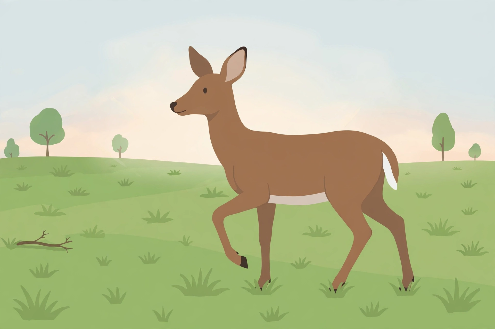

# Lesson 04 — Different Animals, Different Responses

**Time:** 30–35 minutes · **Materials:** the deer picture in
[assets](../assets/deer-freezes-at-twig-snap.png), science journal,
colored pencils. Animal observations are through adult-chosen media
only — no wild animals are approached.

**Goal (read to the learner):** Today you will compare how different
animals respond to the same information in different ways — and
explain why different responses can each help the animal survive.

**Readiness check:** Adult asks, "Trace one path: you hear a loud
sound. Sense, brain, response — in order." Three steps in order
shows readiness.

## Teaching (adult reads and models)

The same information can lead to very different responses. A twig
snaps in a meadow. A deer hears it and freezes. A rabbit hears the
same sound and flees — runs away fast. A squirrel hears it and
investigates — moves closer, carefully, to check what made the
sound. One sound, three animals, three responses. None of them is
"the wrong one." Freezing hides the deer in the grass. Fleeing puts
distance between the rabbit and danger. Investigating tells the
squirrel whether the danger is real. Different responses can each
help the animal survive — it depends on the animal and the situation.

The responses you will meet most are:

- **Freeze** — stop moving and stay very still, so you are harder to
  notice.
- **Flee** — run away quickly, to put distance between you and danger.
- **Investigate** — move closer carefully, to find out more.
- **Hide** — move out of sight, under cover or into a burrow.
- **Call out** — make a sound to warn others or to call for help.

All five go through the same path you learned in Lesson 03: sense →
brain → response. What changes is the last step — what the brain
decides to do.

*Caption: AI illustration — a deer in a meadow at dawn, frozen still
with its ears turned toward a snapping twig. Used in the activity
below. See [assets/README.md](../assets/README.md) for the
generation record.*

**Activity question (look at the picture first):** What information
did the deer receive, which sense picked it up, and what response do
you predict it will make next — freeze, flee, or investigate? Give
one reason from the picture.

**Text-only alternative:** A deer stands in a green meadow at dawn.
Its body faces left and it is standing very still. Its head is turned
toward a dry twig lying on the grass at the left edge of the picture.
Both of its ears are perked up and pointed toward the twig, and one
front leg is slightly raised, as if it stopped in mid-step. A few
simple trees stand in the far background. You can answer the activity
question from this description alone: the deer's ears are turned
toward the twig, and its still body shows it has frozen.

**Worked example 1 — tracing the deer in the picture**

> Adult thinks aloud, pointing to the picture: *"Step 1 — the deer's
> ears pick up a sound: a twig snapping. That is sound information.
> Step 2 — the deer's brain works out what the sound could mean:
> something is moving nearby, and it might be danger. Step 3 — the
> deer freezes. Look at the picture: its body is still, one front leg
> is raised mid-step, and both ears are pointed at the twig. Freezing
> helps it survive because a still deer is harder to see in the
> grass than a running one. The picture shows the moment right after
> the brain decided — the deer is frozen, listening."*

**Worked example 2 — the same sound, three animals**

> Adult models with a comparison table: *"The same twig snaps. The
> deer freezes — still and quiet, hard to see. The rabbit flees —
> fast legs carry it away from the sound. The squirrel investigates —
> it climbs a little higher and looks toward the sound to find out
> what it was. Three responses to the same information. Ask: which
> one is right? All three can be right, because they help in
> different ways: freezing avoids being seen, fleeing avoids being
> caught, investigating avoids being surprised. An animal's response
> fits its body and its life: a rabbit is built to run, a deer is
> built to stand still in the grass, a squirrel is built to climb and
> look."*

Key idea to say plainly: **The same information can lead to
different responses. Freeze, flee, investigate, hide, call out —
each one can help an animal survive, in its own way.**

## Guided practice (adult leads, learner answers and does)

1. Look at the deer picture. Name the sense, the kind of
   information, and the response you see.
2. A rabbit hears the same twig snap and runs away. Name its
   response, and say in one sentence how it helps the rabbit survive.
3. A squirrel hears the twig and climbs higher to look. Name its
   response. Is it the same as the rabbit's? Explain.
4. A bird sees a hawk and calls out loudly. Name the response, and
   say who the call might help.
5. Sort these responses: a deer stands still in tall grass; a mouse
   darts into its burrow; a dog walks toward a new smell. (freeze /
   hide / investigate.)

## Independent practice

1. Draw the three-box path for the deer in the picture: ears hear the
   twig snap → brain works out possible danger → deer freezes. Label
   all three steps.
2. Read the fictional response tally below (made-up practice data from
   a 5-minute meadow video, not your own observation): deer freeze 3,
   rabbit flee 2, squirrel investigate 2, bird call out 1. (a) How
   many responses were counted in all? (b) Which response happened
   most often? (c) Write one sentence about what the tally shows.
3. A deer and a rabbit both hear a loud sound. The deer freezes; the
   rabbit flees. Explain in two sentences why different responses can
   both be good answers to the same sound.
4. A friend says, "The right response is always to run away." Give
   one example from this lesson that shows the friend is wrong, and
   explain why.

## Applied task

With the adult, watch a short adult-chosen video of meadow or forest
animals (see [resource-pack.md](../resource-pack.md) for where to
find one). Tally what you see for five minutes: every time an animal
freezes, flees, investigates, hides, or calls out, make a mark in
that column. If no video is available, use the fictional tally in
Independent practice 2 instead and say so in your journal. Write one
sentence about which response you saw most, and one sentence about
why that response might help that animal.

## Exit check

Tell the adult, without looking at your journal: name three different
responses animals can make, and give one animal for each. Three
responses with three matching animals passes.

## Supports and extensions

- **Support:** if the five response words are hard to hold, use word
  cards (freeze, flee, investigate, hide, call out) and act each one
  out before answering.
- **Extension:** pick one more animal from an adult-chosen video or
  photo — a fox, a frog, or a goose — and trace its full path
  (sense → brain → response) for one signal. Explain in two
  sentences why its response fits its body.

## Teacher note

Likely misconception: "the right response is always to run" — correct
with the deer: running would make the deer easier to see, and
freezing is the safer choice in tall grass. Another: "all animals
respond the same way" — the comparison table is the cure: same sound,
three animals, three responses. Watch for learners who confuse the
response with the sense ("the response was hearing") — ask: "Hearing
is what the ears did. What did the *body* do after the brain
decided?" Do not present the picture as a real observation: it is an
AI illustration of a moment, used to practice tracing a path, not
evidence of a real deer. Answer-key reference:
[answer-key.md](../answer-key.md), Lesson 04.
