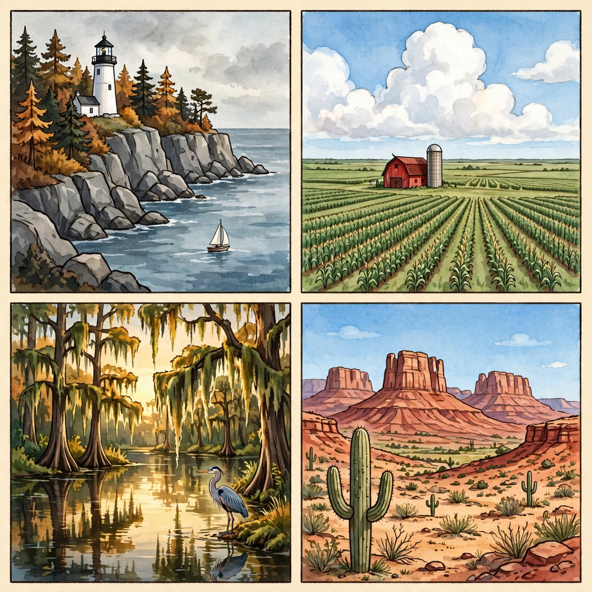

# Lesson 03 — The Four U.S. Regions and Their Environments

**Time:** three sessions, about 35 minutes each · **Materials:** the unit's
generated illustration
([four-us-regions-landscapes.png](../assets/four-us-regions-landscapes.png));
a U.S. map; the `us_states.csv` dataset (adult side — printed rows or a
screen); paper and pencil

**Goal (read to the learner):** Today you will learn the four official
U.S. regions and what each one's environment is like. By the end, you will
sort states into regions from data, match landscapes to regions with
evidence, and ask a big geographic question about one region.

**Readiness check:** Adult: "Name a place you know that is hot and dry,
and one that is cold and snowy. Could both be in the same country?" Accept
any answers — today's lesson explains how.

## Teaching (adult reads and models)

The United States is huge, so geographers divide it into **regions** —
areas whose places share location, climate, or landforms. The **U.S.
Census Bureau** uses four official regions: the **Northeast**, the
**Midwest**, the **South**, and the **West**. (Some children's videos use
*five* regions, splitting the South into Southeast and Southwest. That is
a different system. This unit uses the Census four, because they match our
dataset.)

Look at the unit's illustration — four landscapes, no labels. Study each
panel like a geographer: what landforms do you see? What water? What
plants? What does the sky tell you about rain and heat?

> 
>
> *Caption: An AI-generated illustration of four characteristic U.S.
> landscapes — a teaching picture, not a real place. Which panel belongs
> to which Census region?*

**Text-only alternative:** The illustration has four square panels. Panel
A (top left): a rocky gray cliff coastline with a white lighthouse, dark
pine trees with autumn-orange touches, blue-gray ocean water, and a small
sailboat. Panel B (top right): a vast flat green prairie with a red barn
and a tall silo, neat rows of corn stretching to the horizon, and a big
blue sky full of puffy clouds. Panel C (bottom left): a warm, misty bayou
— tall cypress trees draped with hanging moss reflected in still dark
water, golden light, and a tall gray-blue heron standing at the water's
edge. Panel D (bottom right): a red-rock desert with tall flat-topped
mesas, a large green saguaro cactus in the foreground, smaller cacti and
dry bushes, and a bright blue sky. Every question that uses this picture
can be answered from this description.

Now match each panel to a region, with evidence:

- **Northeast** — rocky Atlantic coastline, forests, cold snowy winters.
  Panel A fits: the lighthouse, the rocky cliffs, the pines.
- **Midwest** — flat plains, rich soil, big farms, the Great Lakes nearby.
  Panel B fits: the barn, the silo, the endless corn rows on flat land.
- **South** — warm and humid, bayous and wetlands, long growing season.
  Panel C fits: the moss-draped cypress, the still warm water, the heron.
- **West** — the most varied: tall mountains, deserts, Pacific coastline.
  Panel D fits: the red-rock mesas, the saguaro cactus, the dry bright
  sky.

The deeper lesson: **a region's location helps explain its environment.**
The South is warm partly because it sits closer to the equator and
between warm waters (the Gulf and the Atlantic). The Northeast is colder
in winter partly because it sits farther north. The West's tall mountains
and deserts make it the most varied region of all.

**Worked example 1 — sorting states with the dataset:**

> Adult opens `us_states.csv`: "Each row has a `subregion` column. Texas
> says 'United States South' — so Texas belongs to the **South** region.
> Montana says 'United States West' — **West**. Illinois says 'United
> States Midwest' — **Midwest**. New York says 'United States Northeast'
> — **Northeast**. Steps: (1) find the state row, (2) read its
> `subregion`, (3) drop the 'United States' part. The dataset is my
> evidence — anyone can check the same column."

**Worked example 2 — location explains environment:**

> Adult points at Panel D and a U.S. map: "My claim: 'The West has
> deserts because of where it sits.' My evidence: (1) the map shows the
> West holds big mountain ranges and sits beside the Pacific; (2) the
> illustration's Panel D shows red-rock desert with cacti — plants that
> survive with very little rain. Mountains and distance from rainy coasts
> leave parts of the West dry. I am not guessing — the map's landforms
> and the picture's plants are my evidence."

Key idea to say plainly: **The Census Bureau divides the U.S. into four
regions — Northeast, Midwest, South, West. Each region's environment
(landforms, water, plants, climate) connects to its location. Sort states
with the dataset's `subregion` column, and always name your evidence.**

## Guided practice (adult leads, learner decides)

1. "Look at Panel B. What do you see that tells you this is farmland?"
   *(red barn, silo, corn rows, flat land — list at least two)*
2. "Which panel shows the most water? Which region does it match, and
   what is your evidence?" *(Panel A — ocean, sailboat; or Panel C —
   bayou water; accept either with evidence named)*
3. "The dataset row for Florida says subregion 'United States South.'
   Which region is Florida in?" *(South)*
4. "Name one way the South's environment (Panel C) differs from the
   West's (Panel D)." *(e.g., the South is wet with still water and mossy
   trees; the West is dry with cacti and red rock)*
5. "A friend says deserts only exist far from the United States. Use map
   evidence to answer." *(the U.S. map shows desert landforms inside the
   West region; Panel D shows a U.S. desert landscape)*
6. Error-analysis: "A friend matched Panel D to the Northeast because
   'it has mountains too.' What is wrong with that evidence?" *(one
   shared feature is not enough — the cacti, red rock, and dry sky point
   to the West; good evidence weighs ALL the clues)*

## Independent practice

- The learner sorts 8 states into the four regions using the dataset's
  `subregion` column (adult provides the rows: Maine, Ohio, Georgia,
  Arizona, Vermont, Iowa, Louisiana, Oregon) and writes the region beside
  each.
- The learner writes a 3-sentence "region profile" for one region:
  environment (landforms/water/plants), one landmark or feature, one
  fact — each with its evidence named.
- The learner drafts a **compelling geographic question** about one
  region plus two **supporting questions** (e.g., compelling: "Why is the
  West the most environmentally varied region?"; supporting: "What
  landforms does the West hold? Where does its rain fall?").

## Application

**Region profile task** (continues into Week 4, S3): the learner builds a
one-page profile for EACH of the four regions — a quick sketch or the
panel letter, 2–3 environment sentences with evidence, and one "why it is
like this" sentence connecting location to environment. The four profiles
become the reference sheet for the rest of the unit.

## Exit check

1. Name the four Census regions. *(Northeast, Midwest, South, West)*
2. Which dataset column tells you a state's region, and what does
   Montana's say? *(`subregion`; "United States West")*
3. Look at Panel C: name two visible clues that this place gets plenty
   of rain. *(still water/bayou, moss-draped trees, lush green growth —
   any two)*

## Supports

- **Reading access:** the adult reads all dataset rows and panel
  descriptions aloud; the text-only alternative replaces the picture at
  any time.
- **Alternate response mode:** region sorts may be spoken or done by
  placing state cards into four labeled boxes.
- **Language support:** sentence frames — "I know this panel is the ___
  because I see ___."

## Extension

The learner picks one state, finds its `state_fact` in the dataset, and
writes two sentences connecting that fact to its region's environment
(e.g., a coastal fact → the region's water; a mountain fact → the
region's landforms).

## Teacher note — likely misconceptions

- Learners often assume every state in a region looks identical. Stress
  that regions share *patterns*, not clones — the West holds both
  rainforest (Pacific Northwest) and desert.
- The five-region video system will confuse the sort. Name the
  difference explicitly whenever a video says "Southeast."
- "Warm = South, cold = North" is a useful start but not the whole story —
  mountains make cold, snowy places even in warm latitudes, and coasts
  soften temperatures. Keep causal claims modest and evidence-bound. (Answer key:
  `answer-key.md`, Lesson 03.)
