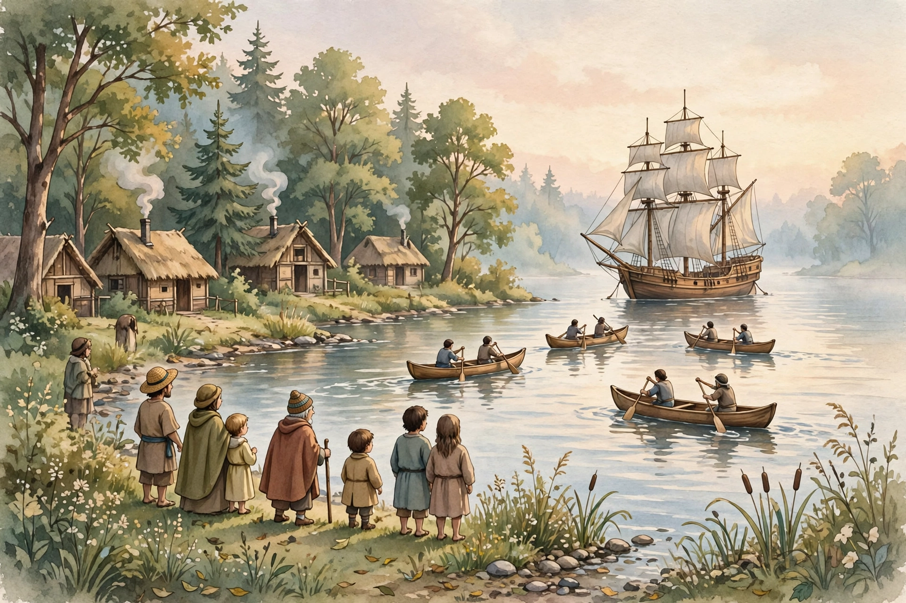

# Lesson 02 — Five Voyages and Route Maps

**Goal:** I can place five voyages on a timeline, read a route map, and
say what each expedition sought and what it found.
**Time:** two 35-minute sessions. **Materials:** timeline strip from
Lesson 01, Atlantic route map (classroom atlas or the schematic in
[assets](../assets/route-diagram.svg)), the generated illustration in
[assets](../assets/harbor-encounter.png).

**Readiness check:** Put these years in order: 1609, 1492, 1534, 1497,
1541. (Answer: 1492, 1497, 1534, 1541, 1609.)

## Teaching

### The five voyages

All five expeditions below were paid for by a European ruler or company,
and all five sought a route to the riches of Asia. None reached Asia.
What they found instead changed both sides of the Atlantic.

| Year | Expedition (sailing for) | Sought | Found |
|---|---|---|---|
| 1492 | Christopher Columbus (Spain) | A westward sea route to Asia | Caribbean islands (the Bahamas); he did not reach Asia |
| 1497 | John Cabot — Giovanni Caboto (England) | A westward route to Asia | The coast of Newfoundland, in present-day Canada |
| 1534–35 | Jacques Cartier (France) | A passage to Asia through northern lands | The Gulf of St. Lawrence and the St. Lawrence River |
| 1541 | Hernando de Soto (Spain) | Gold and riches in the Southeast | The Mississippi River, after traveling through the Southeast (expedition about 1539–1542) |
| 1609 | Henry Hudson (Netherlands) | A Northwest Passage to Asia | The river in present-day New York that bears his name |

A note on dates: historians agree on 1492, 1497, 1534, and 1609. For
de Soto, sources differ by a year on when the expedition ended, so this
unit says "about 1539–1542" and names the Mississippi crossing in 1541.
Saying "about" when sources differ is honest history, not a mistake.

### How to read a route map

A route map answers four questions, in order:

1. **Where did the voyage start?** Find the home port or coast.
2. **Which way did it go?** Follow the arrows, not just the dots.
3. **Where did it stop or turn?** A stop often means "we thought this
   was Asia," "we ran low on supplies," or "we met people here."
4. **What did the mapmaker leave out?** Early route maps often left out
   the peoples already living along the route. A missing people on a map
   does not mean missing people in real life.

### The harbor illustration

Look at the generated illustration
([harbor-encounter.png](../assets/harbor-encounter.png)):

*Caption: AI illustration of a harbor encounter — a sailing ship offshore,
canoes on the water, and people watching from the shore. This is an
artist's imagining, not a record of any one real encounter, and the
dwellings and clothing are generic storybook style, not the dress or
buildings of any specific nation.*

**Text-only alternative (same information as the picture):** A large
wooden sailing ship with square sails sits anchored offshore in calm
water at dawn. Four canoes with paddlers move across the water toward
it. On the shore, adults and children stand watching; behind them are
trees and small thatched dwellings with smoke rising.

Use the picture for one question only in this lesson: *whose viewpoint
does this picture show best — the sailors', the shore people's, or
neither?* There is no single right answer, but a good answer gives a
reason: the picture is drawn from the shore, so we see the ship the way
shore watchers would — large, strange, and far away — while the sailors
on the ship are too far away to see clearly. A picture, like a map, has
a viewpoint.

### Worked example 1 — Timeline gaps

*Question: How many years after Columbus (1492) did Hudson sail (1609)?
How many years after Columbus did Cabot sail (1497)?*

Reasoning: subtract the earlier year from the later year.
1609 − 1492 = 117 years. 1497 − 1492 = 5 years. So Hudson sailed 117
years after Columbus — more than a century later, in a different
generation — while Cabot followed only 5 years later. Timeline gaps
turn "long ago" into real distances in time.

### Worked example 2 — Sought vs. found

*Question: Cartier sought a passage to Asia. What did he find instead,
and why does the difference matter?*

Reasoning: He found the St. Lawrence River and Gulf, not Asia. The
difference matters because the expedition's *claim* ("this is a route
to Asia") was wrong, while its *finding* (a great river system, and
peoples already living along it) became the basis for France's later
claims in Canada. In history, "what they sought" and "what they found"
are two different facts — never swap them.

## Guided practice

**G1.** Place all five voyages on your timeline strip in order. Mark
the gap between 1492 and 1609 with a bracket labeled "117 years."
*Hint: use the worked example's subtraction.*

**G2.** For Hudson's voyage, answer the four route-map questions:
start, direction, stop/turn, and one thing the map leaves out.
*Hint: the Northwest Passage was never found in this period.*

**G3.** Error-analysis: "A friend says Columbus discovered America in
1492 because he was the first person to reach it." What two things are
wrong? (Think: who was already there, and did he reach the mainland
of North America?)
*Hint: Lesson 01's first rule.*

## Independent practice

**I1.** Write one "sought / found" sentence for each of the five
voyages (five sentences total). Do not copy the table word for word.

**I2.** Which two voyages are closest together in time? Show the
subtraction. Which voyage is farthest from 1492? Show the subtraction.

**I3.** Look at the harbor illustration again. Write two sentences
from the shore watchers' viewpoint ("We see…") and two sentences from
the sailors' viewpoint ("We see…"). The two pairs must describe the
same scene differently.

## Applied task — Route-map investigation

Choose one voyage. On a blank Atlantic outline map, draw its route with
arrows, label start and landfall, and add a caption box: "Sought: ___.
Found: ___. Peoples already living there: ___ (name the region, and
write 'peoples already home' if you do not know a nation name — never
write 'nobody')." Present your map to the adult and answer: what does
your map leave out?

## Exit check

Name, in order, the five voyages with years, and say for one of them
what it sought and what it found. The adult checks order, years, and
the sought/found distinction.

## Supports and extensions

- **Reading access:** the voyage table stays visible during all
  practice; years may be copied from the table (ordering is the skill,
  not memorizing dates).
- **Alternate response mode:** build the timeline with year cards on
  the floor; answer I3 orally in role.
- **Extension:** find one more voyage from the period (for example,
  Verrazzano 1524 or Magellan's circumnavigation 1519–22) and add it
  to the timeline with its sought/found pair, noting that it is
  enrichment, not a quiz fact.

## Teacher note

Watch for: swapping sought and found; treating a claim ("claimed for
France") as agreement by the peoples living there; and reading a route
map as if the line were the whole story. Answers: see
[answer key](../answer-key.md#lesson-02).
