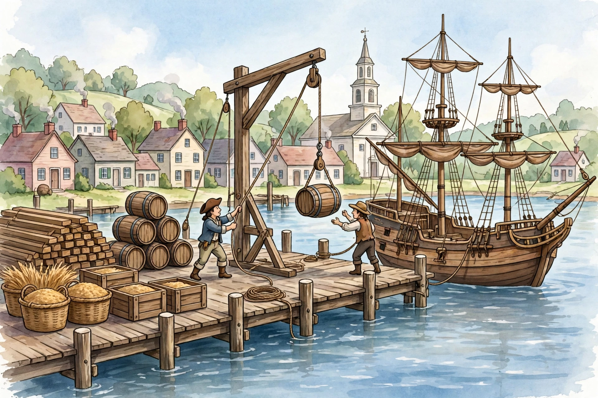

# Lesson 03 — Trade Webs and Ports

**Goal:** I can trace trade between regions and across the Atlantic,
explain how ports changed settlement, and name who benefited and who
was harmed.
**Time:** two 35-minute sessions. **Materials:** the generated port
illustration (below), the Lesson 01 region table, trade-route cards.

**Readiness check (adult-led, 3 minutes):** From Lesson 02, why did a
New England merchant buy Virginia tobacco instead of growing it?
(Specialization + environment.) What had to exist for that trade to
happen? (A route, a port, a ship, and a way to pay.)

## Teaching

### One port, many journeys

Look at the illustration. It is an **AI imagining of a colonial port**,
not a record of a real place, ship, or day — but every object in it
stands for a real kind of colonial work. Study it before reading on.

*Caption: AI illustration of a colonial port town, 1700s (imagined,
not a specific place). Workers load barrels onto a sailing ship at a
wooden wharf; lumber, barrels, and grain wait on the dock.*

**Text-only alternative (same information as the picture):** A wooden
sailing ship with furled sails is tied at a wooden wharf. Two workers
use a rope-and-pulley crane to lift a barrel toward the ship. On the
dock sit a stack of lumber planks, several barrels, baskets and crates
of grain. Behind the wharf are small colonial houses with chimneys and
a church with a tall steeple. The water is calm. Questions about the
picture can be answered from this paragraph alone.

**Picture questions:** (1) Name three goods visible on the dock.
(Lumber, barrels — contents not shown — and grain.) (2) Which region
in Lesson 01 most likely produced the lumber? (New England — forests
and shipbuilding.) Which region most likely produced the grain?
(Middle Colonies — wheat.) (3) What job is the pulley doing, and why
does it matter? (Lifting heavy barrels aboard; without it, loading is
slower and more dangerous — physical capital at work.)

### Trade webs: three scales

Colonial trade ran at three scales, all at once:

1. **Between regions.** New England ships carried Southern tobacco
   and Middle Colony flour; Southern and Middle ports bought New
   England fish, lumber, and ships. No region was self-sufficient.
2. **Across the Atlantic to Britain.** Colonies shipped raw materials
   and cash crops (tobacco, rice, indigo, lumber, furs) to Britain and
   bought back finished goods (cloth, tools, dishes) — often at prices
   Britain controlled. Britain also made rules about what colonies
   could trade and with whom, which colonists resented; that
   resentment will matter in Unit 05's road toward self-rule.
3. **With the West Indies and Africa — the hard part.** Ships carried
   fish and lumber to Caribbean sugar islands and brought back sugar
   and molasses. And, in the same Atlantic system, enslaved African
   people were forcibly transported to the Americas and sold — a
   trade in human beings, not goods. Never describe that leg as if it
   were just another cargo: the "goods" in that leg were people
   stolen from their homes, and the wealth it created for traders and
   plantation owners was built on that theft. Learners at this grade
   do not need graphic detail; they do need the plain fact and the
   resistance that met it — people who ran away, rebelled, and kept
   families and cultures alive.

### How ports changed where people lived

Ports were magnets. A good harbor with a deep channel drew warehouses,
shipyards, workshops, and workers; roads and river landings fed into
it; farms near it could sell more easily than farms far inland. Over
time, trade routes reshaped settlement: towns grew where ships could
load, and regions that could reach a port prospered faster than
regions that could not. That is D2.Geo.11 in action — economic
activity patterns changing because places interacted with nearby and
distant places. Boston, New York, and Philadelphia grew into the
colonies' largest towns largely because they were ports; Charleston
grew as the South's rice-and-indigo port. A map of colonial towns is,
in large part, a map of harbors and river mouths.

### Who benefited, who was harmed?

Every trade has at least two sides, and this unit asks about both:

- **Benefited:** shipowners and merchants who earned fees and
  profits; farmers and planters who could sell beyond their own town;
  townspeople whose shops, workshops, and jobs depended on port
  traffic; British manufacturers who sold finished goods.
- **Harmed or forced:** enslaved African people, transported and
  forced to labor; Indigenous nations, whose land was taken as
  settlement and plantations spread, and whose trade position
  weakened as colonial power grew; small farmers squeezed by prices
  set far away. A trade story that names only the winners is
  incomplete. A complete answer names a winner, a loser, and a reason
  for each.

### Worked example 1 — Trace a good

*Question: "A barrel of Middle Colony flour ends up in the West
Indies. Trace its journey in four steps."*

Reasoning: Follow the chain: (1) wheat grown and milled in the Middle
Colonies; (2) flour packed in barrels and carried to a port such as
Philadelphia or New York; (3) loaded on a ship (perhaps New
England-built) sailing south; (4) unloaded in the West Indies and
traded for sugar or molasses. Each step names a place and a job —
growing, milling, port work, sailing — so the journey is a chain of
people, not a magic jump.

### Worked example 2 — Winner and harmed

*Question: "A Charleston merchant grows rich shipping rice. Name one
person who benefited from this trade besides the merchant, and one
group harmed by it, with a reason each."*

Reasoning: Benefited: the shipowner who carried the rice for a fee, or
the cooper who made the rice barrels — port work paid them. Harmed:
the enslaved workers who grew and harvested the rice in flooded
fields without pay or freedom — their forced labor is what made the
merchant's profit possible. A one-sided answer ("everyone benefited")
fails the question; the harm must be named.

## Guided practice (adult reads aloud if needed)

**G1.** Using the picture's text alternative, name one good on the
dock that probably came from New England and one that probably came
from the Middle Colonies. Give the Lesson 01 reason for each.
*Hint: forests → lumber; wheat → grain.*

**G2.** A Southern planter sells tobacco in Britain and buys cloth
with the money. Name one benefit for the planter and one rule problem:
who set the trade rules? (Britain — and the planter could not vote
on them. That resentment returns in Lesson 05.)
*Hint: benefit = a market; problem = no say in the rules.*

**G3.** Error-analysis: "A friend says triangular trade was just
ships carrying sugar, fish, and cloth." What is missing from that
sentence, and why does it matter? Rewrite the sentence truthfully.
*Hint: the missing leg carried people, by force.*

## Independent practice

**I1.** Draw a trade web with four places (a New England port, a
Middle Colony port, a Southern port, Britain) and arrows labeled with
one good each. Add one arrow labeled "enslaved people, by force"
from Africa to the Americas, and write one sentence explaining why
that arrow is different from the goods arrows.

**I2.** In 3–4 sentences, explain why a town with a good harbor grew
faster than a town far inland with no river or port. Use the words
"port," "trade," and "settlement."

**I3.** Choose one colonial good (fish, flour, tobacco, or lumber).
Write its journey from producer to distant buyer in four steps,
naming a worker at each step.

## Applied task

Port-goods investigation: return to the illustration and sort
everything visible on the dock into three lists — (a) probably from
New England, (b) probably from the Middle Colonies, (c) cannot tell
from the picture alone (a barrel's contents are not shown). Write one
sentence for each "cannot tell" item explaining what extra evidence
would settle it (a label, a shipping list, a merchant's record). Good
historians name what a picture cannot prove.

## Exit check

Name the three scales of colonial trade and give one example good or
flow for each. Then name one group harmed by the Atlantic trade
system and why. The adult checks: three scales present, harm named
plainly.
