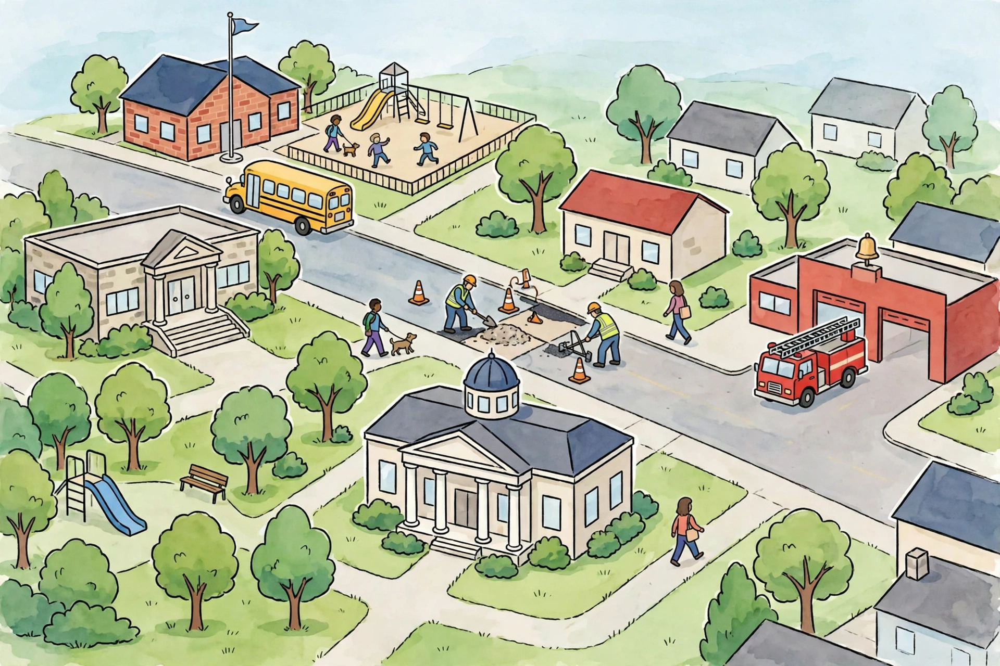

# Lesson 01 — Three Levels of Government

**Goal:** I can name the three levels of government and the three
branches at each level, and explain what officials at each level do.
**Time:** two 35-minute sessions. **Materials:** the generated town
illustration (`../assets/town-services-scene.png`), paper, colored
pencils or markers.

**Readiness check (adult-led, 3 minutes):** In Unit 04 you met town
meetings and elected assemblies — colonists making rules together.
Who makes the rules where *we* live today? (The learner will name
someone — a mayor, the president, a teacher. Accept any answer, then
say: today we sort out *which* government makes *which* rule.)

## Teaching

### Government is not one thing

When people say "the government," they usually mean one big thing
far away. That is wrong in a useful way: government is three levels,
and each level handles different jobs. A **level** is a layer of
government that covers a different-sized place:

| Level | Covers | Elected leader | Lawmakers | Judges |
|---|---|---|---|---|
| **National** (also called **federal**) | The whole country | President | Congress: the House of Representatives and the Senate | The Supreme Court and other federal courts |
| **State** | One state | Governor | The state legislature | State courts |
| **Local** | A city, town, or county | Mayor (or county leader) | City council (or county board) | Local courts |

Notice the pattern: every level has the same three **branches** —
three parts with three different jobs:

- **Legislative branch — makes laws.** Congress at the national
  level; a state legislature at the state level; a city council at
  the local level.
- **Executive branch — carries out laws.** The president; a
  governor; a mayor. These leaders run the day-to-day work and make
  sure laws are followed.
- **Judicial branch — explains what laws mean.** Courts and judges
  decide disputes and check whether a law follows the Constitution.

One sentence to keep: *legislators write it, executives carry it
out, judges explain it.* That sentence works at all three levels.

### Who does what? Concrete jobs

- The **president** leads the national government, commands the
  armed forces, and talks with other countries. The president can
  also **veto** a bill — refuse to sign it — so it does not become a
  law (Lesson 03 shows the rest of that story).
- **Congress** writes national laws and approves the national budget.
  The **House of Representatives** has 435 members, chosen by
  population — bigger states get more representatives. The **Senate**
  has 2 senators per state, so 50 states × 2 = 100 senators. Together
  Congress has 435 + 100 = 535 members.
- A **governor** leads a state: state roads, state parks, state
  police, and state schools' rules. A **state legislature** writes
  state laws.
- A **mayor** leads a city or town: local roads, water, parks,
  libraries, and the fire department. A **city council** writes local
  laws (often called ordinances). A **school board** — elected
  locally — makes decisions about the public schools. A **sheriff**
  or local police chief leads local law enforcement.

The levels share the work on purpose. That sharing has a name you
will meet in Lesson 02: **federalism** — power divided between the
national government and the states. Neither level does everything,
and that is by design.

### Worked example 1 — Sort the job to the level

*Question: "A pothole opens on the street outside the school. Which
level of government fixes it, and how do you know?"*

Reasoning: A street outside a school is a local road, and local
roads are a local government's job — the city or county road crew.
The president does not fix potholes, and a governor does not send a
state crew for a neighborhood street. Answer: local government —
the mayor's road crew (the picture in this lesson shows exactly that
crew at work).

### Worked example 2 — One job, three branches

*Question: "A new national law says every school must have a library.
Which branch wrote it, which branch carries it out, and which branch
would explain what it means if people disagreed?"*

Reasoning: A law is written by the legislative branch — Congress.
Carrying it out (making sure libraries actually open) is the
executive branch's job — the president and the departments. If
people disagreed about what "must have a library" means, a court —
the judicial branch — would explain it. Answer: Congress wrote it,
the president's branch carries it out, the courts explain it. The
same three jobs exist at the state and local levels, with different
officials.

## The town illustration — which level handles which need?

Look at the town illustration together (or read its text-only
alternative below the image if you cannot see it).

*Caption: AI illustration of a generic American town (imagined, not
a specific place). A school, a park, a fire station, a road crew, and
a town hall share one neighborhood — each is handled by a different
level, branch, or office of government.*

**Text-only alternative (read aloud if needed):** The picture shows
a small town from above. Top left: a brick school with a flagpole
and a fenced playground with a slide, swings, and three children.
A yellow school bus drives past on the street. Middle left: a stone
building with columns and steps — a town hall or library. Center:
two road workers in safety vests repair a street, with orange
traffic cones around them. Right: a red fire station with a bell on
top and a red fire truck outside. Bottom center: a larger columned
building with a dome — another public building. Bottom left: a park
with a slide, a bench, and trees. Houses, trees, and people walking
fill the rest of the scene. No words or signs appear in the picture.

*Investigation (Week 20, Session 3):* Sort these six community
needs to the level that handles them — national, state, or local —
and name one official or office for each: (1) the school bus route,
(2) the fire station, (3) the park and playground, (4) the road
repair, (5) the town hall meeting, (6) the library's books. (The
adult checks: school bus route and library — local, school board /
city; fire station — local; park — local; road repair — local;
town hall meeting — local. The point is that *most* of daily life
is local government. National and state examples — an interstate
highway, a state park — come from the learner's own state in the
guided practice.)

## Guided practice (adult reads aloud if needed)

**G1.** Match each official to the level: president, governor,
mayor, senator, city council member, state legislator. (Three
national, one state leader plus one state lawmaker, two local.)
*Hint: who covers the whole country, one state, or one town?*

**G2.** Error-analysis: "The president makes all the laws in the
country." What is wrong with that sentence? Rewrite it truthfully
in one sentence.
*Hint: who writes laws, and who carries them out?*

**G3.** Name one job for your state government and one job for your
local government that are different from each other. Give a reason
each belongs to that level.
*Hint: how big is the place it covers?*

## Independent practice

**I1.** Copy the levels table's first three columns (level, covers,
elected leader) from memory as far as you can, then check and fix it.
Circle anything you missed.

**I2.** In 3–4 sentences, explain why a town has a mayor *and* the
country has a president — why one leader cannot do both jobs.

**I3.** A new state park opens two hours away, and a new playground
opens on your street. Which is a state job and which is a local job?
Explain each with the size of the place it serves.

## Applied task

Make a levels-and-branches chart (you will finish it in the
project): three rows (national, state, local) and three columns
(legislative, executive, judicial). Fill each box with the officials
for that level and branch, in words — never color alone. Add one
real job per row from your own town or state (the adult supplies the
local names).

## Exit check

Without looking at the table, name the three levels from biggest
place to smallest, and name the three branches with one job each.
The adult checks: order correct (national, state, local), branches
matched to the right job (makes / carries out / explains).
