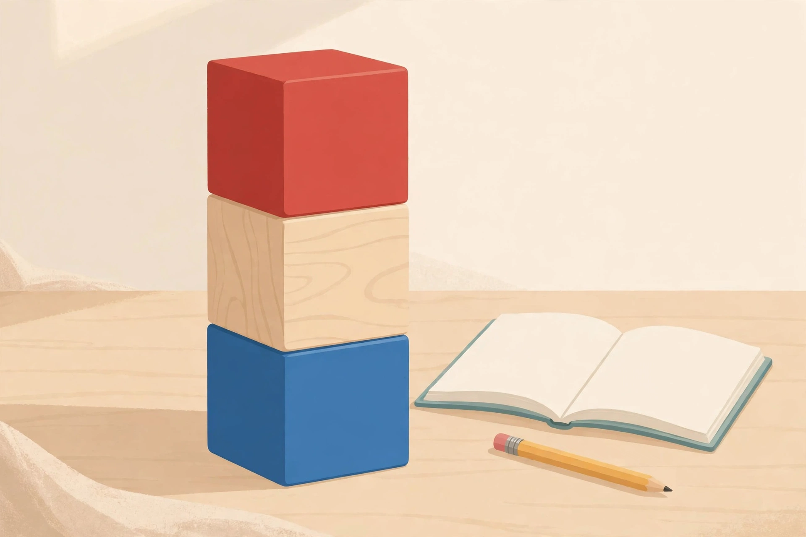

# Lesson 02 — Prefixes: The Meaning-Flippers at the Front of Words

**Goal (learner hears):** "I can find the prefix at the start of a
word, say what it means, and figure out the whole word's meaning."
**Time:** 40 minutes · **Materials:** this lesson; the [unit word
sets](../README.md#unit-word-sets-authored-for-this-unit-reused-across-lessons-and-practice);
word cards the adult writes by hand; pencil and paper.
**Standards:** L.5.4.b; RF.5.3.a.

## Launch (5 min)

*Word-part blocks (AI-generated illustration): every long word is a tower of parts — a prefix (red) at the front, a base word or root (natural wood) in the middle, a suffix (blue) at the end.*

"Imagine tipping the tower onto its side so it reads left to right like a written word. Which color block would come FIRST, and what is that word part called? Which color block carries the word's core meaning? Where does the blue block attach, and what is it called?"

**Text-only alternative (for learners who cannot see the image):**
"Picture three toy blocks stacked on a desk: red on top, plain wood in the middle, blue on the bottom. Read the tower left-to-right as a word: the red block is the PREFIX (attaches at the beginning and changes meaning), the plain-wood block is the BASE WORD or ROOT (carries the core meaning), and the blue block is the SUFFIX (attaches at the end and can change meaning or part of speech)."

(The colors are a redundant cue only — first/middle/last positions carry the meaning, so the activity works without seeing color.)

## Readiness check (2 min)

The adult writes *happy* and *unhappy*. "The second word has one extra
piece at the front. What changed?" (un- flipped the meaning to "not
happy.") "Today we collect eight of these meaning-flippers — and one of
them is a master of disguise."

## Explicit teaching

A **prefix** is a word piece attached to the **front** of a base word
that changes the word's meaning. The base word keeps its own meaning;
the prefix adds a twist. The detective method from this unit:

1. **Find the prefix** (cover it and see what base word is left).
2. **Name the prefix's meaning.**
3. **Assemble:** prefix meaning + base meaning ≈ the word's meaning.
4. **Check in a sentence** — does the assembled meaning make sense?

Today's eight flippers:

| Prefix | Means | Memory hook |
|---|---|---|
| un- | not, opposite of | *unlock* — undo the lock |
| re- | again, back | *reread* — read again |
| pre- | before | *preview* — view before |
| dis- | not, opposite of | *disappear* — the opposite of appear |
| mis- | wrongly, badly | *misplace* — place wrongly |
| in- / im- / il- / ir- | not | *inactive, impossible, illegal, irregular* — same "not," different spelling |
| over- | too much, above | *overcook* — cook too much |
| under- | too little, below | *undervalue* — value too little |

**The disguise:** in- ("not") changes its spelling to match the next
letter: *in-* before most letters (*inactive*), *im-* before *m* and *p*
(*impossible, impatient*), *il-* before *l* (*illegal*), *ir-* before *r*
(*irregular*). Same prefix, four costumes. If you see im-/il-/ir- and
the word means "not ___," you found it.

**The meaning test:** not every word that *starts* with these letters
has the prefix. *Uncle* does not mean "not cle." Cover the prefix, read
the base — if the base is not a real word with its own meaning, it is
not the prefix. (*Dis* + *cover* = "uncover," real. *Un* + *cle* =
nothing, fake.)

### Modeled example 1 — *misunderstanding*

*Adult writes* misunderstanding. "Find the pieces: *mis-* at the front
('wrongly'), the base *understand*, and *-ing* at the end. Assemble:
'wrongly' + 'understand' + '-ing' = the act of understanding wrongly.
Check: 'Their misunderstanding about the meeting time made them late.'
Does 'understanding wrongly' fit? Yes."

### Modeled example 2 — *irregular* (the disguise)

*Adult writes* irregular. "It starts with *ir-*. Cover *ir-*: the base
is *regular*, a real word meaning 'normal, following the pattern.' *ir-*
is the disguised *in-* meaning 'not.' Assemble: 'not normal.' Check:
'The patient's heartbeat was irregular, so the nurse stayed close.'
'Not normal heartbeat' — fits. If I had treated *ir-* as part of the
base, I would have been stuck on a long strange word."

### Modeled example 3 — the meaning test catches a fake

*Adult writes* *uncle* and *unfair* side by side. "*Unfair*: cover
*un-* — *fair* is a real word, 'just.' *un-* + *fair* = 'not just.'
Real prefix. *Uncle*: cover *un-* — *cle* is not a word. Fake. *Uncle*
just happens to start with *un*. The meaning test never lies: no real
base, no prefix."

### Why prefixes matter for reading

About half of the long words in English carry a prefix. That means
half the time you meet a scary-long word, the first two or three
letters are a piece you already know. Readers who spot the prefix
first read the rest of the word faster and guess the meaning before
they finish the sentence. The prefix is the handle on a heavy box —
grab it first.

### Modeled example 4 — an opposite pair: *overcook* and *undercook*

*Adult writes both.* "Same base — *cook*. *Over-* means 'too much':
*overcook* = cook too much (burnt). *Under-* means 'too little':
*undercook* = cook too little (raw inside). Now the check: 'They had to
throw out the chicken because the new cook had overcooked it.' Too-much
cooking → burnt → thrown out. Fits. And: 'The center was still cold —
she had undercooked the roast.' Too-little cooking → raw center.
Fits. One base, two opposite prefixes, two opposite dinners. When you
see over-/under-, ask: 'too much of what, or too little of what?'"

## Guided practice (adult does it with the learner; 5 tasks)

1. "Break *preview* into prefix + base and assemble the meaning."
   (*pre-* "before" + *view* "look at" = look at before.) **Hint:**
   "What do movie previews show you?"
2. "What does *dis-* do to *appear*?" (Flips it: to vanish from sight,
   the opposite of appear.) **Hint:** "Say the base's meaning first,
   then flip it."
3. "Break *impossible*. Name the disguise." (*im-* = in- "not" before
   *p*; *possible* = able to happen; "not able to happen.")
   **Hint:** "Which letter follows the prefix? That picks the costume."
4. "Is *understand* built from *under-* + *stand*? Use the meaning
   test." (Tricky: historically yes, but "stand under" does not equal
   "comprehend" today — the parts do not assemble into the meaning, so
   treat *understand* as a base word, not a prefix word.) **Hint:**
   "Does 'stand under' mean what *understand* means?"
5. **Error-analysis:** The adult assembles *rebuild* as "'back' +
   'build' = build backwards." The learner fixes it. ("*re-* is 'again'
   here — build again, not backwards. The sentence decides which
   meaning of re- fits.")

## Independent practice (learner tries; adult observes, 5 tasks)

1. Break, read, and define: *rewrite, misjudge, preheat, disappear*.
2. Break, read, and define: *illegal, overtake, undercook, uncertain*.
3. Write 3 original sentences, each using a different prefix word from
   today's set correctly.
4. **Explain-your-reasoning:** "Why does knowing that *mis-* means
   'wrongly' help you read *miscalculate* the first time you see it?"
   (2–3 sentences.)
5. Sort these 8 into prefix groups and name any disguise: *impatient,
   replay, unfair, irregular, preview, misplace, overhead, disconnect*.

## Application

**Prefix flip cards.** The learner makes 8 cards — one per prefix:
prefix, meaning, hook word, and one *new* sentence using a word with
that prefix. The cards join the shared word-part card set
([assets/word-part-cards.md](../assets/word-part-cards.md)) and are
used in every later lesson.

## Exit check

The adult writes two unpracticed words — for example, *irresponsible*
and *overestimate*. The learner breaks each into prefix + base, names
the prefix meaning (naming the disguise for *ir-*), and assembles the
meaning. Success: both broken correctly with sensible meanings.

## Supports and extension

- **Reading/language access:** the adult reads each word aloud first;
  prefixes may be color-coded on cards; the learner may tap the prefix
  then the base.
- **Alternate response mode:** the learner may point to the prefix,
  say the assembly aloud, or dictate sentences for the adult to scribe.
- **Extension:** hunt today's eight prefixes in the learner's own
  reading; log 5 new finds with the assembly written out; find one
  "fake prefix" word (like *uncle*) and explain why it fails the
  meaning test.

## Teacher note

**Likely misconception:** letter-matching without the meaning test
("under" in *understand* is not today's under-; "un" in *uncle* is not
a prefix). Drill the cover-and-check: no real base, no prefix.
**Answer-key reference:**
[answer-key.md](../answer-key.md#lesson-02). Reteach plan:
[teacher guide](../teacher-guide.md#lesson-02).
