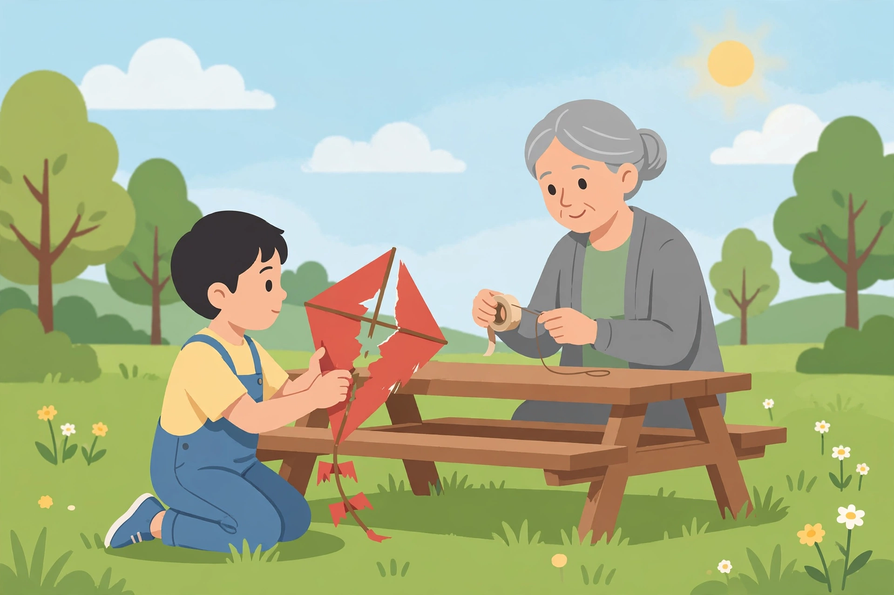

# Lesson 03 — Whose Eyes? Point of View and Perspective

**Goal:** I can identify a narrator's point of view and describe how it
influences what the reader learns — and what the reader never gets to see.
**Time:** two sessions, ~40–45 minutes each · **Materials:** this lesson,
a notebook, the illustration below

## Readiness check (5 minutes)

Look at the illustration. In two sentences, describe what is happening —
then answer: *whose* story does this picture seem to tell — the child's
or the woman's? How can you tell? Pictures, like stories, have a point
of view.

## Teaching: the narrator is a camera

Every story is told by a **narrator**, and the narrator's **point of
view** decides what the reader can know:

- **First person:** the narrator is *a character in the story* and says
  **"I."** You get their thoughts and feelings directly — but you only
  know what *they* know. You can't hear other characters' thoughts.
- **Third person:** the narrator is *outside the story* and says **"he /
  she / they."** A third-person narrator can report what anyone does and
  says, and may share one character's thoughts (like ours does with Sam)
  — but still can't show you everything at once.

**Perspective** is bigger than grammar: it's the narrator's whole
position — what they notice, what they care about, what they *can't*
see. Two narrators can describe the same event and tell true stories
that feel completely different.

*The repair table (AI-generated illustration): the same scene "The Broken
Kite" describes — Sam laying the torn kite on Ms. Okafor's picnic table.
In Lesson 03's activity you will describe this moment from two different
points of view and notice what changes.*

**Text-only alternative:** Picture a sunny park. A child with short dark
hair kneels beside a wooden picnic table, holding a torn red paper kite
with a snapped stick. An older woman with gray hair in a bun sits at the
table, smiling kindly, holding tape and string to help repair it. Green
grass, trees, and a bright sun complete the scene.

### Worked example 1 — our story's point of view

"The Broken Kite" is **third person**: "Sam had worked on the red kite
for eleven days… He stuffed the torn kite into his backpack."

What this POV lets us know: Sam's actions, his dialogue, *and* his
private thoughts ("Asking felt worse than the crash"). What it hides:
Ms. Okafor's thoughts. We see her *act* kindly ("Ms. Okafor didn't
laugh"), but we never hear what she is thinking when Sam drags the
backpack out. The narrator stays close to Sam — that's a choice, and it
makes Sam's embarrassment the emotional center of the story.

### Worked example 2 — the same crash in first person

Read this retelling of the crash scene — same event, new narrator:

**"The Crash, Told by Priya" (original)**

*I was the one who shouted "Three… two… one!" I swear the kite was the
highest thing in that park for a whole minute. Then the wind turned mean
and — crack. Straight into the oak. I ran over, but Sam was already
stuffing the kite into his backpack. His ears were so red. I wanted to
say "it's okay, everybody crashes," but he walked off so fast I didn't
get the words out. I felt bad the whole walk home. I kept thinking: he
probably believes we were all laughing at him. We weren't. I was just
sad his eleven days of work ended like that.*

Compare:

| | Third-person ("The Broken Kite") | First-person (Priya) |
|---|---|---|
| Narrator | Outside the story | Priya, a character |
| Knows Sam's thoughts? | Yes ("did not want to say the words out loud") | No — she *guesses* ("he probably believes…") |
| Knows Priya's thoughts? | No — she just shouts and cheers | Yes ("I felt bad the whole walk home") |
| New information | Sam's shame, Ms. Okafor's help | Nobody was laughing; Priya admired the eleven days of work |

Neither version is lying. But the **perspective changes the meaning**:
in Sam's close-up version the crash is a humiliation; in Priya's version
it's a sad accident witnessed by a friend. Point of view doesn't just
report the story — it *shapes* it.

## Guided practice (with an adult)

1. Look at the illustration again. Describe the scene **as Sam** (first
   person, "I"): what is he noticing? What is he feeling? Then describe
   it **as Ms. Okafor** (first person): what is *she* noticing? What is
   she feeling? List one thing each narrator knows that the other doesn't.
2. Find two sentences in "The Broken Kite" that prove it is third person,
   and two sentences in "The Crash, Told by Priya" that prove it is
   first person.
3. Priya writes, "he probably believes we were all laughing at him."
   What does the word *probably* tell you about the limits of first-person
   narration?

## Independent practice

4. Rewrite the story's last paragraph ("'Thank you,' he said quietly…")
   in **first person as Sam** (3–5 sentences). Then write one sentence
   explaining what your version reveals that the third-person version
   hides.
5. **Error analysis:** A classmate says, "First-person stories are more
   true because the narrator was actually there." Explain the flaw using
   Priya's retelling — what *can't* Priya know even though she was there?
6. Choose: if you wanted readers to feel *most* sorry for the kite
   itself, which point of view would you pick, and why? (There is no
   single right answer — defend it.)

## Applied task

Make a **POV comparison card**: fold a paper in half. Left side: the
crash scene in third person (3 sentences, narrator outside). Right side:
the same scene in first person as Ms. Okafor (3 sentences, "I"). At the
bottom, write one sentence: "The point of view changes the story because
___."

## Exit check

Without looking back: (1) How do you recognize first-person vs.
third-person narration? (2) Name one thing Priya's version tells you
that Sam's version doesn't, and one thing it *can't* tell you.

## Supports and extensions

- **Reading access:** the adult reads Priya's retelling aloud while the
  learner tracks the "I" sentences with a finger.
- **Alternate response mode:** the POV comparison may be dictated or
  drawn as two captioned panels.
- **Extension:** rewrite the crash scene from the **kite's** point of
  view (first person, playful). What does a narrator who can't think
  like a person notice? Discuss with the adult where the fun breaks the
  story's realism — and why the author didn't choose it.

## Teacher note

Likely misconceptions: (1) "first person = main character" — Priya is
not the protagonist; narrators can be witnesses; (2) confusing *who
tells* with *who the story is about*; (3) assuming one POV is "better" —
each reveals and hides; the test is always *what does the reader gain
and lose*. The illustration activity works because the image is fixed
while the telling changes — keep attention on that contrast. Answer-key
reference: `answer-key.md` §L3. Next: Lesson 04 compares two whole
stories.
