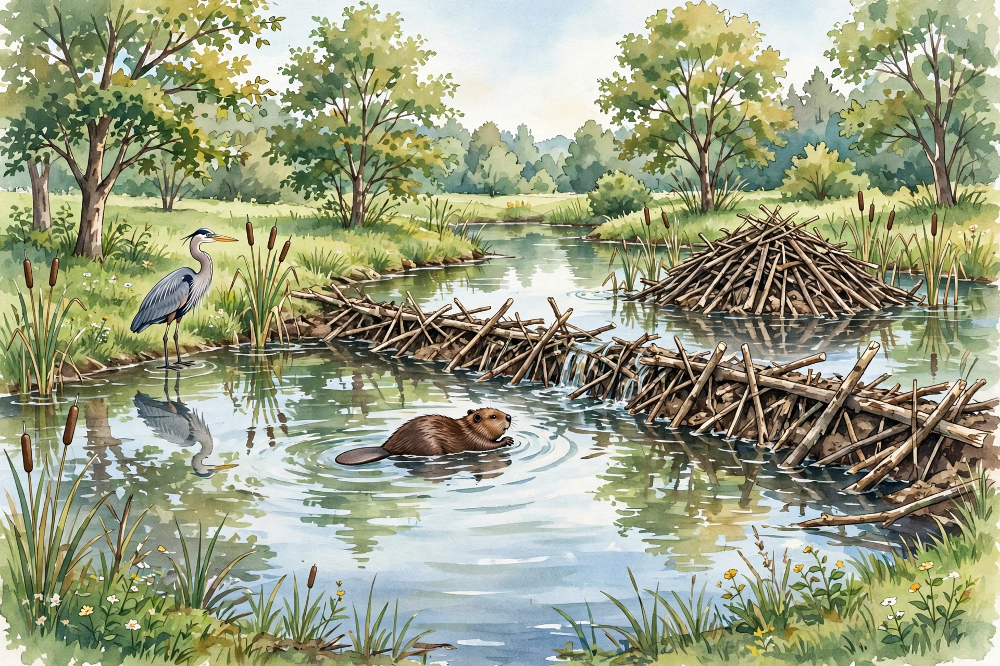

# Lesson 01 — Main Ideas, Key Details, and Summaries

**Goal (learner hears):** "I can find two or more main ideas in an
informational text, prove each one with key details, and summarize the
text in my own words."
**Time:** 40 minutes · **Materials:** this lesson; pencil; the
illustration below (or its text alternative).
**Standards:** RI.5.1, RI.5.2, RI.5.4.

## Readiness check (2 min)

The adult says: "A beaver is an animal. That is the *topic*. Now listen:
'Beavers change streams into ponds, and those ponds help other animals.'
That is a *main idea* — it says something about the topic. What is the
difference?" Accept: the topic names what the text is about; a main
idea says something important about it, and it needs details to prove
it. If the learner cannot tell them apart yet, that is exactly what
this lesson teaches — do not move on until the contrast is said aloud.

## Explicit teaching

**Topic** = what the text is about, usually one or a few words:
*beavers*, *Willow Creek*, *ponds*.

**Main idea** = the most important point the author makes about the
topic, usually a full sentence. A grade-5 informational text often has
**two or more** main ideas — that is why RI.5.2 says "two or more,"
not one.

**Key detail** = a fact, example, or description from the text that
supports a main idea. A detail is *key* only if it helps prove that
main idea. A fun fact that proves nothing is just a detail, not a key
detail.

**Summary** = a short retelling in your own words that keeps the main
ideas and the most important details and leaves out small examples,
repeated points, and your own opinions.

Three summary rules:

1. Keep every main idea. A summary with only one main idea is
   incomplete.
2. Keep only key details — one or two per main idea.
3. Use your own words, except for short quotations that prove a point.
   Copying whole sentences is not summarizing.

**Quoting accurately** means copying the author's exact words inside
quotation marks. If you change even one word, it is no longer a
quotation — it is a paraphrase, and it must not wear quotation marks.

### The illustration — a beaver pond (AI illustration)

*Caption: AI illustration of a beaver pond, generated for this unit
(see [assets/README.md](../assets/README.md)). It is an illustration,
not a photograph, and it is not evidence about a real pond.*

**Text-only alternative (read this if you cannot see the picture):**
A brown beaver with a flat tail swims in calm, clear pond water in the
foreground. Behind it, a dam made of sticks, branches, and mud crosses
the water, with a little water trickling over it. To the right, a lodge
— a large dome of piled sticks — sits in the pond. On the left bank, a
tall grey heron with a long beak stands among grass and cattails.
Trees and green banks surround the pond.

**Observe and say (2 min):** Name three things you can see in the
picture that a text about beavers might also mention (dam, lodge,
heron, pond, cattails). Then notice what the picture *cannot* tell you:
it cannot tell you *why* beavers build, *in what order*, or *what
happened next*. Pictures add information; they do not replace reading.
That is RI.5.7 in action — drawing on more than one source.

### The passage — "The Pond Builders" (original)

> **1.** Willow Creek was once a shallow, fast stream. In spring, a
> family of beavers arrived and began to change it. Beavers are
> sometimes called ecosystem engineers, because the structures they
> build change the land and water around them.
>
> **2.** First, the beavers gnawed down small trees with their strong
> front teeth. Then they dragged branches into the stream and piled
> them across it. Next, they packed mud and stones into the gaps.
> Finally, the wall of branches and mud — the dam — held back the
> water, and a pond began to form.
>
> **3.** Because the dam slowed the water, the pond grew deep and calm.
> As a result, animals that need still water moved in. Frogs laid eggs
> among the pond plants. A heron began to hunt along the bank. In the
> dry month of July, when a nearby stream shrank to a trickle, Willow
> Creek's pond still held water.
>
> **4.** The pond was not good news for everyone. A low field beside
> the creek filled with water in spring, and the farmer who worked
> that field worried about his crop. The beavers, the frogs, the
> heron, and the farmer all depended on the same water — but they did
> not all want the same thing from it.

### Modeled example 1 — topic is not a main idea

*Adult thinks aloud, pointing at paragraph 1.*

- Topic: "beavers." That names the subject. It says nothing about
  them.
- Not a main idea: "Beavers are animals." True, but it is not what
  this passage is trying to teach.
- Main idea 1: **"Beavers change a fast stream into a pond by
  building a dam in stages."** Proof: paragraph 2 shows the stages
  (gnawed trees → dragged branches → packed mud → dam held back
  water), and paragraph 1 says beavers "began to change it."
- A common error: writing "The passage is about beavers and ponds"
  and stopping. That is a topic label, not a main idea. A main idea
  must be a sentence that could be argued with or proved.

### Modeled example 2 — two main ideas, each with key details

*Adult builds the table aloud; the learner copies it.*

| Main idea | Key details that prove it (quote or close paraphrase) |
|---|---|
| 1. Beavers turn a fast stream into a pond by building a dam in stages. | "First, the beavers gnawed down small trees"; "they dragged branches into the stream and piled them across it"; "the dam — held back the water, and a pond began to form" |
| 2. The pond helps other living things, but it also creates a problem for the farmer. | "Frogs laid eggs among the pond plants"; "A heron began to hunt along the bank"; "A low field beside the creek filled with water in spring, and the farmer … worried about his crop" |

Notice what was left out of the table: "strong front teeth" is a
detail, but it is not needed to prove either main idea, so a summary
may drop it. "In the dry month of July" is a key detail for main idea
2 — it shows the pond's value in a dry time — so a good summary keeps
some version of it.

### Modeled example 3 — a summary that keeps both main ideas

> Beavers changed shallow, fast Willow Creek by building a dam in
> stages: they cut trees, piled branches across the stream, and packed
> the gaps with mud and stones until a pond formed. The pond helped
> wildlife — frogs laid eggs there, a heron hunted there, and it still
> held water in dry July. But the pond also flooded a farmer's low
> field in spring, so the same water that helped the animals worried
> the farmer.

Check it against the rules: both main ideas are there; details are
key, not copied whole; no opinion ("beavers are wonderful") sneaks
in. A summary that mentioned only the wildlife would fail rule 1.

## Guided practice

With the adult, do these together. Do not copy sentences from the
passage unless you put quotation marks around them.

1. The topic of paragraph 3 is "the pond." Write one main idea for
   paragraph 3 alone, in your own words.
2. Which detail from paragraph 3 best proves that the pond helped
   animals in dry times? Quote it exactly.
3. Read this summary and find its flaw: "Beavers are animals that
   build dams. The end." Is a main idea missing? Which one, and what
   detail would fix it?
4. Use the illustration's text alternative: name one detail from the
   picture that matches a detail in the passage, and one thing the
   picture shows that the passage never mentions.

## Independent practice

1. Write the topic of the whole passage in three words or fewer.
2. Write main idea 1 and main idea 2 in your own words, each as one
   sentence.
3. For each main idea, list two key details. At least one detail per
   main idea must be an exact quotation (with quotation marks).
4. Write a 3-sentence summary of the passage. Check: does it keep
   both main ideas? Does it leave out small details? Is anything in
   it your opinion rather than the author's point?
5. Inference (RI.5.1): The passage says the farmer "worried about
   his crop." Quote one detail that supports the inference that the
   farmer's problem was the water itself, not the beavers as animals.
6. Vocabulary in context (RI.5.4): Use paragraph 1's clue ("the
   structures they build change the land and water around them") to
   explain *ecosystem engineer* in your own words. Then check a
   dictionary: does your explanation match?

## Application

Choose one: (a) retell the passage to a partner in 30 seconds using
only your summary — no looking back; or (b) write a one-sentence
"main idea" for the illustration alone, then say how it differs from
the passage's main ideas. A picture's main idea and a text's main idea
do not have to match — that difference is worth noticing.

## Exit check

On a slip of paper: "One main idea of 'The Pond Builders' is ___.
One key detail that proves it is ___." The adult checks that the
detail actually proves that main idea, not the other one.

## Supports and extensions

- **Reading access:** the adult reads the passage aloud first while
  the learner follows; paragraph numbers stay visible for quoting.
- **Alternate response:** the learner may point to details in the
  text and dictate the summary for the adult to scribe, then read it
  back and correct it.
- **Extension:** find a third main idea a careful reader could defend
  (for example, about how slowly a pond forms, or about shared water).
  Defend it with two details, or explain why it is really part of
  main idea 1 or 2.

## Teacher note

Likely misconception: learners write the topic ("beavers") or a
single detail ("beavers eat trees" — which this passage does not even
say) as the main idea. Keep returning to the test: *Can I prove this
sentence with details from more than one paragraph?* If not, it is
probably a detail, not a main idea. Another trap: summaries that copy
the first paragraph and stop. Require both main ideas before the
summary counts. Answer-key reference: [answer-key.md](../answer-key.md),
Lesson 01.
