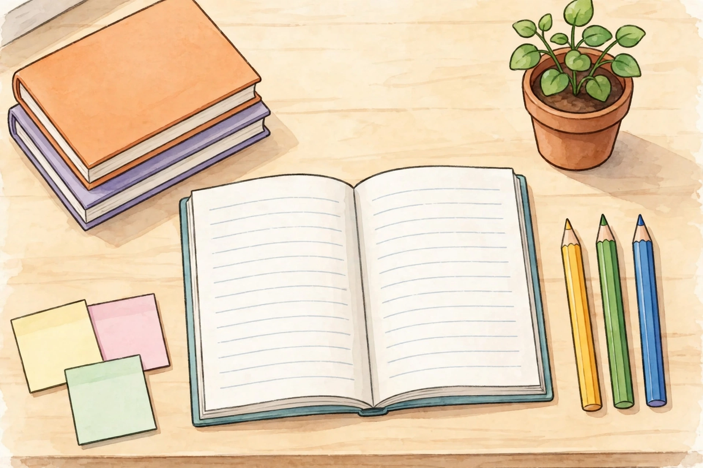

# Lesson 05 — The Editor's Desk: Full-Draft Editing, Varieties of English, Formal and Informal

**Goal (learner hears):** "I can edit a whole draft in passes — one
job at a time — and choose formal or informal English to fit the
occasion."
**Time:** 40 minutes · **Materials:** this lesson; pencil; the
illustration below (or its text alternative); a dictionary or
glossary.
**Standards:** L.5.3.b, SL.5.6, W.5.5.

## Readiness check (2 min)

The adult says: "An editor does not fix everything at once. An
editor reads once for ideas, once for sentences, once for verbs,
once for commas, and once for spelling. Which pass is hardest for
you?" Accept any honest answer. "Today you will practise the passes
on a short draft — and learn when formal English is the right tool
and when informal English is."

## Explicit teaching

### Editing in passes

**Revise** = change ideas, order, and wording to make meaning
clearer. **Edit** = fix grammar, punctuation, and spelling.
**Proofread** = the last slow read, hunting for anything left.
Work in this order, one pass at a time:

1. **Ideas pass:** does every sentence belong? Is anything missing?
2. **Sentence pass:** any fragments, run-ons, comma splices, or
   choppy chains? Combine or split as needed (Lessons 01–02).
3. **Verb pass:** every verb in the right tense? Any wrong shifts?
   (Lesson 03.)
4. **Comma and title pass:** series, introductory, yes/no, tag,
   direct address, titles (Lesson 04).
5. **Spelling pass:** circle unsure words, check each in a reference
   (Lesson 04).

An editor marks changes instead of rewriting silently: circle the
error, write the fix above it, and note the rule in the margin.
That margin note is what turns a correction into learning.

### The illustration — an editor's desk (AI illustration)

*Caption: AI illustration of an editor's desk, generated for this
unit (see [assets/README.md](../assets/README.md)). It is an
illustration, not a photograph, and it shows no real person's desk.*

**Text-only alternative (read this if you cannot see the picture):**
On a light wooden desk sits an open notebook with blank lined pages
and a blue-green cover. To its right stand three pencils — yellow,
green, and blue. To its upper left is a stack of two books with
blank orange and purple covers. To its upper right is a small potted
plant with round green leaves in a clay pot. To its lower left are
three blank sticky notes — yellow, pink, and pale green. Nothing on
the desk has any writing on it.

**Observe and match:** name one editing job for each desk tool.
The notebook holds the draft and its revisions. The three colored
pencils mark three different passes (for example: blue for
sentences, green for verbs, yellow for spelling). The books are
references — a dictionary and a grammar guide. The sticky notes hold
questions for the author ("Did you mean morning or evening?").
The plant does no editing at all — and that is the point: an
editor's desk also needs something that is simply pleasant, because
editing takes patience.

### Varieties of English: dialects and registers

English is not one single way of speaking. A **dialect** is a variety
of English tied to a place or community, with its own consistent
patterns — for example, some speakers say "y'all" for "you all," and
some say "soda" where others say "pop." A dialect is not broken
English; it follows its own rules, and stories use dialects to show
who a character is and where they come from.

A **register** is a variety tied to the occasion. **Informal
English** fits friends, family, and play: "Hey, wanna come to the
festival? It's gonna be awesome!" **Formal English** fits school
reports, invitations, speeches, and letters to people you do not
know well: "Would you like to attend the festival? The parade
begins at noon." The words, the sentence length, and even the
greeting change — but the meaning stays the same.

Choosing a register is a skill, not a judgment: informal English is
not "bad," and formal English is not "better." The question is
always: **who will read or hear this, and what does the occasion
call for?** (SL.5.6: adapt speech to context, using formal English
when appropriate.) In a story, a character may speak informally
while the narrator writes formally — comparing those two registers
is exactly what L.5.3.b asks the learner to do.

## Worked example 1 — One draft, three passes

Draft: "me and jon goes to the festival we buyed tickets and ate
apples cheese and juice the band was great"

Sentence pass: "me and jon goes to the festival we buyed tickets"
is two clauses joined by nothing — a run-on. Split it: "Jon and I
went to the festival. We bought tickets …" (Note: "me and Jon" as a
subject becomes "Jon and I" in formal English, and *goes* must agree
with a plural subject — *go*.)

Verb pass: *buyed* is not a word; the past of *buy* is *bought*.
*Goes* is present; the story is past, so *went*.

Comma pass: "apples cheese and juice" is a series: "apples, cheese,
and juice."

Edited: "Jon and I went to the festival. We bought tickets and ate
apples, cheese, and juice. The band was great." Then a spelling
pass confirms *festival* and *tickets* in a reference if unsure.

Reasoning shown: passes in order, so a sentence fix does not get
undone by a later verb fix.

## Worked example 2 — Formal and informal versions of one message

Informal (text to a friend): "Hey! Wanna come to the festival
Saturday? It's gonna be so fun — bands, food, the whole thing!"

Formal (invitation for the school noticeboard): "You are invited to
the River Festival on Saturday. Bands will perform, food stalls
will serve lunch, and the lantern parade will begin at dusk."

What changed, and what did not: the greeting changed ("Hey!" →
"You are invited"), contractions and slang left ("Wanna," "gonna"),
sentences grew longer and more complete, and the time and events
became exact. The meaning — come to the festival Saturday, it will
be enjoyable — did not change at all. That is register: same
meaning, different clothes.

A common error: thinking formal English means longer words. It
means clearer, more complete sentences fitted to the occasion — a
short formal sentence ("The parade begins at noon.") beats a long
muddled one.

## Guided practice (with the adult)

1. Match each desk tool to its editing job: notebook, colored
   pencils, books, sticky notes. (Use the illustration or its text
   alternative.)
2. Name the pass that fixes each error: "we goed to the store"
   (verb pass); "apples bananas and grapes" (comma pass); "Me and
   Sam runs fast" (sentence pass).
3. Rewrite this informally-worded note formally: "Hey teacher! Can
   I plz go to the library? I gotta finish my poster."
4. A story character says, "I ain't got no ticket." The narrator
   writes, "He had no ticket." Are both "wrong"? Explain using the
   words *dialect* and *register*.
5. Edit this draft in passes, naming each pass as you use it: "the
   parade starts soon we has not painted the banners yet"

## Independent practice

6. Edit this paragraph (6 errors: title, verb agreement,
   capitalization, compound comma, series comma, spelling):
   "Last week we read the novel the lighthouse cat. We has finished
   it on friday and we talked about apples cheese and juice at the
   party. It was definately our favorite book."
7. Write the same invitation twice — once informal (to a friend),
   once formal (for the noticeboard) — for a class art show. Keep
   the facts identical.
8. Explain in your own words why a character's dialect in a story
   should not be "corrected" the way a spelling error is.
9. Do a spelling pass on this sentence and list the words you
   checked: "The principal will announce the schedule for the
   separate science exhibition."
10. Error analysis: a classmate "fixed" a story character's line
    "Y'all come back now!" to "You all return at this time." Explain
    what was lost and why the original was not an error.

## Applied task

Take the illustration's desk as your own: set out your notebook,
three pencils (or three colors), a dictionary, and sticky notes.
Edit the six-sentence paragraph in [practice.md](../practice.md),
Practice Set F, using one color per pass (sentences, verbs,
commas/titles), and put one sticky-note question for the author on
a sentence whose meaning is unclear. Bring the marked draft to the
next session.

## Exit check

The learner says, without looking: the five editing passes in
order — then rewrites "hey wanna play saturday" formally for a
noticeboard.

## Supports and extensions

- **Reading/language access:** the adult reads the draft aloud
  while the learner follows; the learner may dictate fixes and the
  adult scribes the clean copy.
- **Alternate response mode:** instead of writing, the learner may
  record the formal and informal versions aloud and explain the
  differences orally.
- **Extension:** compare two registers in a poem or song the
  learner knows (narrator vs. character, chorus vs. verse) and name
  one difference in words and one in sentence length.

## Teacher note

Likely misconception: "correcting" dialect as if it were an error.
Reteach move: ask, "Does the character's speech follow a pattern?
Would other speakers from that place say it the same way?" If yes,
it is a variety, not a mistake — the editing target is only the
learner's own formal writing, never a character's voice. Likely
misconception: editing everything in one read and missing errors.
Reteach move: require the passes in order, with a different pencil
color per pass, until the habit is automatic. Answers: see
[answer-key.md](../answer-key.md), Lesson 05.
