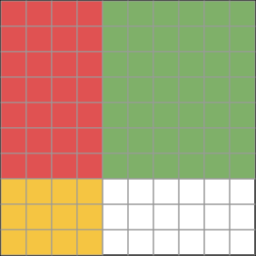

# Lesson 02 — Multiplying Decimals

**My goal:** I can multiply decimals to hundredths using area models and
place-value reasoning, and explain where the decimal point goes.

**Time:** about 40 minutes (5 readiness · 12 teaching · 8 guided ·
12 independent · 3 exit).

**Materials:** hundredths grids (10 × 10), colored pencils, the
[hundredths-grid diagram](../assets/hundredths-grid-0.4-x-0.7.svg).

**Standards:** 5.NBT.B.7 · **Unit objectives:** UO2

## Readiness check (5 minutes)

1. How many hundredths are in 0.4? In 0.7?
2. What is 4 × 7? What is 40 × 70? How are those two answers related?
3. Shade 0.4 of a hundredths grid in your head: how many columns is that?

## Explicit teaching

### Tenths times tenths make hundredths

Multiplication asks for "groups of" or "part of." When both factors are
tenths, the product is counted in hundredths — because a tenth of a tenth
is a hundredth. That is why the decimal point in the answer sits two places
in: one place for each factor's tenths digit.

The diagram shows it exactly: a 10 × 10 hundredths grid with 4 columns
(0.4) and 7 rows (0.7) shaded. The overlap — the part that is both
shaded — is 28 small squares out of 100.

*Caption: 4 columns by 7 rows on a hundredths grid. The overlap is 28 of
100 squares, so 0.4 × 0.7 = 0.28.*

### Worked example 1 — the area model

**0.4 × 0.7**

- As fractions: 0.4 = 4/10 and 0.7 = 7/10.
- Multiply numerators: 4 × 7 = 28. Multiply denominators: 10 × 10 = 100.
- 28/100 = **0.28**.

Check with the grid: 28 shaded squares out of 100 = 0.28. Model, fractions,
and grid all agree — that agreement is the proof.

A common wrong answer is 2.8. Estimation catches it: 0.4 and 0.7 are both
less than 1, so their product must be less than either factor. 2.8 is
bigger than both. Impossible.

### Worked example 2 — a decimal times a whole number

**1.24 × 3**

Think of 1.24 as 124 hundredths. 124 × 3 = 372 hundredths = **3.72**.

Or use the distributive idea: 1 × 3 = 3, and 0.24 × 3 = 0.72, so
3 + 0.72 = 3.72. Both routes land in the same place.

The written method follows the same logic: multiply as if the numbers were
whole (124 × 3 = 372), then place the point so the answer has as many
decimal places as the decimal factor has — here, two. The point is placed
by counting places *because* of the hundredths reasoning, not instead of it.

### The place-counting shortcut, earned

- 0.6 × 0.8: whole-number product 48; each factor has 1 decimal place, so
  the answer has 2: **0.48**.
- 2.4 × 3: whole-number product 72; one decimal place total: **7.2**.
- 1.35 × 2: whole-number product 270; two decimal places: **2.70** (the
  trailing zero may stay or go — 2.70 = 2.7 — but keep it while learning,
  so the place count stays visible).

## Guided practice (with hints)

**G1.** 0.5 × 0.9. (Hint: draw or imagine the grid. How many columns, how
many rows, how many squares overlap?)

**G2.** 3.2 × 2.5. (Hint: 32 × 25 = 800. How many decimal places in total?
What does 8.00 mean as money?)

**G3. Error analysis.** Priya computed 0.3 × 0.4 = 1.2. Explain her error
in one sentence using the word *hundredths*, and give the correct answer.

## Independent practice

**I1.** 0.7 × 0.6

**I2.** 0.8 × 0.9

**I3.** 2.4 × 3

**I4.** 1.35 × 2

**I5.** 0.45 × 4

**I6.** Six packs of pens cost $1.25 each. How much do six packs cost?
Write the multiplication and the answer with a dollar sign.

## Application

A recipe needs 0.6 kg of flour per batch. How much flour do 0.5 batches
need? Draw or describe the grid, and explain why the answer is smaller
than 0.6 kg. (This is the "part of a part" idea: half of 0.6 kg.)

## Exit check

1. 0.9 × 0.7 = ?
2. 2.15 × 3 = ?

## Supports, alternate modes, extensions

- **Support:** always start on the hundredths grid; move to the written
  method only after the grid answer is found.
- **Alternate mode:** shade the grid and point to the overlap instead of
  writing the fraction steps.
- **Extension:** 0.35 × 0.2 — thousandths appear (35 × 2 = 70 thousandths
  = 0.070 = 0.07). Does the place-counting rule still hold? (Yes: 2 + 1 =
  3 places.)

## Teacher note

Learners who memorize "count the decimal places" without the grid will
misplace the point as soon as a product ends in zero (e.g. 0.5 × 0.4 =
0.20, which they may write as 2.0 or 0.2 without knowing why both forms
are equal). Insist on the grid or fraction check until the shortcut is
earned. Guidance: [teacher-guide.md](../teacher-guide.md#s03-lesson-02).
Answers: [answer-key.md](../answer-key.md#lesson-02).
