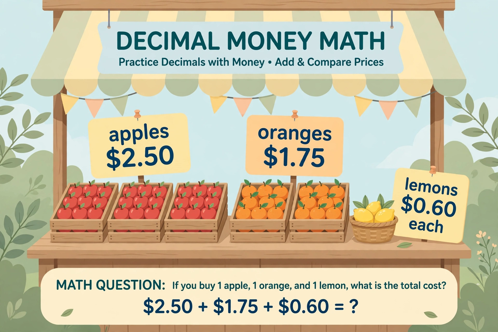

# Lesson 04 — Decimal Money and Measurement Applications

**My goal:** I can solve multistep decimal problems with money and
measurement, choosing the right operation for each step.

**Time:** about 40 minutes (5 readiness · 12 teaching · 8 guided ·
12 independent · 3 exit).

**Materials:** the market-stall illustration below, play money, a ruler
or measuring tape if available.

**Standards:** 5.NBT.B.7; 5.OA.A.1 · **Unit objectives:** UO4, UO5

## Readiness check (5 minutes)

1. What does the word *per* mean in "$2.50 per apple"?
2. You buy 2 items costing $3.25 each and pay with $10. What two steps do
   you need to find your change?
3. Estimate: 3 × $2.50 is about how much?

## The market stall (generated illustration activity)

Look carefully at this market stall. Read every price sign before you
compute anything.

*Caption: A market stall. Apples cost $2.50 each, oranges $1.75 each, and
lemons $0.60 each. The banner asks: if you buy 1 apple, 1 orange, and
1 lemon, what is the total cost?*

**Text-only alternative (same information):** The stall sells apples for
$2.50 each, oranges for $1.75 each, and lemons for $0.60 each. There are
three crates of apples and two crates of oranges on the table and a basket
of lemons. Use these prices for every question in this lesson; do not
guess other prices.

### Worked example 1 — the banner question

**1 apple + 1 orange + 1 lemon**

$2.50 + $1.75 + $0.60. Line up by place value:

- Hundredths: 0 + 5 + 0 = 5.
- Tenths: 5 + 7 + 6 = 18 tenths = 1 one + 8 tenths. Write 8, carry 1.
- Ones: 2 + 1 + 0 + the carried 1 = 4.

**Total: $4.85.** Estimation check: about $2.50 + $1.75 + $0.50 ≈ $4.75,
and $4.85 is close — reasonable.

### Worked example 2 — two steps: total, then change

**Maya buys 3 apples and pays with $10. How much change does she get?**

- Step 1 (multiply): 3 × $2.50 = $7.50.
- Step 2 (subtract): $10.00 − $7.50 = $2.50.

**Change: $2.50.** Notice the answer equals the price of one apple —
that is a coincidence, not a rule. Always do both steps.

Writing it as one expression: $10.00 − (3 × $2.50) = $2.50. The
parentheses say "work out the apples first," which is why they matter
(5.OA.A.1).

## Guided practice (with hints)

Use the stall prices ($2.50 apples, $1.75 oranges, $0.60 lemons).

**G1.** What do 2 oranges cost? (Hint: 2 × $1.75.)

**G2.** What do 4 lemons cost? (Hint: 4 × $0.60 = 240 cents = $2.40.)

**G3.** What do 1 apple and 1 orange cost together? If you pay with $5,
what is your change? (Two steps.)

## Independent practice

Use the stall prices unless a question gives its own numbers.

**I1.** What do 3 lemons cost?

**I2.** What do 2 apples and 1 orange cost together?

**I3.** Amara has $10. She wants 2 apples, 2 oranges, and 3 lemons. Can
she afford them? Show the total and explain your answer in one sentence.

**I4. Measurement.** A ribbon is 4.75 m long. You add a 2.5 m piece, then
cut off 1.25 m. How long is the ribbon now? Show both steps.

## Application

Plan a fruit salad for 4 people: each person gets 1 apple, 1 orange, and
2 lemons. What is the total cost? Write an expression with parentheses
for the whole order, then compute it. (Hint: one person's fruit costs
$2.50 + $1.75 + 2 × $0.60. Then multiply by 4 — or add four times.)

## Exit check

1. 1 apple + 2 lemons = ? (Use the stall prices.)
2. You pay for that fruit with $5. What is your change?

## Supports, alternate modes, extensions

- **Support:** act out each purchase with play money before writing the
  computation.
- **Alternate mode:** point to the price signs in the illustration and
  dictate the steps; the adult writes the numbers.
- **Extension:** the stall offers "3 lemons for $1.50." Is that cheaper
  than $0.60 each? (3 × $0.60 = $1.80, so yes — by $0.30.) When is a
  "deal" not actually cheaper? Give an example.

## Teacher note

The most common failure here is not arithmetic but step-skipping: learners
answer the total when the question asked for change, or stop after step
one. Require the sentence "The question asks for ___" before any
computation. Guidance: [teacher-guide.md](../teacher-guide.md#s07-lesson-04).
Answers: [answer-key.md](../answer-key.md#lesson-04).
