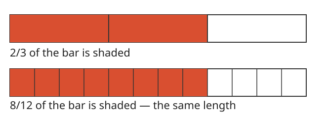

# Lesson 01 — Equivalent Fractions and Common Denominators

**Grade 5 · Unit 04, Lesson 01 · ~40 minutes · Objective UO1**

**Goal (in one sentence):** I can replace fractions with equivalent
fractions so that two fractions share a common denominator.

**Materials:** fraction strips or paper bars, the fraction-bars diagram
below, a multiplication list (2s through 12s).

**Readiness check (answer before the lesson):**

1. What is 2 × 4? What is 3 × 4?
2. Write a fraction equivalent to 1/2 with denominator 6.
3. List the first four multiples of 3 and of 4.

## Teaching

A fraction names a size: the denominator says how many equal parts the
whole is cut into, and the numerator says how many of those parts we have.
If we cut every part into smaller equal parts, the *number* of parts
changes but the *size* does not. That is why multiplying the numerator
and the denominator by the same number gives an equivalent fraction:

> 2/3 = (2 × 4)/(3 × 4) = 8/12.

We cannot add or subtract fractions whose pieces are different sizes —
thirds and fourths are different-sized pieces. So first we rename them
with a **common denominator**: a number that is a multiple of both
denominators. The smallest such number is the **least common denominator
(LCD)**. Any common multiple works, but the smallest keeps the numbers
small.

**The rule to remember:** the whole must stay the same. Both fractions
must describe parts of the *same-size* whole, or the comparison and the
sum are meaningless.

*Figure 1 — Two equal-length bars. The top bar shows 2/3; the bottom bar
shows 8/12. The shaded lengths match, so 2/3 = 8/12. Text alternative:
"A bar split into 3 equal parts has 2 parts shaded. A second bar of the
same length split into 12 equal parts has 8 parts shaded. The shaded
lengths match."*

### Worked Example 1 — Rename 2/3 and 5/4 with a common denominator

Denominators are 3 and 4. Multiples of 3: 3, 6, 9, **12**, 15 …
Multiples of 4: 4, 8, **12**, 16 … The least common multiple is 12.

- 2/3 = (2 × 4)/(3 × 4) = 8/12.
- 5/4 = (5 × 3)/(4 × 3) = 15/12.

So 2/3 + 5/4 = 8/12 + 15/12 = 23/12 = 1 11/12. (We will finish this
addition in Lesson 02; the renaming is the work of this lesson.)

### Worked Example 2 — Rename 1/2 and 1/3

Multiples of 2: 2, 4, **6** … Multiples of 3: 3, **6** … LCD = 6.

- 1/2 = (1 × 3)/(2 × 3) = 3/6.
- 1/3 = (1 × 2)/(3 × 2) = 2/6.

Check with bars: three sixths of a bar is half the bar, and two sixths
is one third of the bar. The renaming did not change either size.

## Guided practice

**G1.** Rename 3/4 with denominator 12. (Multiply top and bottom by 3.)

**G2.** Rename 2/5 and 1/2 with a common denominator. (Multiples of 5
and 2; LCD = 10.)

**G3. Error analysis.** Sam says 1/4 = 2/6 "because I added 1 to the top
and 1 to the bottom." Is he right? Explain, and give the correct
equivalent with denominator 8.

## Independent practice

**I1.** Write 5/6 with denominator 12.

**I2.** Rename 3/8 and 1/4 with a common denominator.

**I3.** Rename 2/3 and 3/4 with a common denominator.

**I4.** Rename 7/10 and 1/2 with a common denominator.

**I5.** Which is larger, 5/6 or 7/8? Rename both with denominator 24 and
explain.

**I6.** Explain in words why 2/3 and 4/6 are the same size even though
the pieces are different sizes. (Hint: what happens to each third when
you cut it in half?)

## Application

A cook has two same-size measuring jugs. One holds 5/6 of a litre of
juice and the other holds 2/3 of a litre. Rename both amounts with
denominator 6 so the cook can compare them on one scale. Which jug
holds more?

## Exit check

1. Write 1/3 with denominator 12.
2. Rename 1/4 and 2/3 with a common denominator.

## Supports and extensions

- **Support:** cut paper bars into thirds and twelfths and lay them side
  by side before writing any numbers.
- **Alternate response mode:** learners may point to the shaded parts
  and dictate the multiplication step to the adult.
- **Extension:** find *two* common denominators for 3/8 and 5/6 (24 and
  48), and explain why the least one is usually the most useful.

## Teacher note

- **Likely misconception:** adding the same number to numerator and
  denominator (G3) instead of multiplying. Fix: show it on a bar — 1/4
  of a bar is not 2/6 of the same bar.
- **Likely misconception:** renaming only one fraction. Both fractions
  must be renamed to the common denominator before any adding or
  subtracting.
- Answers: [answer-key.md](../answer-key.md#lesson-01).
