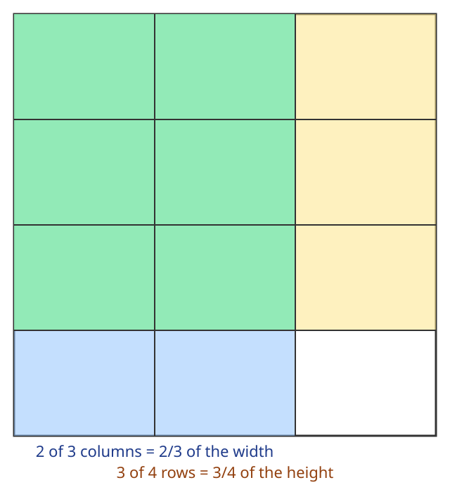
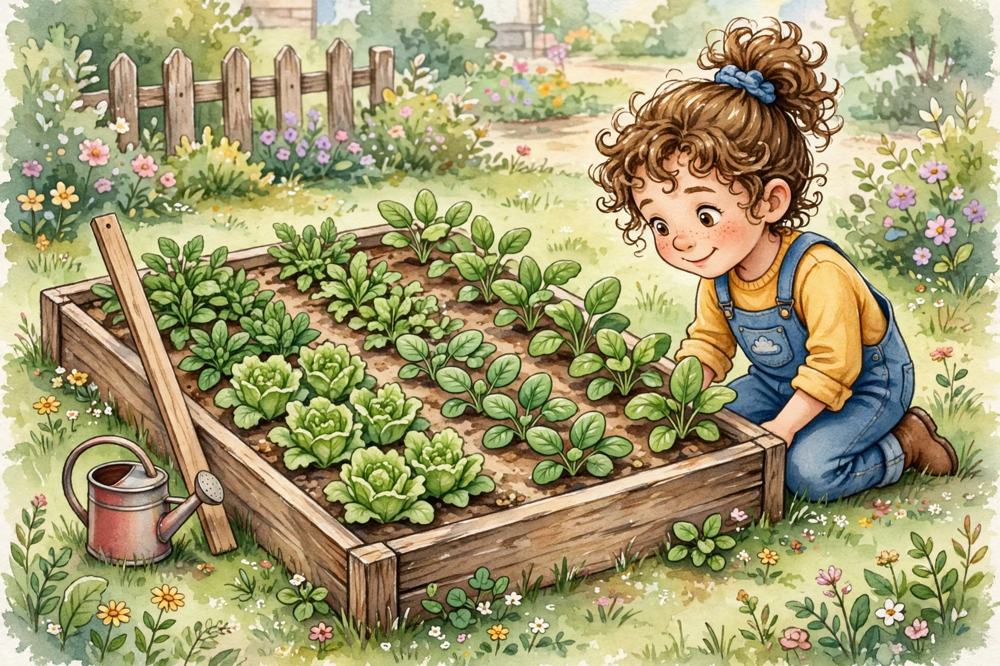

# Lesson 02 — A Fraction Times a Fraction: Area Models

**Grade 5 · Unit 05, Lesson 02 · ~40 minutes · Objectives UO1–UO2**

**Goal (in one sentence):** I can multiply two fractions with an area
model and find the area of a rectangle with fractional side lengths.

**Materials:** grid paper, the area-model diagram below, the garden
picture below, crayons (two colors).

**Readiness check (answer before the lesson):**

1. What is 2 × 3? What is 3 × 4?
2. Find (2/3) × 4.
3. What is the area of a rectangle that is 3 units long and 2 units
   wide? How do you know?

## Teaching

"A fraction of a fraction" is the heart of this lesson. (2/3) × (3/4)
means: take 2/3 **of** 3/4. An **area model** shows it. Start with a
unit square — one whole. Split the width into 3 equal columns and
shade 2 of them (that is 2/3 of the width). Split the height into 4
equal rows and shade 3 of them (that is 3/4 of the height). The
rectangle where the two shadings overlap is the product.

*Figure 1 — A unit square split into 3 columns and 4 rows (12 small
rectangles). Two columns are shaded blue (2/3 of the width) and three
rows are shaded amber (3/4 of the height). The green overlap is 6 of
the 12 small rectangles, so (2/3) × (3/4) = 6/12 = 1/2. Text
alternative: "A square is divided into 3 equal columns and 4 equal
rows, making 12 small equal rectangles. Shading 2 of the 3 columns and
3 of the 4 rows overlaps on 6 of the 12 small rectangles, so the
product is 6/12, which simplifies to 1/2."*

Count the small rectangles: 3 columns × 4 rows = 12 in the whole
square. The overlap covers 2 columns × 3 rows = 6 of them. So
(2/3) × (3/4) = 6/12 = 1/2. That is the multiply-across rule:

> (a/b) × (c/d) = (a × c)/(b × d)

The numerator counts the overlapped pieces; the denominator counts
all the pieces in the whole square. **You do not need a common
denominator to multiply fractions** — the area model builds the new
denominator (b × d) for you.

The same model finds the **area of a rectangle with fractional side
lengths**: tile it with unit squares of the matching unit-fraction
side. A rectangle 4/5 m long and 2/3 m wide has area
(4/5) × (2/3) = 8/15 square meters — 8 of the 15 unit-fraction tiles
cover it.

### Worked Example 1 — (1/2) × (3/5) = 3/10

Split a unit square into 5 columns; shade 3 (3/5 of the width).
Split it into 2 rows; shade 1 (1/2 of the height). The overlap is
3 columns × 1 row = 3 small rectangles out of 5 × 2 = 10. So
(1/2) × (3/5) = 3/10.

Multiply across to check: (1 × 3)/(2 × 5) = 3/10. ✓

**Story context:** You have 3/5 of a pan of brownies left. You eat
1/2 of what is left. You ate (1/2) × (3/5) = 3/10 of a whole pan.

### Worked Example 2 — (2/3) × (3/4) = 1/2

From Figure 1: the overlap is 6 of 12 small rectangles.

(2/3) × (3/4) = (2 × 3)/(3 × 4) = 6/12 = 1/2.

**Simplifying early (cancelling):** before multiplying, divide out a
factor that appears in a numerator and a denominator. Here the 3 in
the numerator of 3/4 and the 3 in the denominator of 2/3 cancel:
(2/3) × (3/4) = (2/1) × (1/4) = 2/4 = 1/2. Same answer, smaller
numbers. Cancelling is a shortcut, not a new rule — it only works
because 3/3 = 1.

## Garden activity (uses the generated picture)

*Figure 2 — A child kneels beside a rectangular raised garden bed.
The picture is a story prompt, not a measurement: the bed's side
lengths are given in the activity below, and learners must not count
plants in the picture to do the arithmetic. Text alternative: "A
child kneels beside a rectangular garden bed with leafy green plants
in rows, a wooden measuring stick leaning on the bed, and a watering
can nearby. The bed in the story is 4/5 meter long and 2/3 meter
wide."*

**The bed in the story** is 4/5 meter long and 2/3 meter wide.

1. Draw the bed as a rectangle. Split the length into 5 equal parts
   and shade 4; split the width into 3 equal parts and shade 2.
2. How many small rectangles tile the whole bed? (5 × 3 = 15.)
3. How many are in the shaded overlap? (4 × 2 = 8.) So the area is
   8/15 square meters.
4. Check with the rule: (4/5) × (2/3) = 8/15. ✓

## Guided practice

**G1.** Draw an area model for (1/3) × (1/4). How many small
rectangles are in the whole square? How many overlap?

**G2.** Find (3/5) × (2/3). Simplify. (Try cancelling the 3s first.)

**G3. Error analysis.** Ana says (1/2) × (2/3) = 2/5 "because I
added the denominators: 2 + 3 = 5." Is she right? Explain, and give
the correct answer with an area-model reason.

## Independent practice

**I1.** (2/5) × (1/2) =

**I2.** (3/4) × (2/5) = — simplify completely.

**I3.** (5/6) × (3/10) = — cancel before multiplying if you can.

**I4.** Find the area of a rectangle 3/4 meter long and 5/6 meter
wide. Show the tiling count (how many unit-fraction tiles, and how
many are covered).

**I5.** (4/7) × (7/9) =

**I6.** Explain in words why (2/3) × (3/4) is *less* than 2/3 and
also less than 3/4. (Hint: you took a fraction *of* each factor.)

## Application

A garden plot is 3 1/2 feet long and 2 feet wide. (You will multiply
mixed numbers formally in Lesson 04 — for now, use what you know:
3 1/2 = 7/2, and a whole number is a fraction over 1.) What is the
area of the plot? Show the multiplication and simplify.

## Exit check

1. Find (1/4) × (2/3). Simplify.
2. A rectangle is 2/5 meter long and 3/4 meter wide. What is its area?

## Supports and extensions

- **Support:** build the area model with grid paper and two crayon
  colors before writing any numbers; count the overlapped cells.
- **Alternate response mode:** learners may point to the overlap and
  dictate the numerator and denominator to the adult.
- **Extension:** find (2/3) × (3/4) × (1/2) in two ways — multiply
  the first two, then the third; and draw the three-way model — and
  explain why both ways agree.

## Teacher note

- **Likely misconception:** adding denominators (G3) or needing a
  common denominator. Fix: count the tiles — the denominator of the
  product is the *total* number of tiles (b × d), not a sum.
- **Likely misconception:** cancelling across an addition sign, or
  cancelling two numerators. Cancelling only divides a numerator and a
  denominator by the same factor.
- Answers: [answer-key.md](../answer-key.md#lesson-02).
