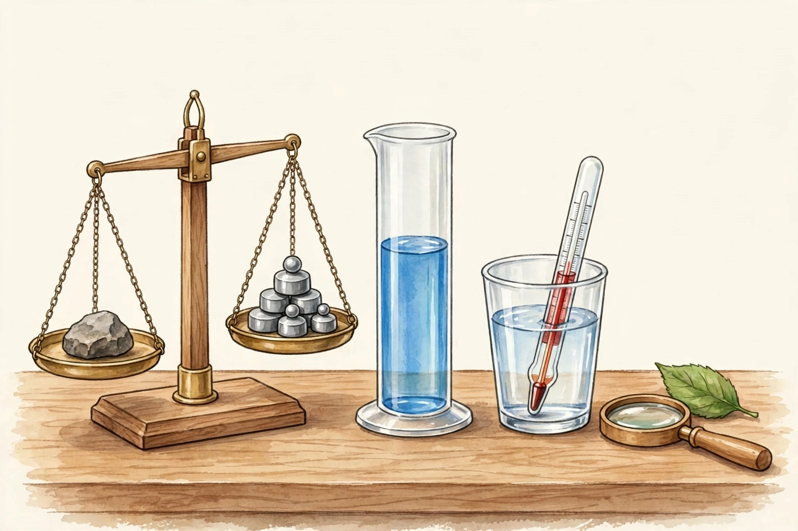

# Lesson 02 — Measuring Like a Scientist

**Unit:** 01 — Models, Measurement, and Controlled Investigations · **Grade 5**
**Time:** ~40 minutes · **Session:** 4 of 16

## Goal

You will measure **length, mass, volume, and temperature** with standard
tools, and **convert** measurements within the metric system.

## Materials

- Ruler or tape measure (metric), balance or kitchen scale (grams), plastic
  graduated cylinder or measuring cup (mL), non-mercury thermometer (°C),
  hand lens
- Notebook, pencil, the unit's two-column conversion table template
- The generated image [`measurement-station.png`](../assets/measurement-station.png)

## Readiness check (3 minutes)

Look at the image [`measurement-station.png`](../assets/measurement-station.png)
(shown below). Point to each tool and say what you think it measures.

*Caption: A measurement station. This is an AI-generated illustration of the
four tools you will use this week — not a photograph of a real lab.*

*Text-only alternative: The picture shows four tools on a table. (1) A
two-pan balance: a rock sits on the left pan and small metal weights sit on
the right pan. (2) A tall clear graduated cylinder about half full of blue
water. (3) A thermometer standing in a clear cup of water. (4) A round hand
lens next to a green leaf.*

**Tool-detective questions** (answer orally or in writing):

1. Which tool would you use to find the **mass** of the rock? *(the balance)*
2. Which tool would you use to measure **100 mL of water**? *(the graduated
   cylinder)*
3. Which tool would you use to check the **temperature** of the water in the
   cup? *(the thermometer)*
4. Which tool helps you look **closely** at the leaf's edge? *(the hand lens)*

## Teaching

### Part A — The right tool, the right unit

Every measurement answers one of four questions, and each question has its
own tool and its own metric units:

| Question | Tool | Metric units |
|---|---|---|
| How long? | ruler, tape measure, meter stick | millimeter (mm), centimeter (cm), meter (m), kilometer (km) |
| How heavy? (mass) | balance, scale | gram (g), kilogram (kg) |
| How much space does it fill? (volume) | graduated cylinder, measuring cup | milliliter (mL), liter (L) |
| How warm? (temperature) | thermometer | degree Celsius (°C) |

Two tool rules scientists never skip:

1. **Zero the tool.** Line the object's end up with the zero mark — not the
   end of the ruler. On a balance, check that it reads zero before you add
   anything.
2. **Estimate first, then measure.** An estimate is a careful guess. If your
   measurement is wildly different from your estimate, check the tool before
   trusting the number.

**Worked example 1 — zeroing matters.**
Sam measures a pencil starting at the 1-cm mark instead of zero and reads
"14 cm." *Thinking:* the pencil didn't start at zero, so the reading is 1 cm
too big. The real length is 13 cm. Starting at zero is not fussy — it is the
difference between a right answer and a wrong one.

**Worked example 2 — estimate catches errors.**
Priya estimates her shoe is about 24 cm long. She measures and reads 240 mm.
*Thinking:* 240 mm — is that close to 24 cm? 10 mm = 1 cm, so 240 mm =
24 cm. Yes! The estimate and the measurement agree, so she trusts the
number. If she had read 2,400 mm, the estimate would have warned her
something went wrong.

### Part B — The metric system: converting

The metric system is built on **tens, hundreds, and thousands** — that is what
makes converting a multiplication or division instead of a guessing game.

- Length: 10 mm = 1 cm · 100 cm = 1 m · 1,000 m = 1 km
- Mass: 1,000 g = 1 kg
- Volume: 1,000 mL = 1 L

To convert, ask: *am I going to a smaller unit (more of them — multiply) or
a bigger unit (fewer of them — divide)?*

**Worked example 3 — small to big (divide).**
Convert 250 cm to meters. *Thinking:* meters are bigger than centimeters
(100 cm = 1 m), so there will be *fewer* meters — divide by 100.
250 ÷ 100 = 2.5 m. Check: 2.5 m × 100 = 250 cm. ✓

**Worked example 4 — big to small (multiply).**
Convert 2.5 L to milliliters. *Thinking:* milliliters are smaller
(1,000 mL = 1 L), so there will be *more* milliliters — multiply by 1,000.
2.5 × 1,000 = 2,500 mL. Check: 2,500 ÷ 1,000 = 2.5 L. ✓

**Worked example 5 — two-column conversion table.**
Scientists keep a running record of equivalents. Fill left to right, then
check each row backward:

| cm | m |
|---|---|
| 5 | 0.05 |
| 137 | 1.37 |
| 40 | 0.40 |

*Thinking for 137 cm:* meters are bigger → divide by 100 → 1.37 m. Backward
check: 1.37 × 100 = 137. ✓

## Guided practice (with the adult)

1. **Station tour.** At each real tool, the adult demonstrates and you try:
   - Balance: zero it, weigh the rock (or another object) to the nearest
     gram. Record: estimate → measurement.
   - Graduated cylinder: pour water to exactly the 100-mL line (read at eye
     level, at the bottom of the curve). The adult confirms.
   - Thermometer: the adult reads it with you to the nearest °C; record the
     room-temperature water reading.
   - Hand lens: examine the leaf's edge; draw what you see, bigger than
     life, and label two observations.
2. Convert together, saying the reasoning aloud:
   a. 80 mm → cm b. 3 m → cm c. 1,500 g → kg d. 0.5 L → mL

## Independent practice

Write or dictate your answers (8 tasks).

1. Which tool and unit: the length of your notebook? *(ruler, cm)*
2. Which tool and unit: the mass of an apple? *(balance/scale, g)*
3. Which tool and unit: the volume of juice in a cup? *(graduated cylinder/measuring cup, mL)*
4. Which tool and unit: whether bath water is too hot? *(thermometer, °C)*
5. Convert: 45 mm = ____ cm. Show the division.
6. Convert: 6 km = ____ m. Show the multiplication.
7. Convert: 2,000 mL = ____ L. Then check backward.
8. Complete the two-column table and check each row backward:

   | g | kg |
   |---|---|
   | 500 | |
   | | 2 |
   | 1,250 | |

## Application — the measuring ritual

Choose three objects in the room. For each: **estimate, then measure** (length
in cm, mass in g, or volume in mL — your choice per object), and record
`estimate → measurement` in a table. Circle any measurement that disagreed
with its estimate by a lot, and write one sentence about what you will
double-check. This estimate-first ritual is now your habit for the whole
year.

## Exit check

1. A classmate measured a book starting at the 2-cm mark and read 27 cm. What
   is the book's real length? Explain.
2. Convert 350 cm to meters. Show your thinking.

## Supports

- **Reading/language access:** the conversion facts live on a wall card
  (10 mm = 1 cm; 100 cm = 1 m; 1,000 m = 1 km; 1,000 g = 1 kg;
  1,000 mL = 1 L); the adult reads tasks aloud on request.
- **Alternate response mode:** point to the tool in the image instead of
  naming it; dictate conversions while the adult writes.
- **Extension:** convert 1.5 km to cm in two steps (km → m → cm); explain why
  multiplying by 100 twice is the same as multiplying by 10,000.

## Teacher note

**Likely misconceptions:** (1) Starting measurement at the ruler's end
instead of zero — check every reading this week. (2) Mixing up "multiply vs.
divide" — anchor to *smaller unit = more of them = multiply*. (3) Reading a
graduated cylinder from above instead of at eye level. **Safety:** the adult
handles the thermometer; nothing near the mouth; water spills wiped
immediately. **Answer key:**
[answer-key.md](../answer-key.md#lesson-02). **Next:** Lesson 03 (fair
tests).
