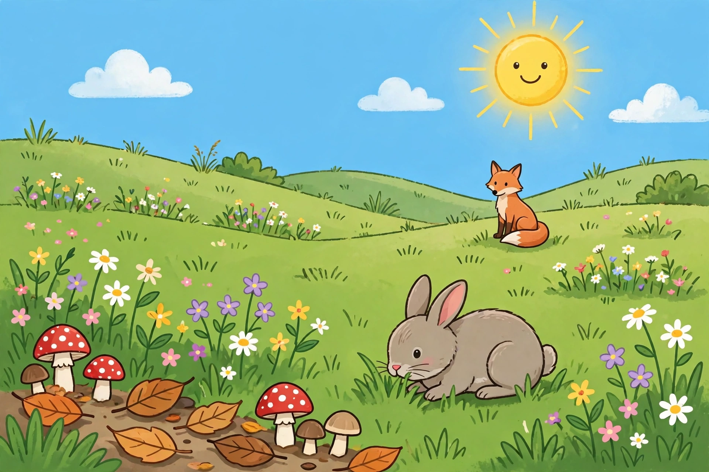

# Lesson 05 — Energy Flows, Matter Cycles (Image Activity)

**Unit 04 · Session 9 (Week 17) · ~40 minutes · Investigation lesson**

## Goal

You will use a generated meadow illustration to name the producers, consumers, and decomposers in an ecosystem, trace one energy path from the sun, trace one matter loop back to a plant, and state the flow-versus-cycle contrast in your own words.

## Materials

The image below (also saved as `../assets/meadow-ecosystem.png`), science notebook, pencil, colored pencils if available.

## The image

*Caption: AI-generated illustration of a meadow ecosystem for classroom use (generated 2026-10-31; see `../assets/README.md` for the generation record). The mushrooms and fallen leaves in the lower left show the decomposer corner of the meadow; the rabbit and fox show two consumer steps; the grass and flowers are the producers; the sun is the energy source. This is an illustration, not a photograph and not a record of a real meadow.*

**Text-only alternative (use this instead of the picture if you cannot see it):** A sunny meadow. In the sky is a bright sun. On the ground are green grass and many wildflowers (white, yellow, pink, and purple). In the foreground a gray rabbit eats grass. On a hill in the background sits an orange fox. In the lower left, on a patch of bare brown soil, are red-and-white mushrooms and several fallen brown leaves. Everything you need to answer the questions below is in this paragraph: sun, grass and flowers, rabbit, fox, mushrooms, fallen leaves, soil.

## Readiness check (3 minutes)

Look at the image (or read the text alternative). Point to or name one producer, one consumer, and one decomposer before you read on. If you are unsure about the mushrooms, remember Lesson 04: fungi are decomposers, even though they look like plants.

## Teaching

### Part A — Sorting the meadow

Sort what you see into the three roles:

| Role | In the image | What it does |
|---|---|---|
| **Producers** | Grass, wildflowers | Make their own food-matter from air, water, and sunlight energy |
| **Consumers** | Rabbit (eats grass), fox (eats rabbits and other animals) | Get energy and matter by eating other living things |
| **Decomposers** | Mushrooms (fungi), and the tiny soil life under the fallen leaves | Break down dead plants and animals; return matter to soil, air, and water |

Two cautions about the picture. First, it is an **illustration**, not a photograph: the artist (an image generator) drew a friendly scene, and real meadows are messier. Second, the mushrooms in the picture are **not for eating** — never eat wild mushrooms. Their job in the lesson is to stand for decomposers, not to suggest a snack.

### Part B — Two tracings from one picture

**Worked example 1 — the energy tracing (a flow).** Start at the sun: sun → grass → rabbit → fox. The arrows point toward the eater. The energy in the fox's food was once sunlight energy captured by the grass. Notice the direction: energy enters from the sun, passes from step to step, and is used up for motion, warmth, growth, and repair along the way. It does **not** flow back to the sun. If you drew an arrow from the fox back to the sun, that would be the flow-versus-cycle error — energy flows one way.

**Worked example 2 — the matter tracing (a cycle).** Start at the fallen leaves: fallen leaves → decomposers (mushrooms and soil life) → soil, air, and water → grass and flowers → rabbit → fox → (when the fox dies) decomposers → soil, air, and water → grass again. The arrows form a **loop** that returns to a plant. That return is the difference: matter cycles, energy flows. A common error is to stop the matter tracing at "soil." Soil is a way station, not the end — plants pull matter back out of soil, air, and water, so a complete matter model always comes back to a producer.

## Guided practice

Work with the adult, using the image or its text alternative.

**L5-G1.** List one producer, one herbivore, one carnivore (or omnivore), and one decomposer visible in the image.
**L5-G2.** Draw the energy chain sun → grass → rabbit → fox with arrows pointing toward each eater. Write one sentence tracing the fox's food energy back to the sun.
**L5-G3.** Draw the matter loop starting from the fallen leaves and returning to the grass. Check that your arrows form a closed loop.

## Independent practice

**L5-I1.** The fox in the image is sitting, not hunting. Does a food chain need a hunting scene to be true? Explain: a chain describes what an animal *eats*, not a single moment, and the fox's body was built from the energy and matter of animals like the rabbit.
**L5-I2.** Suppose all the mushrooms and soil decomposers vanished from this meadow overnight, but the sun, grass, rabbit, and fox stayed. Predict two things that would happen over the following year, using the matter loop (dead leaves and dead animals pile up; soil stops receiving returned matter; new grass eventually runs short of material).
**L5-I3 (error analysis).** A learner labels the mushrooms as producers "because they grow in the ground like plants." Explain the error: mushrooms do not make their own food from sunlight — they get energy and matter by breaking down dead material, which is the decomposer role.

## Application

Choose one living thing from the image and write its "life story in two tracings": (1) one sentence tracing its energy back to the sun, and (2) one sentence tracing its matter forward after it dies, back to a producer. Bring this to the project sessions — it is the draft of your project explanation.

## Exit check

Answer in one or two sentences: *In the meadow picture, what is the difference between the energy story and the matter story?*

## Supports and extensions

- **Reading/language access:** the text-only alternative above carries every fact the questions need; the learner may answer orally or by pointing to items in the picture.
- **Alternate response mode:** the learner may dictate the tracings while the adult writes them, or build them with picture cards arranged in a line (energy) and a circle (matter).
- **Extension:** add a second energy chain to the meadow (for example, sun → flowers → bee → bird) and show how the two chains share the producers — the start of a food web.

## Teacher note

Likely misconceptions: mushrooms as producers, energy drawn as a loop, and matter drawn as a line ending at soil. All three are addressed in the worked examples. The image's friendly style is deliberate for grade 5; the teacher guide notes its limits (no scale, no real species identification, no hunting behavior shown). Answer-key reference: Lesson 05 section of `../answer-key.md`.
