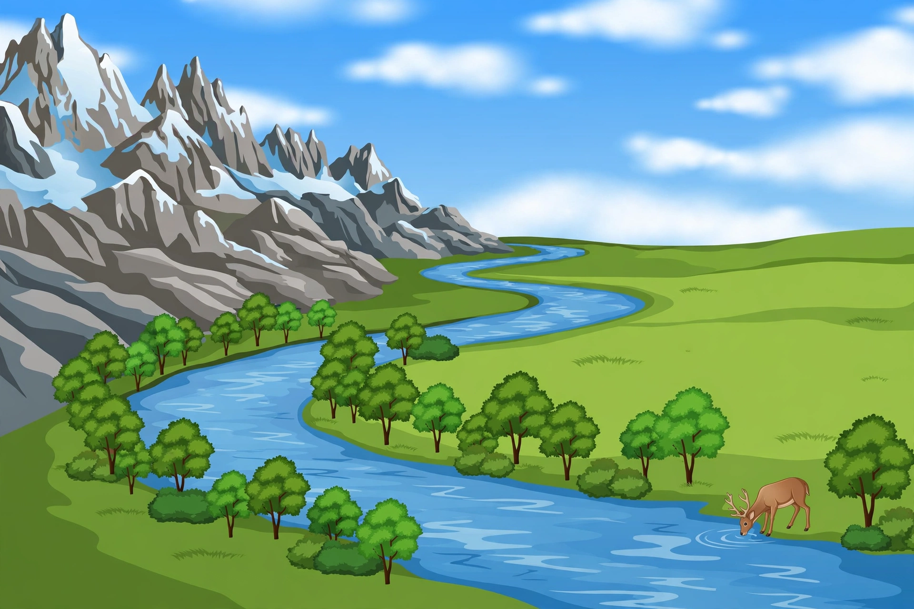

# Lesson 05 — Fresh Water Is Rare

**Unit 05 · Session 9 (Week 21) · ~40 minutes · Investigation lesson**

## Goal

You will split the 3 fresh parts of Earth's water into frozen, underground, and surface water — about 69, 30, and 1 out of 100 fresh parts — graph them, and use the generated river-valley image to name four sphere interactions and explain why most fresh water is hard for people to use.

## Materials

Science notebook, pencil, 100 counters, three labeled jars ("frozen," "underground," "lakes and rivers"), the generated image `../assets/river-valley-spheres.png` (or its text-only alternative below), the deterministic bar chart `../assets/water-distribution-bars.svg`.

## Readiness check (3 minutes)

Yesterday you found that only 3 parts out of 100 of Earth's water are fresh. Today's question: *of those 3 fresh parts, how many do you think are frozen in glaciers, how many are underground, and how many are in lakes and rivers you can see?* Say your guess. The answer surprises almost everyone — the lakes and rivers hold the smallest share of all.

## Teaching

### Part A — Splitting the fresh water

Take the 3 fresh cups from Lesson 04 and look inside them. The USGS table splits **fresh water** into these shares, rounded to whole parts out of 100 fresh parts:

- **About 69 parts out of 100 are frozen** in glaciers and polar ice caps (the exact USGS figure is 68.7 percent of fresh water).
- **About 30 parts out of 100 are underground** as ground water (the exact USGS figure is 30.1 percent of fresh water).
- **About 1 part out of 100 is in lakes, rivers, and other surface water** (the exact USGS figures add up to about 1.2 percent: lakes 0.26, rivers 0.006, and small shares in swamps, soil moisture, and ground ice).
- Check: 69 + 30 + 1 = 100. The three parts add up to all the fresh water — always check that first.

Now put the two lessons together. Out of **100 parts of all Earth's water**, the fresh-water slice is only 3 parts — and out of those 3 parts, about 2 parts are frozen, about 1 part is underground, and only a few drops are in lakes and rivers. The USGS says it plainly: *"Most fresh water is in glaciers or underground; only a tiny fraction is in streams, lakes, wetlands, and the atmosphere."* The atmosphere's share is left off your graph on purpose — the framework's boundary excludes it.

**Worked example 1 — the 100 fresh cups.** A learner counts 100 counters for fresh water only: 69 into "frozen," 30 into "underground," 1 into "lakes and rivers." She says, "Most fresh water is frozen." Her evidence: 69 is more than 30 and more than 1 — more than two-thirds of all fresh water is ice. A common error is to read the 69 as "69 parts of all Earth's water." It is not — it is 69 parts **of the fresh water**, which is itself only 3 parts of all water. Say "of the fresh water" every time, or the number means the wrong thing.

**Worked example 2 — why fresh water is hard to use.** Most fresh water is frozen at the poles or locked in glaciers far from where most people live, and much of the rest is underground, where you must drill a well to reach it. The lakes and rivers people drink from hold only about 1 part in 100 of the fresh water. So the water people use most is the water there is least of. That is the unit's one-sentence explanation — you will write your own version in the exit check.

### Part B — Reading the river valley (image activity)

Look at the generated image below — a river valley on a sunny day. It shows: snow-capped rocky mountains on the left, a winding river through green grassland, leafy trees along the riverbank, white clouds in a blue sky, and a deer drinking at the river's edge. There is no text in the image and no sun drawn in the sky.

*Caption: A river valley. Find the four spheres — land, water, air, and living things — and name four ways two of them interact. (AI-generated illustration for this lesson; see `assets/README.md`.)*

**Text-only alternative (the same information, in words):** *A wide valley. On the left, tall grey rocky mountains with white snow on their tops. A blue river winds from the far mountains through green grassland to the front of the picture. Green leafy trees grow along both banks of the river. White clouds drift in a blue sky. At the lower right, a brown deer with antlers stands at the river's edge with its head down, drinking.*

Name **four sphere interactions** you can see in the image, two spheres at a time:

1. **Hydrosphere → geosphere:** the river winds through the valley, carrying soil and shaping the land.
2. **Hydrosphere → biosphere:** the deer drinks river water; the trees grow beside the river because the soil there is wet.
3. **Geosphere → atmosphere:** the mountains push air upward, where it cools and makes the clouds you see.
4. **Atmosphere → biosphere:** the clouds and the mild air give the trees and grass the rain and warmth they need to grow.

Then revise one model: pick interaction 1 and draw it as a two-sphere model with arrows and one sentence — the same way you did in Lesson 01, but now with real evidence from a picture. Models get better when new evidence arrives; that is the Unit 02 habit, used again here.

## Guided practice

Work with the adult.

**L5-G1.** Split 100 fresh-water counters into frozen (69), underground (30), and lakes/rivers (1). Write the claim "Most fresh water is frozen" with the numbers that support it.
**L5-G2.** Look at the river-valley image (or read the text alternative). Name two sphere interactions that are *not* the river-shapes-the-land one, with the sphere pair for each.
**L5-G3.** A learner says, "69 parts of Earth's water are frozen." Correct the sentence so the number means the right thing, and explain what was wrong.

## Independent practice

**L5-I1.** Draw the fresh-water bar graph: three bars — Frozen (69), Underground (30), Lakes and rivers (1). Label every bar with its number and write the source (USGS, rounded) under the graph.
**L5-I2.** Use the image or its text alternative: name one more sphere interaction (a fifth one) and write it as a two-sphere model sentence. Then say one way your model could be wrong — what evidence would change it?
**L5-I3 (error analysis).** A learner says, "Lakes and rivers hold most of the fresh water, because that is where we get our drinking water." Explain the mistake with the 69 / 30 / 1 numbers, and say why the mistake is easy to make.

## Application

Tonight, look at the deterministic bar chart `../assets/water-distribution-bars.svg` with the adult. It shows both graphs from this unit — all water (97 / 3) and fresh water (69 / 30 / 1). Pick the bar that surprises you most and write two sentences: what the bar says, and why it surprises you.

## Exit check

Answer in one or two sentences: *Out of 100 parts of fresh water, how many parts are frozen, underground, and in lakes and rivers — and in one sentence, why is most fresh water hard for people to use?*

## Supports and extensions

- **Reading/language access:** the adult reads the text-only alternative aloud; the learner may answer by pointing to parts of the image instead of writing.
- **Alternate response mode:** the learner may build the fresh-water graph with stacked counters instead of drawing bars, or dictate the image interactions while the adult writes them.
- **Extension:** research one real place that depends on glacier water or on a well (ground water) and write a two-sphere model for where its water comes from and what would change if that source shrank.

## Teacher note

Likely misconceptions: "69 parts of all water are frozen" (it is 69 parts *of the fresh water*) and "lakes and rivers hold most fresh water" (they hold about 1 part in 100 of it). The image has no sun drawn — do not let the learner claim the sun is in the picture; the sun's role as the energy behind weather belongs to Unit 06. If the image is unavailable, the text-only alternative carries the whole activity — never require the image. See the teacher guide for reteach steps. Answer-key reference: Lesson 05 section of `answer-key.md`.
