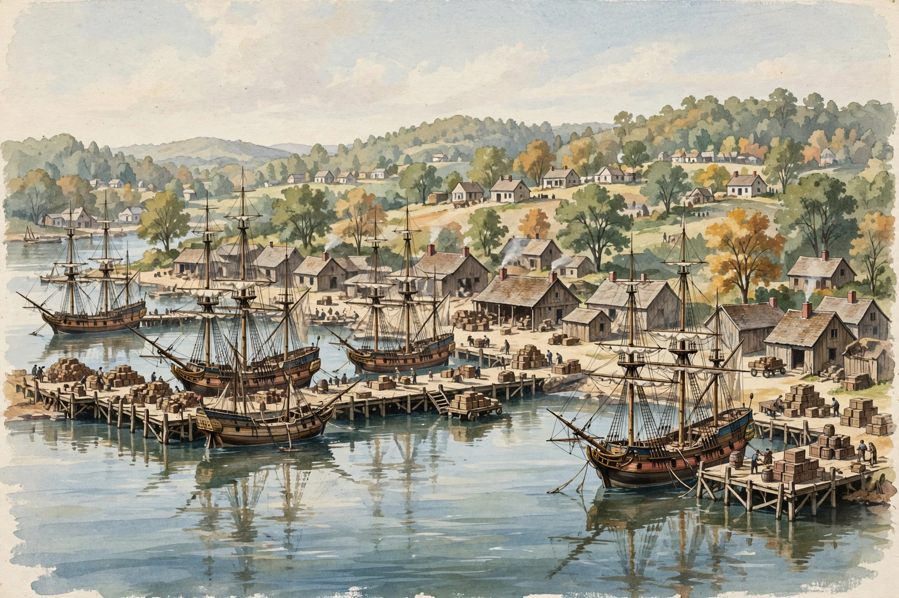

# Lesson 05 — Colonial Port Towns: Reading the Trade Map

**Unit:** [U02 — Colonial Societies: Labor, Trade, and Diverse Perspectives](../README.md) · **Week 8 (S3)**
**Time:** one ~40-minute session (single-session investigation lesson).
**Student goal:** I can observe a harbor scene for evidence about colonial
trade, trace the simplified triangular-trade flow, and explain who
benefited and who was harmed.

**Materials:** the generated illustration
`assets/colonial-port-scene.png` (below); the deterministic flow diagram
`assets/triangular-trade-map.svg`; notebook.

## Readiness check (opening, ~5 minutes)

1. Name the three circles of colonial trade from Lesson 02. (Within a
   region; between colonies; across the Atlantic.)
2. What is a **port**? (A harbor town where ships load and unload goods.)
3. Predict: what would you expect to see — and hear, and smell — standing
   on a colonial dock in 1750? (Answers will vary; compare with the
   illustration below.)

## Part 1: Observe the harbor (15 minutes)

Study this illustration. It is an **AI illustration** — a reconstruction
made for this lesson, not a photograph and not a primary source. It can
suggest what a colonial port looked like, but it cannot prove anything
about a real place.

*Caption: AI illustration of a busy colonial American harbor around 1750 —
tall-masted sailing ships at wooden docks, workers loading barrels and
crates, warehouses and a small town on shore. Generated 2026-10-18 for
this lesson's observation activity; a reconstruction, not a primary
source.*

**Text-only alternative** (same information, for learners not using the
image): *A watercolor-style scene of a colonial harbor: four or five
tall-masted wooden sailing ships tied at long wooden docks; small figures
of workers carrying and stacking barrels and crates on the docks; simple
wooden warehouses with smoking chimneys behind the docks; a cluster of
small houses and green trees on the hillside above; calm water reflecting
the ships.*

**Observation task — see, infer, question.** In your notebook make three
columns:

| I see… (observable detail) | This suggests… (inference) | I still wonder… (question) |
|---|---|---|
| *Example: barrels and crates stacked on every dock* | *Example: this port handles a large volume of goods — trade is its business* | *Example: what is inside the barrels?* |

Find **three** observable details of your own (ships, workers, buildings,
the town on the hill — what do they suggest about who works here and what
the town is for?). Then answer: **what can this picture NOT tell us?**
(Example answers: who loaded the barrels — free, indentured, or enslaved
workers; where the ships are going; what year it is; whether the workers
were paid. An illustration shows a scene; it does not show a system.)

## Part 2: Trace the triangle (15 minutes)

Now study the flow diagram — a simplified map of how goods and people
moved between three points of the Atlantic world:

*Caption: Simplified triangular-trade flow, 1600s–1700s (deterministic
diagram). Historians use "triangular trade" for a common route pattern —
not every voyage sailed the full triangle.*

**Trace-one-good task.** Pick one good and trace it around the triangle
in 4 numbered steps, naming who handled it at each step:

- **Rum:** distilled in New England → traded in West Africa → …
- **Sugar:** grown in the Caribbean with enslaved labor → shipped to New
  England → made into rum → …
- **Tobacco:** grown in Virginia with enslaved labor → shipped to Britain
  → …

Then answer the unit's hardest question in two sentences: **who benefited
from this triangle, and who was harmed?** (Merchants, planters, and
ship owners benefited through profit; enslaved Africans were harmed —
captured, transported by force, and worked without pay or freedom. The
triangle's profits depended on their suffering. D2.Eco.1.3-5)

## Exit check (closing, ~5 minutes)

1. Name two things the harbor illustration suggests about colonial trade
   and one thing it cannot tell us.
2. In your own words, what does "triangular trade" describe?
3. Why do historians call it a *simplified pattern* rather than a rule
   every ship followed?

## Supports and extensions

- **Reading access:** the adult reads the "see / infer / question"
  column headers aloud and models one full row before the learner
  attempts their own.
- **Alternate response mode:** the trace-one-good task may be drawn as a
  three-stop loop with arrows and labeled goods, with the
  benefited/harmed sentences dictated to the adult.
- **Extension:** compare the triangular-trade diagram to Lesson 02's
  tobacco production chain. In a paragraph, explain how the two diagrams
  show the same system at different scales — one voyage vs. one product.

## Teacher note

- **Image honesty:** reinforce that the illustration is a reconstruction.
  If the learner treats it as evidence ("this proves ports looked like
  this"), redirect: it *suggests* based on what we know; proof comes
  from primary sources.
- **Likely misconception:** "The triangle was a law or a plan." It was
  neither — it was a profitable pattern that emerged from many separate
  decisions. The diagram's caption says this; make sure it lands.
- **Sensitive-content guidance:** the "who was harmed" answer must name
  enslaved people plainly (as the lesson does). Do not soften it into
  "some people had a harder time."
- **Answer-key reference:** [answer key](../answer-key.md) — Lesson 05.
