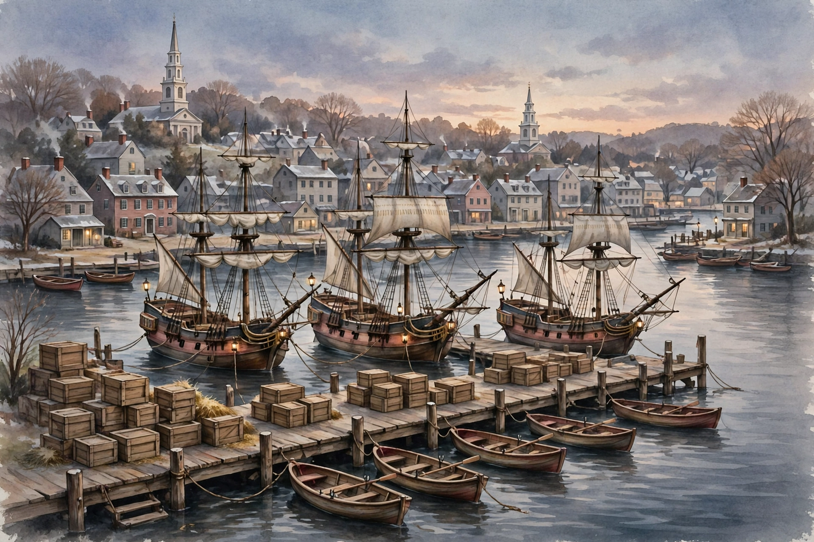

# Lesson 05 — Harbor Scene Investigation: What a Picture Can and Cannot Prove

**Goal:** I can observe an illustration carefully, list what it shows, and
explain what it cannot prove because it is a modern reconstruction, not
evidence from 1773.

**Time:** One ~40-minute session (Week 12, S3). **Materials:** the generated
[harbor illustration](../assets/boston-harbor-1773.png), the
[timeline diagram](../assets/road-to-revolution-timeline.svg).

**Readiness check:** "What is the difference between a picture made today
about 1773 and a document written in 1773?" (One is a modern imagining; the
other is a primary source.) If this is unclear, re-teach Lesson 03's five
questions in one minute each.

## Teaching

Look at the illustration first, before reading anything about it:

*Caption (read aloud):* "AI illustration — a modern artist's imagining of
Boston Harbor in December 1773. It is not a photograph and not evidence from
1773. The three ships are not labeled with names, and the crates in the
picture are not a count of the 342 chests destroyed in the Boston Tea Party."

This lesson's skill is *observation with restraint*. A good investigator
says what she sees, and then stops where the seeing stops.

### Worked example 1 — What the picture shows

*Observation:* "Three tall sailing ships are moored at a wooden wharf.
Rowboats float on calm water. Wooden crates are stacked on the dock. Behind
the harbor stands a town of small houses with two church steeples."

*Why this is good:* Every word describes something visible. Nothing is
guessed: no ship is named, no person is identified, no action is claimed.
If you cannot point to it in the picture, do not write it in the
observation column.

### Worked example 2 — What the picture cannot prove

*Claim a careless investigator might make:* "This picture proves the three
ships are the *Dartmouth*, *Eleanor*, and *Beaver*, and that 342 chests
were on the dock."

*Why it fails:* The ships carry no names and no flags that identify them;
counting crates in a painting cannot give 342, because a painter chooses
how many crates to paint. The *facts* — three named ships, 342 chests —
come from written records (see Lesson 02 and the Resource Pack), not from
this picture. The picture can help you *imagine* a harbor; it cannot
*testify* about one. That is the difference between an illustration and a
source, and historians guard it carefully: a reconstruction that is treated
as evidence will quietly invent facts.

**Teacher note — common misconceptions:** (1) "Old-looking means old."
This picture was made in 2026 in a storybook style; style is not age.
(2) "If it looks real, it is evidence." Realism is a choice of the artist,
not a guarantee. (3) "Pictures are just decoration." Not here: the picture
teaches the lesson's central skill — knowing the limits of what you see.

## Guided practice

Work in pairs, one observer and one checker. The checker may only ask,
"Can you point to that in the picture?"

1. List five things you can see in the illustration. No guessing.
2. Name three things the picture does NOT show (for example, any named
   ship, any person in disguise, the date).
3. Match the illustration to the timeline: which timeline event (from the
   SVG) does this harbor scene belong with, and what written fact would
   you need before claiming the scene shows that event?
4. Write one sentence the picture *supports* ("Boston was a harbor town
   with large ships") and one sentence it *does not support* ("The ships
   shown are the Tea Party ships"), and explain the difference.

## Independent practice

1. Write a two-column table: "I can see…" (at least 5 rows) / "I cannot
   tell from this picture…" (at least 4 rows).
2. **Error analysis:** A learner writes, "The picture proves 342 chests
   were dumped, because I counted lots of crates." Explain the error in
   two sentences.
3. Text-only alternative task: using only the description in
   [assets/README.md](../assets/README.md) (no picture), answer: how many
   ships are shown, and what stands behind the harbor? Then explain why a
   text description is a fair substitute for the picture for these
   questions — and where it would fail (for example, the exact arrangement
   of the wharf).

## Application

Choose one more event from this unit and describe, in three sentences,
what a *honest* modern illustration of it could show and what it must not
pretend to prove. Label your description "illustration plan, not evidence."

## Exit check

In one sentence, why is this harbor picture not evidence from 1773? Check
against the [answer key](../answer-key.md).

## Supports and extensions

- **Reading/language access:** The text-only alternative in
  [assets/README.md](../assets/README.md) carries every fact needed for
  the activity; no learner needs the picture to complete it.
- **Alternate response mode:** Observations may be spoken and scribed, or
  drawn with labels, instead of written as a list.
- **Extension:** Find one real historical image of the Boston Tea Party
  from the Resource Pack (adult-selected) and run Lesson 03's five
  questions on it: who made it, when, for whom, why, and how useful is it?
