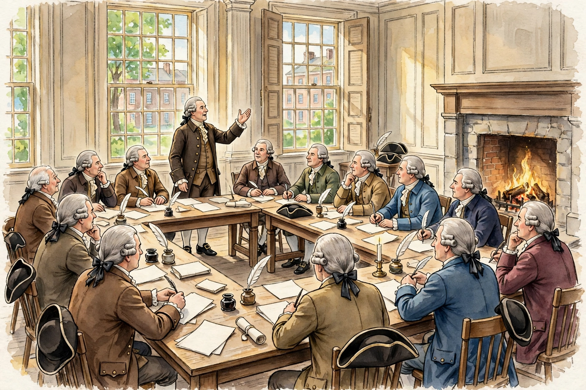

# Lesson 05 — Convention Scene Investigation: What a Picture Can and Cannot Prove

**Goal:** I can observe an illustration carefully, state what it can and
cannot prove, and explain why documents — not pictures — answer
questions about what people said and decided.

**Time:** One ~40-minute session (Week 16, S3). **Materials:** The
generated illustration below, the branches-and-checks diagram in
[assets](../assets/branches-checks-diagram.svg), the learner's evidence
chart. **Readiness check:** Ask the learner to name one fact about the
1787 Convention from Lesson 02 (place, year, Washington presiding, or
the Great Compromise). If none is recalled, re-read Lesson 02's
"summer of 1787" section together.

## The illustration — labeled AI reconstruction, never evidence

*Caption: AI-generated illustration of the Constitutional Convention in
Philadelphia, summer 1787 — an imagined scene, not a photograph and not
evidence of what any delegate said, wore on a particular day, or looked
like. Generated 2026-10-31 for this unit; see
[assets/README.md](../assets/README.md) for the generation record.*

**Text-only alternative (contains everything needed to answer E1–E6):**
The picture shows a large, sunlit room with tall multi-paned windows on
the left and center and a stone fireplace with a fire burning on the
right. About a dozen men in 18th-century dress — long coats, waistcoats,
white shirts, and powdered hair tied back — sit at long wooden tables
arranged in a U-shape. On the tables are sheets of paper, quill pens in
inkwells, a rolled document, and several black three-cornered hats. One
man stands near the center-left, gesturing with one hand raised, as if
speaking to the room; the seated men look toward him, some holding pens
as if taking notes. No words or writing can be read anywhere in the
picture. No women, children, or enslaved people appear in the room.

## Teaching

Historians love pictures, and historians distrust pictures — both at
once. A picture can help you imagine a scene. It cannot tell you what
anyone said, what anyone decided, or even whether the room looked like
that. This illustration was made by an image generator in 2026. No
photographer was in Philadelphia in 1787 (photography did not exist),
and this picture's details — the fireplace, the arrangement of tables,
the faces — are invented by the generator, not copied from a record.

So the lesson's rule is simple: **a picture suggests; a document
proves.** If you want to know what Madison argued on a given day, you
read Madison's notes — a primary source made at the time. If you want
to know what the Constitution says, you read the Constitution. The
picture's job is different: it helps you ask better questions. Why were
the windows shut, if the summer was hot? (Because the meetings were
secret.) Why are there only men in the room? (Because only men were
delegates — and that absence is itself a fact about 1787, matching
Lesson 01's "who was not included.") What would you need to check
before believing any detail in the picture? (A source from the time.)

The same rule applies to the deterministic diagram in this unit's
assets: the branches-and-checks diagram is not a picture of a real
place; it is a model of an idea, and its value is that every box and
arrow can be checked against the Constitution's text.

## Guided practice

**E1.** List five observations from the illustration — things you can
actually see, not things you guess. (Use the text alternative if you
cannot see the picture.)

**E2.** What can this picture prove about the summer of 1787? Choose
one: (a) that delegates met and debated in Philadelphia; (b) that one
delegate stood and spoke while others took notes; (c) nothing about
1787, because it is a modern illustration. Defend your choice in two
sentences.

**E3.** Who is missing from this room, and why does that absence matter?
Name two groups who are not shown and connect each to Lesson 01's
"who was not included" question.

## Independent practice

**E4.** Compare the illustration with the branches-and-checks diagram.
Name one thing the diagram shows that the picture cannot show, and one
thing the picture suggests that the diagram cannot show. (One sentence
each.)

**E5.** A classmate asks: "What did Madison argue on June 19, 1787?"
Which source answers that question — this illustration, Madison's
convention notes, or the Constitution's text? Give one reason for your
choice and one reason the other two do not answer it.

**E6.** Using only the text alternative above (no picture), answer:
(a) What is the standing man doing? (b) Name three objects on the
tables. (c) What is on the right side of the room?

## Applied task

**E7.** Project launch — class constitution preamble. With the class
(or, for an individual learner, with the guiding adult), draft one
sentence beginning "We the students of…" that states two purposes for
your class constitution, modeled on the Preamble's six purposes. The
sentence will open the project constitution in Week 17.

## Exit check

**E8.** In one sentence: why must a historian treat this illustration
as a suggestion, not as evidence?

## Supports, extensions, teacher note

- **Reading access:** The text alternative is the full basis for every
  task; no learner needs the picture to succeed.
- **Alternate response mode:** E1–E3 may be answered orally or as
  labeled annotations on a printed copy of the picture.
- **Extension:** Compare this illustration with a real photograph of
  Independence Hall's Assembly Room today (adult-selected, via the
  Resource Pack's National Park Service search link) and list two
  differences between the imagined room and the real room.
- **Teacher note — likely misconceptions:** (1) "Old-looking means
  true" — the illustration style is a choice, not a date stamp.
  (2) "The picture shows what happened" — correct to "it shows what
  an artist (here, a generator) imagined." (3) Absences are data: who
  is not in the room is as informative as who is. Solutions: see
  [answer key](../answer-key.md) (E1–E8).
