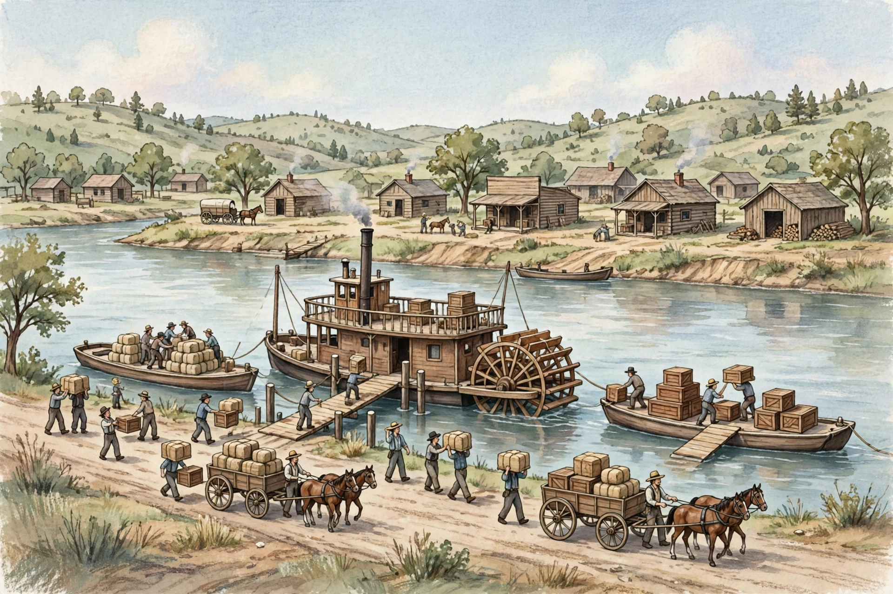

# Lesson 04 — Trade Routes and Changing Places

**Goal:** I can explain how canals, steamboats, and cotton reshaped where
people lived and how goods moved — and name who benefited and who was
harmed when trade expanded.

**Time:** Two ~40-minute sessions (Week 22, S1–S2). **Materials:** the
generated river-port illustration
([`river-port-1840s.png`](../assets/river-port-1840s.png)), the practice
bank (Set D).

**Readiness check (adult asks aloud):** "In Unit 02 you explained
specialization and trade: different places make different goods, so they
trade. Name one trade from Unit 02." If this is shaky, re-teach it for five
minutes: this lesson is the same idea at a continental scale.

## Teaching

In 1800, moving goods over land was slow and expensive. A wagonload of
grain might take three weeks to travel from Buffalo to New York City, and
the cost could eat the farmer's whole profit. Water was cheaper — but the
rivers ran the wrong way: the great rivers of the East flow north–south,
while the trade Americans wanted ran east–west, from the farms of the
interior to the ports of the Atlantic. The early republic solved that
problem by digging, building, and inventing — and each solution changed
where people lived.

The most famous dig was the Erie Canal. Built from 1817 to 1825, it ran 363
miles from Albany, on the Hudson River, to Buffalo, on Lake Erie — cutting
straight through New York State. It opened on October 26, 1825. Before the
canal, shipping goods between Buffalo and New York took about three weeks
by wagon; canal boats made the trip in about eight days, at a fraction of
the cost. Farm towns sprouted along the canal — Rochester, Syracuse, Utica
— and New York City, at the Hudson's mouth, became the busiest port in the
country. A ditch full of water remade the map of New York.

On the rivers, the steamboat changed the rules. A steamboat is a boat
pushed by a steam engine and a paddle wheel, and it can travel *upstream*,
against the river's current. Before steamboats, flatboats floated goods
downriver and were broken up for lumber at the end of the trip — there was
no going back. Steamboats made two-way river trade possible, so goods
flowed both directions on the Mississippi and the Ohio, and river towns
like St. Louis, Cincinnati, and New Orleans grew into busy ports. Look at
the river-port illustration in this lesson: the steamboat, the flatboats,
the wagons, and the workers loading crates are all one system — land roads
feeding river boats feeding ocean ships.

The third change was cotton. Eli Whitney's cotton gin (1793) separated
cotton fiber from its seeds quickly, so cotton farming became enormously
profitable in the South. Cotton was shipped north to mills in New England
and across the Atlantic to mills in Britain, and the money came back to buy
manufactured goods, tools, and more land. But the cotton system ran on
enslaved labor: as cotton spread west into Alabama, Mississippi, and
Louisiana, enslaved people were forced west with it, and the number of
people held in slavery in the South grew. Trade made the country richer
and more connected — and it made one of its cruelest systems bigger. Both
facts belong in the same sentence.

That is interdependence: different places make different goods, so they
depend on each other. A cotton shirt in an 1840s home might contain cotton
grown in Mississippi by enslaved workers, spun in a Massachusetts mill,
carried by steamboat and canal, and sold in a shop in Ohio. The same shirt
connects a dozen places — and a dozen different lives, some free and some
not. Trade links people; it does not treat them equally.

### Worked example 1 — Reading the river-port illustration

*Question:* Study the generated river-port illustration
(`river-port-1840s.png`). What does it show about how goods moved in the
1840s?

*Reasoning, step by step:* (1) List what you can see: a paddle-wheel
steamboat at a dock, flatboats loaded with cotton bales and crates, workers
carrying boxes, horse-drawn wagons on a dirt road, and a small wooden town
behind the river. (2) Connect the parts: wagons bring goods over land to
the dock; workers load them onto flatboats and the steamboat; the boats
carry them downriver. (3) State what the picture shows: three kinds of
transport — wagon, flatboat, steamboat — working as one system. (4) State
what it cannot show: where the goods came from, who grew or made them, or
whether the workers were free or enslaved. The picture is a modern AI
illustration — a reconstruction, not evidence from the 1840s — so it can
teach us how a port *worked*, but it cannot prove who was there.

*Alt text:* "Painted illustration of a busy river port in the 1840s: a
paddle-wheel steamboat at a wooden dock, flatboats loaded with cotton bales
and wooden crates, workers carrying boxes, horse-drawn wagons on a dirt road
beside the river, and a small town of wooden buildings behind the river."

*Caption:* "AI illustration — a modern artist's imagining of a river port
in the 1840s. It is not a photograph and not evidence from the 1840s. The
goods in the picture are not labeled, so it cannot prove where they came
from or who grew them."

*Text-only alternative:* "A paddle-wheel steamboat sits at a wooden dock
on a wide river. Two flatboats nearby are loaded with cotton bales and
wooden crates. Workers carry boxes between the dock and the boats. Two
horse-drawn wagons wait on a dirt road beside the river. Behind the river
stands a small town of wooden buildings. Use this description to answer
this lesson's questions without the picture: the scene shows a steamboat,
flatboats, wagons, workers, crates, and cotton bales, but it does not name
any town, label any cargo, or show whether the workers were free or
enslaved."

### Worked example 2 — Who benefits, who is harmed?

*Claim:* The Erie Canal helped farmers and merchants, and it harmed
Indigenous nations and enslaved people — the same canal did both.

*Reasoning:* (1) Name who benefits: farmers west of the Appalachians could
ship grain cheaply; merchants in New York City grew rich; canal towns
gained jobs and shops. (2) Name who is harmed: the canal crossed Haudenosaunee
(Iroquois) land in New York, and the settlement it brought pushed
Indigenous peoples off more land; and the cheap transport also carried
cotton grown by enslaved labor, strengthening the system that enslaved
them. (3) The test of a fair answer is that it names at least one group on
each side, with a reason. "The canal was good" is not history; "the canal
was good for *these* people and bad for *those* people, for these reasons"
is history.

**Teacher note — common misconceptions:** (1) "Canals and steamboats
helped everyone." No — new transport helped the people who owned the
goods and the land, and harmed people whose land was taken or whose labor
was forced. (2) "The picture proves what an 1840s port looked like." No —
it is a modern AI illustration; it shows how a port worked, not a real
place. (3) "Cotton made the South rich, so it was good for the South."
Cotton made some Southern planters rich; it did so by enslaving more
people and forcing them west. (4) "Interdependence means everyone
depends on everyone equally." No — dependence can be unequal: the mill
needed the cotton, and the enslaved worker had no choice at all. See the
[teacher guide](../teacher-guide.md).

## Guided practice

Work through these together, with the adult modeling the first answer.

1. Look at the river-port illustration. Name three different ways goods
   move in the picture, and say what each one carries or connects.
2. Use Worked example 2's steps: name one group the Erie Canal helped and
   one group it harmed, each with a reason.
3. A cotton shirt in 1840 might contain cotton from Mississippi, spun in
   Massachusetts, and sold in Ohio. Trace the shirt's journey in three
   steps, naming one kind of transport for each step.
4. A learner says, "The steamboat was better than the flatboat, so
   flatboats disappeared." Is that a good claim? Why or why not? (Hint:
   look at the picture — both are there. Why would a cheap one-way boat
   still be useful?)

## Independent practice

1. The Erie Canal ran 363 miles from Albany to Buffalo and opened on
   October 26, 1825. Before it, the Buffalo-to-New York trip took about
   three weeks; by canal boat it took about eight days. About how many days
   did the canal save? (21 − 8 = about 13 days.)
2. Explain in your own words what interdependence means, using the cotton
   shirt as your example. Two sentences.
3. **Error analysis:** A classmate writes, "The Erie Canal was good for
   everyone because it made shipping cheaper." Find the two errors
   (cheaper shipping helped owners and merchants, not everyone; and it
   harmed Indigenous nations and enslaved people) and rewrite the sentence
   correctly.
4. Name one thing the river-port illustration can teach us and one thing it
   cannot prove. Explain the difference in one sentence each.

## Application

Draw or describe a "goods web" for one item in an 1840s home — a cotton
shirt, a wooden chair, or a loaf of bread. Show at least three places the
item's parts or ingredients came from, name one kind of transport for each
leg of the journey, and mark one link where someone was harmed by the trade
(for example, enslaved labor or taken land). Label the drawing with words
so it can be read without the picture.

## Exit check

Without looking: (a) name the year the Erie Canal opened and the two
cities it connected; (b) finish this sentence: "Interdependence means
different places depend on each other because ______." The adult checks
both against the [answer key](../answer-key.md).

## Supports and extensions

- **Reading/language access:** Read the illustration description aloud
  together; let the learner point to each part of the picture as it is
  named (steamboat, flatboat, wagon, crates, cotton bales).
- **Alternate response mode:** The learner may build the goods web with
  cards and string on a table and explain it orally instead of drawing it.
- **Extension:** Research one canal town (for example, Rochester, New
  York) and add one sentence to the goods web: what did the canal change
  for that town? Cite the source used.
