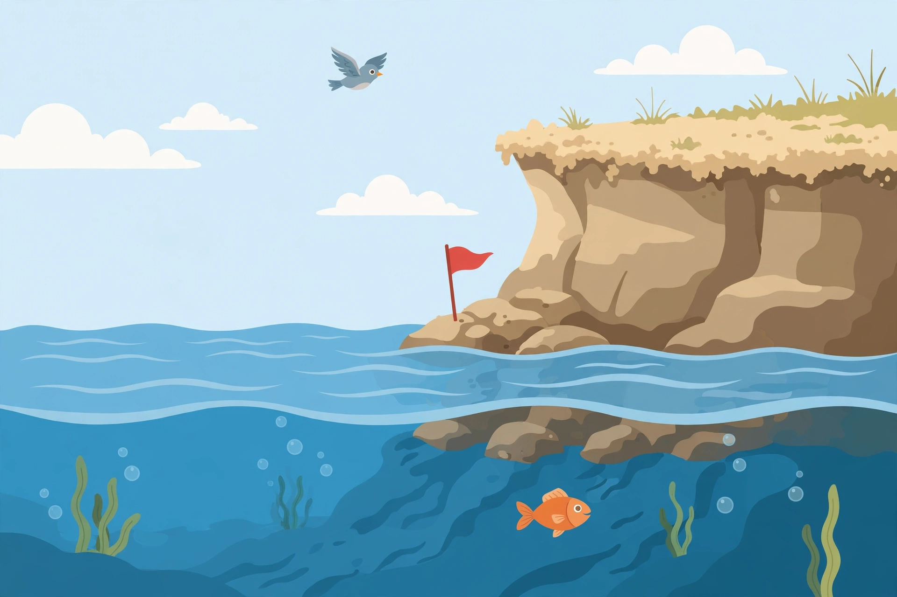

# Lesson 01 — Opposite Quantities and What 0 Means

**My goal:** I can use positive and negative numbers for quantities that
point in opposite directions, and I can explain what 0 means in each
situation.

**Time:** about 45 minutes (5 readiness · 15 teaching · 10 guided ·
12 independent · 3 exit).

**Materials:** paper, pencil; two-color counters (optional);
[sea-level illustration](../assets/sea-level-scene.png).

**Standards:** 6.NS.C.5 · **Unit objectives:** UO8

## Readiness check (5 minutes)

Answer before we start — this tells us what is already solid.

1. On a thermometer, is 5 °C warmer or colder than 12 °C? How do you know?
2. A bank account holds $40. A second account owes $40. Are those the
   same situation? Explain in one sentence.
3. Sea level is the reference for elevation. Is a hill 20 meters above
   sea level higher or lower than a valley 20 meters below sea level?

*(If #2 felt tricky, stay with us — today builds exactly that idea.)*

## Explicit teaching

### Some quantities point two ways

Most numbers you have used so far count *how much* of something there is:
4 apples, 12 meters, $30. But some quantities come in **opposite pairs**,
and "how much" alone is not enough — you also need to know *which way*:

- Temperature **above** zero vs temperature **below** zero.
- Elevation **above** sea level vs elevation **below** sea level.
- Money **gained** (a credit) vs money **owed** (a debit).
- Moving **up** vs moving **down**, **forward** vs **backward**.

Mathematicians use a **sign** to record the direction. Positive numbers
(3, 12, 0.5) point one way; **negative numbers** (−3, −12, −0.5) point the
opposite way. The minus sign in front of a negative number is not a
subtraction instruction here — it is part of the number's name, telling
you its direction.

### The most important question: what is 0?

A signed number only means something once you know what **0** stands for
in that situation. Zero is the dividing line, the reference point:

| Situation | What 0 means | Positive means | Negative means |
|---|---|---|---|
| Temperature (°C) | water freezes; 0 °C | warmer than freezing | colder than freezing |
| Elevation (m) | sea level | above sea level | below sea level |
| Bank balance ($) | neither owing nor holding | money held (credit) | money owed (debit) |
| Floors in a building | ground floor | floors above ground | floors below ground (basement) |

Change the zero and you change the meaning. In a building, 0 is the
ground floor, not sea level. In a bank account, 0 is "even" — not broke
in the sense of owing, and not rich either. Always ask first: *what is 0
here?*

### Worked example 1 — the sea-level picture

Look at the illustration:

*Caption: The sea-level scene. This illustration is an AI-generated story
prompt — not a photograph and not a measurement. The heights below are
given in words; do not try to measure them from the picture.*

**Text alternative:** A blue bird flies in a pale sky above calm water.
A red flag stands on rocks at the waterline beside a sandy cliff. Below
the surface, an orange fish swims among green seaweed and bubbles.
(The numbers below are given in words — the picture contains no counts
or labels.)

Sea level is 0. The story gives three heights:

- The bird flies **6 meters above** the water: **+6 m** (or just 6 m).
- The flag stands **at** the waterline: **0 m**.
- The fish swims **4 meters below** the surface: **−4 m**.

Read them as positions relative to the same zero: the bird is 6 above,
the fish is 4 below. The sign tells the direction; the number tells how
far from zero.

**A common error:** writing the fish's height as "4 m" with no sign.
"4 m" alone could mean 4 above sea level. Without the minus sign, the
direction is lost — and direction is half the information.

### Worked example 2 — credits, debits, and what 0 means

Maya's account starts at $0 (even — she owes nothing and holds nothing).

- She earns $25 mowing a lawn. Her balance is **+$25** (a credit).
- She then spends $40 on supplies. Her balance is **−$15** — she now
  owes $15. Check: 25 − 40 = −15. The negative sign says "owed," and
  15 says "how much."
- She earns $15 more. Her balance is **$0** again: even. Not "nothing
  happened" — two real movements brought her back to the reference point.

**Check the zero rule:** if someone asks "is −$15 good or bad?" the
honest answer is "it depends on the story" — but as a *number*, −$15
always means 15 in the negative direction from 0. The story tells you
whether that direction is debt, cold, or below sea level.

## Guided practice

Work these with your adult or partner. Say the zero out loud first.

1. A diver is 9 meters below the surface. Write her depth as a signed
   number, and name what 0 means here.
2. The temperature at noon is 3 °C below zero. Write it as a signed
   number. At midnight it is 2 °C above zero. Write that too.
3. A shop's account shows −$60. In words: does the shop hold money or
   owe money, and how much? What would a balance of $0 mean?
4. A hiker climbs from sea level to a lookout 150 meters above sea
   level, then descends into a canyon 40 meters below sea level. Write
   both positions as signed numbers.

## Independent practice

1. Write a signed number for each: (a) 8 °C above zero; (b) 8 °C below
   zero; (c) a $120 credit; (d) a $120 debit; (e) 250 meters below sea
   level.
2. In a parking garage, level 0 is the ground floor. A car is parked on
   level −2. What does that mean, in plain words?
3. Two towns report morning temperatures: Pine Falls −6 °C and Cedar
   Bay 4 °C. Which town is warmer? Which town's temperature is below
   the freezing reference, and how do you know?
4. A submarine sits at −120 meters. It rises 50 meters. Is it still
   below sea level? Write its new depth as a signed number. (Hint: it
   is still below, so the sign stays negative.)
5. **Application — the weather desk:** A weather report lists four
   readings for one fictional town: dawn −5 °C, noon 7 °C, evening
   1 °C, midnight −2 °C. (a) List the readings from coldest to warmest
   as signed numbers. (b) Which readings are below zero? (c) In one
   sentence, what does 0 °C mean in this report?

## Exit check

1. What does 0 mean for a bank balance? For elevation?
2. Write a signed number for "a debt of $18."

## Supports, extensions, teacher note

**Reading/language access:** Read each story aloud before writing any
number; underline the direction words (above/below, credit/debit, gain/
owe) before choosing a sign. Home-language direction words are welcome
beside the English ones.

**Alternate response mode:** Point to "above," "at," or "below" cards, or
place a counter above, on, or below a drawn waterline, before writing
the signed number.

**Extension:** Invent a situation where 0 is *not* sea level or freezing
(for example, the floor of a lift, or the start line of a race with
backward steps). Write three signed numbers in it and explain what 0
means there.

**Teacher note — likely misconception:** Learners often treat the minus
sign as "take away" and try to subtract whenever they see it. Keep
returning to the sentence frame: "The sign says *which direction*; the
number says *how far from zero*." If a learner writes "−4 m" for a fish
4 meters below the surface but then says "minus 4 means take away 4,"
ask them what is being taken away from what — there is nothing to take
away; the fish simply *is* 4 below. See the
[teacher guide](../teacher-guide.md#lesson-01) and
[answer key](../answer-key.md#lesson-01) (separate — do not show the key
to the learner).
