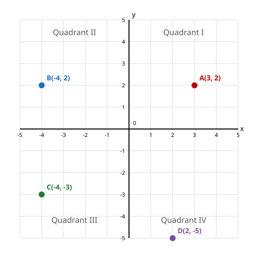

# Lesson 05 — Four Quadrants, Reflections, Distances

**My goal:** I can plot ordered pairs in all four quadrants, describe
reflections across the axes, and find distances between points that
share a coordinate.

**Time:** about 45 minutes (5 readiness · 15 teaching · 10 guided ·
12 independent · 3 exit).

**Materials:** paper, pencil, coordinate grids from −6 to 6 on both axes.

**Standards:** 6.NS.C.6.b, 6.NS.C.6.c, 6.NS.C.8 · **Unit objectives:** UO9, UO12

## Readiness check (5 minutes)

Answer before we start — this tells us what is already solid.

1. Plot (3, 2) in Quadrant I. Which number is the x-coordinate, and
   which is the y-coordinate? Which axis does each one move along?
2. What is the opposite of 4? Of −4? (Lesson 02 — you will need this.)
3. Find |3 − (−4)|. (Hint: 3 − (−4) = 3 + 4.)

## Explicit teaching

### From one quadrant to four

In grade 5, the coordinate plane had one quadrant: both coordinates
positive, up and to the right of the origin (0, 0). Now both axes extend
in both directions, and the plane divides into **four quadrants**,
numbered counterclockwise starting at the top right:

| Quadrant | x-coordinate | y-coordinate | Example point |
|---|---|---|---|
| I (top right) | positive | positive | (3, 2) |
| II (top left) | negative | positive | (−4, 2) |
| III (bottom left) | negative | negative | (−4, −3) |
| IV (bottom right) | positive | negative | (2, −5) |

Read an ordered pair as directions from the origin: the **x-coordinate**
says how far left (negative) or right (positive) to go; the
**y-coordinate** says how far down (negative) or up (positive) to go.
Points on an axis have a 0 coordinate: (0, 4) sits on the y-axis and
(−2, 0) sits on the x-axis — neither is in any quadrant.

*Caption: The four quadrants and one point in each. This is a
deterministic diagram — the coordinates are exact, not drawn by eye.*

**Text alternative:** Quadrant I (top right) holds A(3, 2): 3 right, 2
up. Quadrant II (top left) holds B(−4, 2): 4 left, 2 up. Quadrant III
(bottom left) holds C(−4, −3): 4 left, 3 down. Quadrant IV (bottom right)
holds D(2, −5): 2 right, 5 down.

### Reflections: flip one sign, or both

When two ordered pairs differ only by signs, their points are related by
**reflections** (mirror images) across the axes:

- Reflect across the **x-axis**: flip the sign of the **y**-coordinate.
  (3, 2) → (3, −2). The point jumps vertically to the other side of the
  x-axis; its left-right position does not change.
- Reflect across the **y-axis**: flip the sign of the **x**-coordinate.
  (3, 2) → (−3, 2). The point jumps horizontally; its height does not
  change.
- Reflect across **both axes**: flip both signs. (3, 2) → (−3, −2).
  The point lands diagonally opposite, in the quadrant opposite the
  original.

### Distances: when points share a coordinate

If two points share an **x-coordinate**, they sit on the same vertical
line, and the distance between them is the distance between their
y-coordinates on a vertical number line: |y1 − y2|. If they share a
**y-coordinate**, they sit on the same horizontal line, and the
distance is |x1 − x2|. Absolute value keeps the distance positive no
matter which point you start from.

### Worked example 1 — plot, name, reflect

Plot A(3, 2). Then find: (a) its quadrant; (b) its reflection across the
x-axis; (c) its reflection across the y-axis; (d) its reflection across
both axes.

- (a) Both coordinates positive → **Quadrant I**.
- (b) Across the x-axis, flip y: **(3, −2)** — Quadrant IV.
- (c) Across the y-axis, flip x: **(−3, 2)** — Quadrant II.
- (d) Across both, flip both: **(−3, −2)** — Quadrant III.

Check: the four points form the corners of a rectangle centered on the
origin. Each reflection changed exactly the coordinate it was supposed
to change — if both coordinates changed for a single-axis reflection,
something went wrong.

**A common error:** swapping the coordinates — plotting (2, 3) for
(3, 2). The order in an ordered pair is the whole point: x first (walk
left/right), then y (climb up/down). Say "x, then y; across, then up"
every time until it is automatic.

### Worked example 2 — distances with absolute value

Find the distance between P(2, 3) and Q(2, −4). They share the
x-coordinate 2, so they are on the same vertical line. The distance is
|3 − (−4)| = |7| = **7 units**. Check by counting: from y = 3 up to 0
is 3 steps, and from 0 down to y = −4 is 4 more steps; 3 + 4 = 7. Both
routes agree — and they must, because |3| + |−4| = 7 counts the same
two stretches.

Now find the distance between R(−5, 1) and S(3, 1). They share the
y-coordinate 1, so they are on the same horizontal line. The distance
is |−5 − 3| = |−8| = **8 units**. Check: from x = −5 to 0 is 5 steps,
from 0 to x = 3 is 3 more; 5 + 3 = 8.

**A common error:** subtracting without absolute value and reporting a
negative distance ("−7 units"). Distance is a length; lengths are never
negative. If your subtraction gives a negative number, take its absolute
value — or subtract the smaller coordinate from the larger one.

## Guided practice

Work these with your adult or partner. Plot every point before
answering.

1. Name the quadrant (or axis) for each point: (5, 1), (−2, 4),
   (−3, −6), (4, −1), (0, −3), (−5, 0).
2. Start at M(−2, 5). Write: (a) its reflection across the x-axis;
   (b) its reflection across the y-axis; (c) its reflection across
   both axes. Name the quadrant of each result.
3. Find the distance between: (a) (4, 6) and (4, −2); (b) (−1, −3) and
   (5, −3). Show the absolute-value subtraction for each.
4. Points A(−3, 2) and B(3, 2) differ only in the sign of x. What
   reflection relates them, and what is the distance between them?

## Independent practice

1. Plot and name the quadrant (or axis) for each point: (2, 3),
   (−6, 1), (−1, −4), (5, −2), (0, 5), (3, 0).
2. Start at N(4, −3). Write its reflections across the x-axis, the
   y-axis, and both axes, with the quadrant of each result.
3. Find the distance between: (a) (−2, 5) and (−2, −1); (b) (6, −4) and
   (−3, −4); (c) (0, 3) and (0, −7). For (c), explain in one sentence
   why the answer is not 4.
4. A treasure map (fictional) places a well at (−4, −2) and a gate at
   (−4, 5). (a) Which quadrant is each in? (b) How far apart are
   they, in map units? (c) Reflect the gate across the y-axis. Where
   is the reflected gate, and in which quadrant?
5. **Application — the drone route:** A fictional drone flies from
   (0, 0) to (3, 4), then to (−3, 4), then back to (0, 0). (a) Name the
   quadrant of each stop after the origin. (b) What reflection relates
   (3, 4) and (−3, 4)? (c) How far is the leg from (3, 4) to (−3, 4)?
   (d) The full route forms a triangle. In one sentence, say whether
   the route crosses the y-axis, and where.

## Exit check

1. Point (x, y) is in Quadrant III. What are the signs of x and y?
2. Find the distance between (1, −2) and (1, 5). Show your subtraction.

## Supports, extensions, teacher note

**Reading/language access:** Read every ordered pair as a walk: "3 right,
2 up" — never as two bare numbers. Quadrant numbers are spoken as
"Quadrant One" through "Quadrant Four" alongside the numerals.

**Alternate response mode:** Walk a floor grid: step left/right for x,
then forward/back for y, before marking the point on paper. Reflections
can be acted out by mirroring the walk across a taped axis line.

**Extension:** Points P(a, b) and Q(a, −b) are reflections across the
x-axis. Prove that the distance between them is 2|b|, and explain what
happens when b = 0. Then find a pair of points whose distance cannot be
found by the shared-coordinate rule, and explain why (their segment is
diagonal — the rule in this lesson covers only horizontal and vertical
segments).

**Teacher note — likely misconception:** Learners reflect by flipping
the wrong coordinate (the "mirror" intuition is strong but
undirected). Anchor it: the x-axis is horizontal like a floor mirror —
you flip vertically, so y changes. The y-axis is vertical like a wall
mirror — you flip horizontally, so x changes. If a learner flips both
for a single-axis reflection, ask which axis they mirrored across and
which coordinate that axis leaves alone. See the
[teacher guide](../teacher-guide.md#lesson-05) and
[answer key](../answer-key.md#lesson-05) (separate — do not show the key
to the learner).
