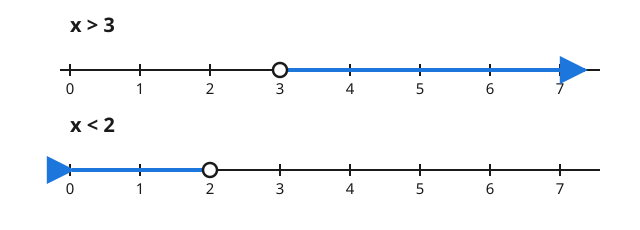

# Lesson 04 — Inequalities: Constraints and Number-Line Graphs

**My goal:** I can write an inequality of the form x > c or x < c for a
real constraint, list solutions, and graph the solution set on a number
line with an open circle and an arrow.

**Time:** about 45 minutes (5 readiness · 15 teaching · 10 guided ·
12 independent · 3 exit).

**Materials:** paper, pencil; number-line tape; the number-line diagram
below.

**Standards:** 6.EE.B.8 · **Unit objectives:** UO21

## Readiness check (5 minutes)

Answer before we start — this tells us what is already solid.

1. Is 5 < 7 true or false?
2. List three numbers less than 4.
3. On a number line, where is 6 relative to 3 — to the left or to
   the right?

*(If #2 gave you more than three numbers easily, good — today we
learn that the list never ends.)*

## Explicit teaching

### A constraint is an inequality

An equation says two things are equal. An **inequality** says one thing
is greater than or less than another. Real life is full of constraints
that are inequalities, not equations:

- A ride allows children **shorter than** 48 inches.
- You need **more than** 10 points to win the game.
- A parcel must weigh **less than** 20 kilograms.

Each constraint has **infinitely many** solutions — there is no single
answer, because any value on the right side of the limit works.

### Worked example 1 — shorter than 48 inches

Let h stand for a child's height in inches. "Shorter than 48 inches"
means:

h < 48

Test values (Lesson 01's method): h = 40 → 40 < 48, true. h = 47 →
47 < 48, true. h = 47.5 → 47.5 < 48, true. h = 48 → 48 < 48, false —
48 is not less than itself. h = 50 → false.

Every height below 48 works, including decimals like 47.5 and 47.99.
There is no "smallest" or "largest" solution to list — the solutions
go on forever. That is what **infinitely many solutions** means.

**Graph it:** on a number line, draw an **open circle** at 48 (open
means 48 itself is *not* included) and an arrow pointing left, toward
all the smaller numbers.

### Worked example 2 — more than 10 points

Let p stand for points. "More than 10 points" means:

p > 10

Test: p = 11 → 11 > 10, true. p = 10 → 10 > 10, false. p = 9 → false.
The solutions are 11, 12, 13, ... and also 10.5 and 10.01 — every
number greater than 10.

**Graph it:** an open circle at 10, with an arrow pointing right.

### The diagram

*Caption: Solution graphs for x > 3 (top) and x < 2 (bottom). The open
circle means the endpoint is not a solution; the arrow shows that the
solutions continue forever in that direction.*

**Text alternative:** The diagram shows two horizontal number lines
from 0 to 7. On the top line, an open circle sits at 3 and a thick
arrow runs from the circle to the right, past 7 — this is the graph of
x > 3. On the bottom line, an open circle sits at 2 and a thick arrow
runs from the circle to the left, past 0 — this is the graph of x < 2.

### Reading a graph back into words

A graph is a picture of a solution set. An open circle at 3 with an
arrow to the right says: "every number greater than 3." An open circle
at 2 with an arrow to the left says: "every number less than 2." The
direction of the arrow is the whole message — right means greater,
left means less.

## Guided practice (with hints)

1. Write an inequality: "A bag must weigh less than 50 pounds." Let
   w stand for the weight in pounds.
2. Write an inequality: "You must be older than 12 to join the club."
   Let a stand for age in years.
3. List 3 solutions of x > 7. *(Hint: any number bigger than 7.)*
4. List 3 solutions of y < 3.
5. Is 6 a solution of n < 6? Why or why not?
6. Graph m > 2 on a number line. Describe your graph in words.

## Independent practice

1. Write inequalities: (a) "A child must be taller than 42 inches to
   ride." Let h stand for height in inches. (b) "A parcel must weigh
   less than 20 kilograms." Let w stand for weight in kilograms.
2. List 5 solutions of t < 5.
3. List 3 solutions of s > 100.
4. Is 10 a solution of x > 9? Is 9 a solution of x > 9? Explain both
   answers.
5. Error analysis: Jo graphs x < 4 with a closed dot at 4 and an
   arrow pointing right. What two things are wrong with Jo's graph?
6. A library lets you borrow a book for fewer than 21 days.
   (a) Write the inequality for the number of days d.
   (b) Describe the graph of your inequality in words.
   (c) Name three numbers of days that work and one that does not.

## Application

A fish tank must hold less than 10 gallons of water for the shelf it
sits on. Let g stand for the gallons of water in the tank.
(a) Write the inequality. (b) Describe its graph in words.
(c) Could you put 9 gallons in the tank? 10 gallons? 10.5 gallons?
Explain each answer with a substitution.

## Exit check

Write the inequality for "a number greater than 8" and describe its
number-line graph in words (where is the circle, and which way does
the arrow point?).

## Supports and extensions

- **Reading/language access:** Translate every constraint aloud twice:
  once in words ("shorter than 48 inches") and once in symbols
  ("h < 48"). Keep "open circle = not included" on the word wall.
- **Alternate response mode:** The learner may walk the number-line
  tape: stand at the endpoint, step in the arrow's direction, and say
  "this number works" at each stop — including a decimal stop
  (47.5) to feel that the solutions never end.
- **Extension:** A rule says "at least 10 points to win." Why can
  this rule *not* be written as p > 10 or p < 10? (Because 10 itself
  must be allowed — "at least" includes the endpoint. The symbols for
  that, ≥ and ≤, come in grade 7; for now, name the gap honestly.)

## Teacher note

Likely misconception: treating the endpoint as a solution (48 < 48 is
false — 48 is not less than itself), and pointing the arrow the wrong
way (the arrow follows the inequality sign's direction: > points
right, < points left). Also watch for "at most / at least" language:
those need ≥ / ≤, which are out of scope this year — redirect such
stories to "more than" / "less than" forms, and note the gap rather
than teaching the new symbols. See the teacher guide for the full
misconception list and the answer-key reference.
