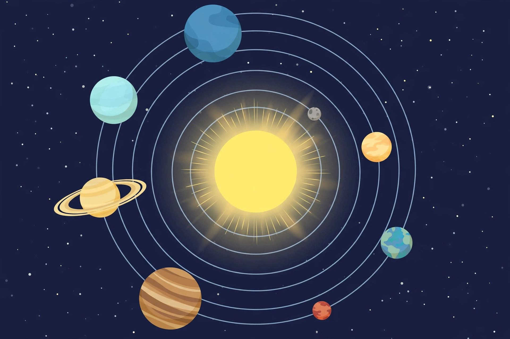

# Lesson 01 — The Neighborhood: Eight Planets in Order

**Student goal:** I can name the eight planets in order from the Sun, sort
them into rocky and giant groups, and read the planet dataset table without
memorizing it.
**Time:** ~45 minutes · **Sessions:** S1 (plus S2–S4 table work and practice)
**Materials:** the dataset table in the [unit README](../README.md); the
orbit illustration `assets/solar-system-orbits-top-view.png` (below); paper
for an order strip.

**Readiness check (2 minutes):** Write down every planet you can name, in any
order. Then guess: which planet is closest to the Sun, and which is farthest?
Keep your list — you will check it against the dataset before this lesson ends.

## Teaching

Our solar system is a family with one parent and eight children. The parent
is the **Sun**, a star — a ball of hot gas so massive that it holds more
than 99% of all the mass in the whole system. The children are the eight
**planets**, and they all travel around the Sun on curved paths called
**orbits**. (A planet's trip around the Sun is one **revolution**, and the
time it takes is its **orbital period** — its "year.")

In order from the Sun, the planets are: **Mercury, Venus, Earth, Mars,
Jupiter, Saturn, Uranus, Neptune**. Do not try to memorize this list from a
chant you found online — build your own memory sentence in the practice
below, using words you choose, and the order will stick better.

The eight planets fall into two natural groups, and the dataset table shows
why. The first four — Mercury, Venus, Earth, Mars — are **rocky planets**:
small, dense, made mostly of rock and metal, and close to the Sun. The last
four — Jupiter, Saturn, Uranus, Neptune — are **giant planets**: much larger,
much farther out, and made mostly of gases and ices rather than rock. (Two
of the giants, Uranus and Neptune, are sometimes called "ice giants" because
so much of their material is icy — but in this unit, "giant" covers all
four.) Between the two groups, between Mars and Jupiter, orbits a band of
rocky bodies called the **asteroid belt** — leftover building material that
never became a planet.

Two more things the table will teach you if you read it like a scientist
instead of a memorizer. First, look at the **orbital period** column: the
farther a planet is from the Sun, the longer its year. Mercury's year is 88
days; Neptune's is 60,190 days — about 165 Earth years. Second, look at the
**diameter** column: the giants are not just a little bigger than the rocky
planets. Jupiter's diameter (139,820 km) is about 11 times Earth's
(12,742 km). Keep both patterns in mind — Lessons 03 and 04 turn them into
models you build yourself.

A note on **dwarf planets**, since you will meet the name: Pluto is the
famous one. Dwarf planets are round bodies that orbit the Sun but have not
cleared their neighborhood of other objects. They are enrichment in this
unit, not a ninth planet and not test material. If a picture shows nine
planets, it is using an old classification (Pluto was reclassified in 2006)
or it is counting a dwarf planet as a planet.

### The orbit illustration — read it before you trust it

*Caption: An AI-generated illustration of the solar system seen from above.
It is NOT to scale: the distances between orbits are squeezed together and
the outer planets are drawn large so they show up — and the planets are
placed decoratively, so their positions in the picture do NOT encode their
true order from the Sun. Use it only for the activity below — spotting what
the picture distorts — never for judging sizes, distances, or order. The
dataset table is the authority on all three.*

**Activity — Spot what the picture distorts (10 minutes).** Look at the
illustration and answer three questions in writing:

1. Which planet can you identify with confidence from appearance alone,
   and why? (Hint: only one planet in the picture wears a feature no other
   planet has.)
2. Which planets can you NOT identify from appearance alone? Name the
   look-alike problem: several planets in the picture are blue, but
   blue alone cannot tell you whether you are looking at Earth, Uranus,
   or Neptune.
3. What does the picture get wrong about sizes? Use the dataset table:
   find the largest planet by diameter, then check whether the picture
   draws any other planet as large as or larger than it. Write one
   sentence naming the distortion.

**Text-only alternative:** The illustration shows a glowing yellow Sun at
the center with eight thin circular orbit paths around it on a dark starry
background. Around the Sun sit: a tiny gray planet near the Sun at the
upper right; a small orange-yellow planet on the right; a small blue-and-
green planet on the lower right; a small red planet at the lower right; a
large banded brown planet at the bottom; a large pale-yellow planet with
wide rings on the left; a medium pale-blue-green planet on the upper left;
and a large blue planet at the top. Planet positions in the picture are
decorative and do not encode true order, size, or distance. The activity
is fully answerable from this text plus the dataset table: the ringed
planet is Saturn (the only ringed planet); the blue planets cannot be told
apart by color alone; and the table shows Jupiter (139,820 km) is the
largest planet, so any picture drawing another planet as large as Jupiter
distorts sizes.

### Worked example 1 — Sorting rocky vs. giant from the table

Question: *Is Mars a rocky planet or a giant planet? Use the table as
evidence.*

Step-by-step:

1. Find Mars's row: distance 227.9 million km, diameter 6,779 km.
2. Compare its diameter with Earth's (12,742 km): Mars is about half Earth's
   size — in the small-planet range, not the giant range (Jupiter is
   139,820 km).
3. Check its position: Mars is the 4th planet out, inside the asteroid
   belt's neighborhood — with the inner group, not the outer group.
4. Conclusion: **Mars is rocky.** Evidence: small diameter (6,779 km, about
   half of Earth's) and an inner position (4th from the Sun).

The same test works for any planet: giants are the four with diameters above
about 49,000 km and positions 5th–8th; rocky planets are the four with
diameters below about 13,000 km and positions 1st–4th.

### Worked example 2 — Reading a pattern, not memorizing a row

Question: *Without memorizing the table, what can you say about how a
planet's year length relates to its distance from the Sun?*

Step-by-step:

1. Pick two planets far apart in the table: Mercury (57.9 million km, 88
   days) and Neptune (4,495.1 million km, 60,190 days).
2. Neptune is about 78 times farther out than Mercury (4,495.1 ÷ 57.9 ≈ 78).
3. Neptune's year is about 684 times longer (60,190 ÷ 88 ≈ 684).
4. Check a middle pair to make sure it is not a fluke: Earth (149.6 million
   km, 365 days) vs. Saturn (1,433.5 million km, 10,759 days) — Saturn is
   about 10 times farther and its year is about 29 times longer.
5. Pattern: **the farther a planet is from the Sun, the longer its year.**
   This is a pattern in the data, not a fact to memorize — and Lesson 04
   explains it with the distance scale.

## Guided practice

Work with a partner or your adult. Use the dataset table for every question;
show the numbers you used.

1. Write the eight planets in Sun order. Star the planet you live on.
2. Which two planets sit on either side of the asteroid belt? How do you
   know from the table?
3. Sort the eight planets into rocky and giant groups. For one planet in
   each group, write the diameter evidence for your sort.
4. The illustration shows one planet with wide rings around it. Which
   planet is it, and why is that identification safe while the blue
   planets' identities are not? (Hint: only one planet in the solar
   system wears rings like that; several planets are blue.)
5. True or false, with evidence: "Venus is farther from the Sun than Mars."
6. A new planet is discovered between Saturn and Uranus. Would you predict
   it is rocky or giant, and would its year be longer or shorter than
   Saturn's? Give two reasons from the patterns in this lesson.

## Independent practice

1. Invent your own memory sentence for the planet order (first letters
   M, V, E, M, J, S, U, N). Write it out and test yourself twice: once
   immediately, once after finishing the rest of this practice.
2. Without looking at the table, write the rocky planets and the giant
   planets as two lists. Then check yourself against the table and correct
   any errors in a different color.
3. Which planet has the shortest year, and which has the longest? Give both
   year lengths in days.
4. Explain in two or three sentences why textbook solar-system pictures
   cannot be trusted for sizes or distances. Use the word "scale."
5. **Error analysis:** A classmate says, "Pluto is the ninth planet, and it
   is the farthest planet from the Sun." What is wrong with each half of
   that sentence? (Use the dwarf-planet note in this lesson.)
6. **Explain your reasoning:** Why is it more useful to learn the
   rocky/giant pattern than to memorize each planet's diameter? Give one
   example where the pattern lets you predict something about a planet you
   have not studied.

## Applied task

Make a **planet order strip**: a strip of paper with eight boxes in Sun
order. In each box write the planet's name, its group (rocky/giant), and one
number from the table that you find interesting — with its unit. Decorate
each box with a color, not a copied picture. Keep the strip: it becomes the
label set for your Lesson 03 size model and your project exhibit.

## Exit check

1. Name the eight planets in order (your memory sentence is allowed).
2. Is Uranus rocky or giant? One piece of evidence.
3. What sits between Mars and Jupiter?

## Supports and extensions

- **Reading access:** the adult reads the table row by row with the learner
  on the first pass; the learner points to each row as it is read.
- **Alternate response mode:** the order strip may be built by arranging
  pre-written planet name cards instead of writing names.
- **Extension:** research question (adult-approved source only): why did
  astronomers reclassify Pluto in 2006? Write a three-sentence summary that
  uses the word "cleared" correctly.

## Teacher note

Likely misconceptions: Pluto as a ninth planet; the asteroid belt as a
former planet that exploded (it is leftover material, not a destroyed
planet); "giant" meaning "bigger version of Earth" (giants differ in
composition, not just size). Answer-key reference: Practice Sets A–B in the
answer key; the order-strip criteria are in the project rubric.
