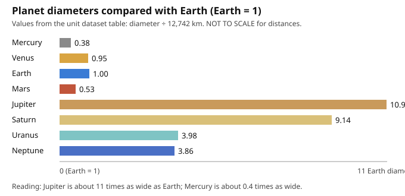

# Lesson 03 — How Big? Planet Sizes at True Scale

**Student goal:** I can compare planet sizes with ratios, build a size strip
at Earth = 1 cm, and explain why the Sun cannot fit on that strip.
**Time:** ~45 minutes · **Sessions:** S9 (plus S11–S12 data task and project work)
**Materials:** a paper strip at least 30 cm long; a ruler in centimetres;
scissors; the dataset table; the bar chart
`../assets/planet-diameter-bars.svg` (below).

**Readiness check (2 minutes):** Guess, without looking: how many Earths
wide is Jupiter — 2, 5, or 11? Write your guess and one reason for it. You
will compute the real answer in this lesson.

## Teaching

Kilometres are honest but hard to feel. Jupiter's diameter is 139,820 km and
Mercury's is 4,879 km — both numbers are true and neither gives you a
picture. A **ratio** fixes that: divide each planet's diameter by Earth's
diameter (12,742 km), and Earth becomes the measuring stick. Earth = 1.00.
Everything else is "this many Earths wide."

The bar chart below does that division for you. Read it slowly, because it
overturns the textbook picture: the rocky planets are all 1 Earth wide or
smaller (Mercury 0.38, Mars 0.53, Venus 0.95), while the giants are 4 to 11
Earths wide (Neptune 3.86, Uranus 3.98, Saturn 9.14, Jupiter 10.97). Jupiter
is not "a bit bigger than Earth." It is about **11 Earths** wide — you could
line up 11 Earths across Jupiter's face.

*Caption: Planet diameters as multiples of Earth's diameter, computed from
the dataset table (diameter ÷ 12,742 km). This chart shows sizes only — it
says nothing about distances. Values are rounded to two decimals.*

A **scale model** keeps those ratios with real objects. Choose a scale:
**Earth = 1 cm**. Then every planet's model size is its ratio × 1 cm.
Mercury: 0.38 cm (about 4 mm — a peppercorn). Venus: 0.95 cm (about 1 cm).
Mars: 0.53 cm (about 5 mm). Jupiter: 10.97 cm (about 11 cm — a grapefruit).
Saturn: 9.14 cm (about 9 cm). Uranus: 3.98 cm (about 4 cm). Neptune: 3.86 cm
(about 4 cm). On a 30 cm paper strip, all eight circles fit — with room to
spare, because the rocky planets are tiny dots next to the giants.

Now try the Sun on the same scale. The Sun's diameter is about 1,392,700 km.
Divide by Earth's 12,742 km: about **109**. On the Earth = 1 cm scale, the
Sun would be a circle **109 cm across** — wider than a classroom door and
longer than your strip three times over. That is not a mistake; it is the
point. Any picture that shows the Sun and the planets together has already
chosen to shrink the Sun, enlarge the planets, or both. The honest move is
to say so on a limits card, which your project exhibit will do.

One more ratio habit: when a question asks "how many times bigger," it is
asking for a division, not a subtraction. Jupiter is not "127,078 km bigger"
in the useful sense — it is "about 11 times as wide." Ratios travel across
scales; differences do not. (If Earth were a 2 cm ball instead, Jupiter
would be about 22 cm — the ratio 11 stays the same.)

### Worked example 1 — Computing a ratio

Question: *How many Earths wide is Saturn? Show the division.*

Step-by-step:

1. Saturn's diameter: 116,460 km. Earth's diameter: 12,742 km.
2. Divide: 116,460 ÷ 12,742 = 9.139… → about **9.14**.
3. Say it as a sentence: "Saturn is about 9.14 times as wide as Earth."
4. On the Earth = 1 cm strip, Saturn's circle is 9.14 cm across — round to
   9 cm when cutting paper, and note the rounding on your strip.

### Worked example 2 — Changing the scale

Question: *If Earth is a 2 cm ball, how wide are Mercury and Jupiter as
balls?*

Step-by-step:

1. Ratios stay the same whatever the scale: Mercury 0.38, Jupiter 10.97.
2. Multiply each ratio by the new Earth size (2 cm): Mercury 0.38 × 2 =
   0.76 cm (about 0.8 cm); Jupiter 10.97 × 2 = 21.94 cm (about 22 cm).
3. Check the sense: Jupiter's ball (22 cm) is still about 29 times Mercury's
   (0.8 cm), because 10.97 ÷ 0.38 ≈ 29 — the same as on the 1 cm scale.
4. Answer: **Mercury ≈ 0.8 cm, Jupiter ≈ 22 cm** at Earth = 2 cm.

## Guided practice

Use the dataset table and the bar chart. Show each division.

1. Compute Venus's ratio yourself: 12,104 ÷ 12,742. Does your answer match
   the chart's 0.95? What does 0.95 mean in words?
2. Which is wider, Uranus or Neptune? By how many Earth diameters (subtract
   the ratios)? By what ratio (divide the diameters)?
3. On the Earth = 1 cm strip, how wide is Mars's circle? Round to the
   nearest millimetre and explain your rounding.
4. A classmate draws all eight planets the same size "so they fit nicely."
   Use one ratio to explain why that drawing misleads a reader about
   Jupiter.
5. If Earth is a 5 cm ball, how wide is Saturn's ball? Show the
   multiplication.
6. **Error analysis:** A learner computes Jupiter's ratio as
   139,820 − 12,742 = 127,078 and says "Jupiter is 127,078 times as wide as
   Earth." What did they confuse, and what is the correct ratio?

## Independent practice

1. Compute all eight ratios from the table (or check the chart's values
   with two divisions of your choice). List the planets from widest to
   narrowest, with ratios.
2. On the Earth = 1 cm scale, the Sun is 109 cm. Your strip is 30 cm long.
   How many strips would you need, end to end, to draw the Sun's diameter?
   (Divide, and round to a sensible whole number with a note about the
   remainder.)
3. Neptune's diameter is 49,244 km and Uranus's is 50,724 km. A learner says
   "Uranus and Neptune are basically the same size." Is that a fair claim?
   Support your answer with the ratio difference (50,724 ÷ 12,742 vs.
   49,244 ÷ 12,742) and one sentence about what "basically" hides.
4. **Explain your reasoning:** Why does the size strip use circles, not the
   planets' real colors and bands? What does a plain circle model include,
   and what does it leave out?

## Applied task

Build the **size strip**: on your paper strip, draw eight circles in Sun
order with diameters from the Earth = 1 cm scale (Mercury 0.4 cm, Venus
1.0 cm, Earth 1.0 cm, Mars 0.5 cm, Jupiter 11.0 cm, Saturn 9.1 cm, Uranus
4.0 cm, Neptune 3.9 cm — rounded to the nearest millimetre). Label each
circle with the planet's name and its ratio. Then add a limits card: "This
strip shows SIZES only. It does not show distances. The Sun at this scale
would be 109 cm wide and does not fit here."

## Exit check

1. Jupiter is about how many Earths wide?
2. On the Earth = 1 cm scale, how wide is Mercury's circle?
3. Why can't the Sun fit on your size strip? One sentence with a number.

## Supports and extensions

- **Reading access:** the adult works the first division (Worked example 1)
  on paper with the learner before the learner tries one alone.
- **Alternate response mode:** circles may be made by tracing round objects
  of matching size (coins, lids) instead of compass drawing; the learner
  still labels each with its ratio.
- **Extension:** compute the Sun's ratio yourself from 1,392,700 ÷ 12,742
  and check it against the lesson's 109. Then answer: if Earth were a
  1 mm bead, how wide would the Sun be in centimetres? (109 mm = 10.9 cm.)

## Teacher note

Likely misconceptions: ratios computed by subtraction; "bigger" meaning
"farther" (size and distance are separate scales — Lesson 04 keeps them
apart); rounding treated as error rather than honest approximation (the
strip's rounding note is required, not optional). Answer-key reference:
Practice Set C in the answer key.
