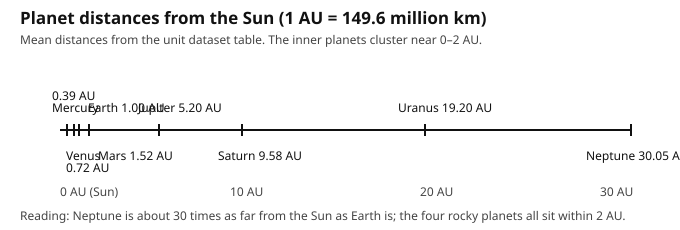

# Lesson 04 — How Far? Orbital Distances at True Scale

**Student goal:** I can use the astronomical unit to compare planet
distances, build a distance line at 1 AU = 10 m, and explain why one model
cannot show true sizes and true distances together.
**Time:** ~45 minutes · **Sessions:** S10 (plus S11–S12 data task and project work)
**Materials:** a measuring tape or trundle wheel (or a 30 m rope marked in
metres); planet markers (cones, cards, or chalk); the dataset table; the
number line `../assets/orbit-distance-number-line.svg` (below).

**Readiness check (2 minutes):** Earth is 149.6 million km from the Sun.
Neptune is 4,495.1 million km away. About how many times farther is Neptune
than Earth — 3, 10, or 30? Divide and write your answer before reading on.

## Teaching

Millions of kilometres are even harder to feel than thousands. Astronomers
solve this with a yardstick built for the job: the **astronomical unit
(AU)**. One AU is the mean Earth–Sun distance, **149.6 million km**.
Earth is 1.00 AU from the Sun by definition. Every other planet's distance
in AU is just its distance divided by 149.6 million km:

| Planet | Distance (million km) | Distance (AU) |
|---|---|---|
| Mercury | 57.9 | 0.39 |
| Venus | 108.2 | 0.72 |
| Earth | 149.6 | 1.00 |
| Mars | 227.9 | 1.52 |
| Jupiter | 778.6 | 5.20 |
| Saturn | 1,433.5 | 9.58 |
| Uranus | 2,872.5 | 19.20 |
| Neptune | 4,495.1 | 30.05 |

Read that table as a picture: the four rocky planets all live within 2 AU of
the Sun — huddled together — while Neptune sits 30 AU out, thirty times
Earth's distance. The number line below shows the same fact visually: the
inner planets cluster so tightly near zero that their labels have to take
turns above and below the line, while Neptune stands alone at the far end.

*Caption: Mean planet distances in AU, computed from the dataset table
(distance ÷ 149.6 million km). This line shows distances only — planet
sizes are not shown.*

Now build it as a **distance line**. Choose a scale: **1 AU = 10 metres**
on a playground or field. Then each planet's marker goes at its AU value ×
10 m from the Sun marker: Mercury 3.9 m, Venus 7.2 m, Earth 10.0 m, Mars
15.2 m, Jupiter 52.0 m, Saturn 95.8 m, Uranus 192.0 m, Neptune 300.5 m
(about 300 m — three football fields from the Sun marker). Walk it if you
can: the first four markers pass in a few steps, and then you keep walking,
and walking, to Neptune. That walk *is* the lesson — the solar system is
mostly empty space.

If no field is available, build the same line on paper: **1 AU = 1 cm**
gives Neptune at 30.1 cm, which fits on a long strip, with Mercury at 0.4 cm
from the Sun marker. The ratios are identical; only the scale changed — the
same trick as Lesson 03.

Finally, the question that ties the unit together: **why can't one model
show true sizes and true distances at the same time?** Put the two scales
side by side. On the size scale (Earth = 1 cm), Neptune's distance is
4,495.1 million km ÷ 12,742 km per cm = about 352,800 cm = about **3.5 km**.
Your 1 cm Earth marble would sit 3.5 km from the Sun marker — in another
neighborhood, not another room. And on the distance scale (1 AU = 10 m),
Earth's 1 cm ball would shrink to a speck: 10 m per AU ÷ 149.6 million km
per AU means 1 cm on the ground represents about 15 million km, so Earth
(12,742 km wide) would be less than a millimetre across — invisible. Every
real model must therefore choose: true sizes *or* true distances, with the
other distorted and labeled. Your project exhibit makes that choice twice,
on purpose, and says so on each limits card.

### Worked example 1 — Converting to AU

Question: *How far is Saturn from the Sun in AU?*

Step-by-step:

1. Saturn's distance: 1,433.5 million km. One AU: 149.6 million km.
2. Divide: 1,433.5 ÷ 149.6 = 9.582… → about **9.58 AU**.
3. Say it as a sentence: "Saturn is about 9.58 times as far from the Sun as
   Earth is."
4. On the 1 AU = 10 m line, Saturn's marker goes at 9.58 × 10 = **95.8 m**.

### Worked example 2 — The 3.5 km truth

Question: *On the Earth = 1 cm size scale, how far from the Sun marker is
Neptune? Show the calculation.*

Step-by-step:

1. Neptune's distance: 4,495.1 million km = 4,495,100,000 km.
2. On this scale, 1 cm represents Earth's diameter: 12,742 km.
3. Divide: 4,495,100,000 ÷ 12,742 = 352,758 cm (about 352,800 cm).
4. Convert: 352,758 cm ÷ 100 = 3,527.58 m ≈ **3.5 km**.
5. Answer: **about 3.5 km** — far beyond any room, field, or schoolyard.
   A single true-scale model of sizes and distances together is not
   buildable at human scale, which is why this unit builds two models.

## Guided practice

Show your working for every calculation.

1. Compute Mars's distance in AU: 227.9 ÷ 149.6. Does it match the table's
   1.52? On the 1 AU = 10 m line, where does Mars's marker go?
2. On the 1 AU = 10 m line, how far apart are Earth's and Jupiter's markers?
   (Subtract their metre positions.)
3. Which two neighboring planets are farthest apart in AU? Compute the gap
   for each neighboring pair from the AU column and name the biggest gap.
4. On the paper scale (1 AU = 1 cm), where does Uranus's marker go? Give
   the distance in centimetres.
5. True or false, with evidence: "On the 1 AU = 10 m line, Saturn's marker
   is about 10 times as far from the Sun as Earth's marker." (Hint: compare
   95.8 m with 10.0 m.)
6. **Error analysis:** A learner builds a distance line with planets spaced
   evenly — Mercury, Venus, Earth, Mars, Jupiter, Saturn, Uranus, Neptune
   all the same distance apart — "because the order is what matters."
   What does the even spacing hide? Name one pair of planets whose real gap
   it misrepresents most, with numbers.

## Independent practice

1. Compute all eight AU values from the million-km column (or verify the
   table's values with two divisions of your choice). List the planets from
   nearest to farthest with AU values.
2. A school hallway is 40 m long. On the 1 AU = 10 m scale, which planets'
   markers fit inside the hallway, and which do not? List both groups.
3. On the Earth = 1 cm size scale, how far is Jupiter from the Sun marker?
   (778.6 million km ÷ 12,742 km per cm, converted to metres.) Compare with
   Neptune's 3.5 km: which is farther, and by about how much?
4. **Explain your reasoning:** A museum exhibit shows the planets as
   grapefruit-sized balls spaced a metre apart. It is beautiful and easy to
   walk past. What two things does it get wrong about scale, and what
   should its label say to be honest? Write the label (two sentences).

## Applied task

Build the **distance line**: outdoors, place markers at the 1 AU = 10 m
positions (or the 1 AU = 1 cm paper version indoors). Photograph or sketch
the line — no people in the picture — and mark on your sketch where the
rocky planets cluster and where the long empty stretch begins. Write one
sentence under the sketch: "The solar system is mostly ______." (Fill the
blank from what the walk taught you.)

## Exit check

1. What is 1 AU, in million km and in words?
2. On the 1 AU = 10 m line, how far is Neptune's marker from the Sun marker?
3. Why can't one model show true sizes and true distances together? One
   sentence with a number.

## Supports and extensions

- **Reading access:** the adult reads the AU table row by row on the first
  pass; the learner points to each row as it is read.
- **Alternate response mode:** the distance line may be built by placing
  numbered cards on a rope marked in metres, without walking the full line;
  the learner still computes each position.
- **Extension:** light takes about 8 minutes to travel 1 AU. About how long
  does sunlight take to reach Neptune (30.05 AU)? Multiply and give the
  answer in hours (8 × 30.05 = 240.4 minutes ≈ 4 hours). Write one sentence
  about what that means for "seeing" Neptune.

## Teacher note

Likely misconceptions: AU as a fixed number of kilometres to memorize
rather than a ratio (Earth = 1 by definition); even spacing on distance
lines; confusing the two scales (using the 1 cm size scale for distances).
The 3.5 km calculation is the unit's key number — check it in the answer
key before teaching it. Answer-key reference: Practice Set D in the answer
key.
