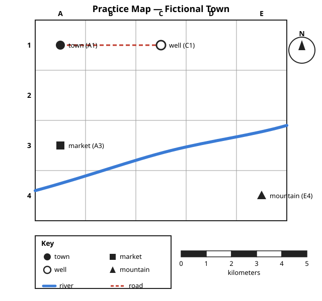

# Lesson 03 — Maps as Evidence

**Unit:** [U01 — Historical Inquiry: Archaeology, Maps, and Chronology](../README.md) · **Week 4**
**Time:** ~40 minutes · **Session:** 5 of 16

## Goal

You will read a map's **scale bar**, **grid**, **key**, and **symbols** to
make evidence claims, and explain what a map **cannot show** — including
what every flat world map must distort.

## Materials

- Notebook (inquiry notebook) and pencil; ruler
- The practice map below ([map-grid-scale.svg](../assets/map-grid-scale.svg)
  — a deterministic diagram; every measurement in this lesson is checked
  against it)

*Deterministic practice diagram — drawn to exact measurements, not an
illustration. Alt text: grid map, columns A to E, rows 1 to 4; black dot
labeled town at A1; open circle labeled well at C1; black square labeled
market at A3; black triangle labeled mountain at E4; blue river curving
across the lower map; dashed red road running east from the town to the
well; key box; compass rose with N arrow; scale bar marked 0 to 5
kilometers.*

## Readiness check (4 minutes)

Answer aloud, pointing at the practice map:

1. What does the key tell you?
2. Which way is north on this map? How do you know?
3. Read the grid label of the mountain.

If the key or compass rose felt shaky, the adult re-teaches those two items
now — scale and grid are new in this lesson, but the basics must be quick.

## Teaching

### Part A — The six tools on every good map

A map is **evidence**: it can prove a claim about a place — but only if you
read it through its tools. Six tools appear on this practice map:

1. **Title** — what the map is about ("Practice Map — Fictional Town").
2. **Key (legend)** — what every symbol and color means. Without the key, a
   black square could be anything; with the key, it is the market.
3. **Compass rose** — which way is north (and therefore south, east, west).
4. **Scale bar** — what a length on the map equals in real distance. This
   map's bar reads 0 to 5 kilometers; each segment is 1 km.
5. **Grid** — lettered columns (A–E) and numbered rows (1–4). A grid label
   like **C1** names an exact square: column C, row 1.
6. **Symbols** — the dots, squares, circles, triangles, and lines that stand
   for real things.

A geographer's move is the **evidence claim**: a statement about a place
that you prove by pointing to a specific map feature. "The well is east of
the town" is not a memory — it is a claim you prove with the grid (A1 → C1
moves east) and the compass rose.

**Worked example 1 — locate with the grid.**
Question: *"Where is the well?"*
*Thinking:* Find the well's symbol (open circle, per the key). Read its
column letter first, then its row number: column **C**, row **1** → the well
is at **C1**. The grid lets you tell someone exactly where to look — much
more precise than "near the top."

**Worked example 2 — measure with the scale bar.**
Question: *"How far is it from the town to the well along the road?"*
*Thinking:* The scale bar says each segment = 1 km. Lay a ruler (or count
segments) along the dashed red road from the town dot to the well circle:
the road spans exactly 4 scale-bar segments → **4 km**. Check: the road runs
straight east for 2 grid columns, and each column is 2 km wide (4 km ÷ 2
columns). A second check: the town-to-market distance runs straight south
for 2 rows — also 4 km. Both measurements agree with the grid, so the
scale bar and grid confirm each other.

**Worked example 3 — read symbols to make an evidence claim.**
Claim: *"The mountain is far from the river."*
*Thinking:* The key says the triangle is the mountain (E4) and the blue
line is the river. On the map, the river curves through the lower rows
while the mountain sits at E4, south and east of the river's path — the
symbols and the key together prove the claim. But note the limit: the map
does not say *how* far in kilometers unless you measure with the scale bar
— "far" is vague until it is measured.

### Part B — What maps cannot show (and what projections distort)

Every map leaves things out. The fictional town sketch in Lesson 02 left out
scale and path conditions. This practice map leaves out people, weather,
sounds, and history — a map shows *where*, not *what happened*.

And there is a deeper limit for **world maps**: the Earth is round, and a
flat map cannot show a round surface without stretching something. Every
method of flattening the Earth — called a **projection** — distorts at least
one of: shape, size, distance, or direction.

**Worked example 4 — the projection distortion.**
*Thinking:* Look at a common world map (the Mercator projection, used in
many classrooms). Greenland looks about as big as Africa. Check the real
land areas: Africa covers about 30.4 million square kilometers; Greenland
covers about 2.2 million — **Africa is about 14 times larger than Greenland**
(30.4 ÷ 2.2 ≈ 14).
The map *lied* about size to keep compass directions straight for sailors.
That trade was useful for navigation, but it is terrible for judging how
big places really are. The lesson: always ask what a projection stretched —
a map is evidence *through* its tools, never a photograph of the Earth.

This is why historians use **many maps**, not one: each projection — and
each mapmaker's choice of symbols, colors, and what to leave out — is a
decision. Asking "what did this map distort or leave out?" is asking about
the map's limits, just like Lesson 02 asked about the note's limits.

## Guided practice (with the adult)

Do these together, pointing at the practice map.

1. Locate: name the grid square of (a) the town, (b) the market,
   (c) the mountain.
   - *Hint: column letter first, then row number — say it like "C1."*
2. Measure: use the scale bar to find the straight-line distance from the
   market (A3) to the mountain (E4). Show your measuring.
   - *Hint: count whole kilometers first, then estimate the leftover part.
     A straight line is shorter than any winding path between the same two
     places.*
3. Evidence claim: make one claim about the river's location using the grid
   and the key, and point to the features that prove it.
   - *Hint: "The river passes through __ and __" — name two grid squares it
     crosses.*
4. Projection check: a learner says, "This map proves Greenland is as big
   as Africa." Explain the error in two sentences.
   - *Hint: what does a projection have to distort, and what are the real
     areas?*

## Independent practice

Write or dictate your answers (8 tasks).

1. The well is at C1. Describe in words how to walk the grid from the town
   (A1) to the well (C1) using directions.
2. Measure the straight-line distance from the town (A1) to the market (A3)
   with the scale bar. Show your count.
3. Which two symbols are closest together on the map? How do you know?
4. Write one **evidence claim** about the mountain's location, citing the
   grid square and the key.
5. Name **three things** this practice map cannot show.
6. A classmate claims, "The river is the longest thing on the map, so the
   river must be the most important feature." What is wrong with this
   reasoning? (Two sentences.)
7. Explain in your own words: why can't a flat world map show every country
   at its true size *and* true shape?
8. Inquiry notebook: write one **supporting question** about the ancient
   world that a *map* could answer, and name the map features (scale, grid,
   symbols) you would need.

## Application — map detective

The adult prints or projects any real map with a key, scale bar, and grid
(see the [Resource Pack](../resource-pack.md) for verified map sources, or
use an atlas). Find: (a) one place by its grid label, (b) the distance
between two labeled places using the scale bar, (c) one evidence claim you
can prove with the key. Then write **one limit** of that map — something it
cannot show. Bring your three findings and your limit to the next session.

## Exit check

Answer in one or two sentences each:

1. What are the six tools on a good map, and what does each one do?
2. Why must every flat world map distort something?

## Supports

- **Reading/language access:** grid labels are read "letter-number" aloud
  ("C1"); the adult models measuring once before the learner tries;
  home-language direction words welcome.
- **Alternate response mode:** locating may be done by pointing; measuring
  may use a strip of paper marked off in scale-bar segments instead of a
  ruler; the evidence claim may be dictated or drawn with arrows on a printed
  map.
- **Extension:** compare two world maps with different projections (the
  adult provides them): which one keeps sizes truer? Which keeps shapes
  truer near the poles? Write two sentences on which map you would choose to
  answer "which continent is largest?" and why.

## Teacher note

**Likely misconceptions:** (1) Learners read grid labels backwards ("1C") —
insist on letter-first, like reading a spreadsheet column then row. (2)
"Far" without measuring — require the scale-bar number before accepting any
distance claim; vague distance words are the map version of Lesson 02's
unsupported inferences. (3) Learners think distortion means the map is
"wrong" — reframe: a projection is a *trade*, and the skill is naming what
was traded. **Answer key:**
[answer-key.md](../answer-key.md#lesson-03--maps-as-evidence).
**Next:** Week 4 S6–S7 (measuring/locating practice; construct-a-map
investigation), then the formative quiz.
