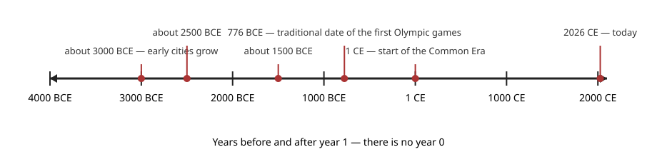
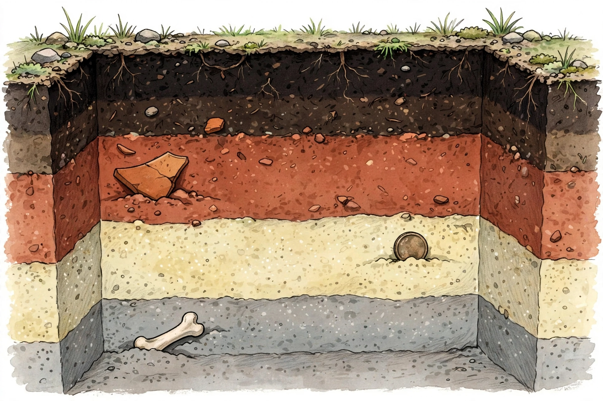

# Lesson 05 — Chronology and Archaeology: Reading Time in Layers

**Unit:** [U01 — Historical Inquiry: Archaeology, Maps, and Chronology](../README.md) · **Week 6**
**Time:** ~40 minutes · **Session:** 13 of 16

## Goal

You will place events in order on a **BCE/CE timeline**, compute elapsed
time across millennia, and order finds by **archaeological layer** to infer
what changed.

## Materials

- Notebook (inquiry notebook) and pencil; ruler
- The BCE/CE timeline ([bce-ce-timeline.svg](../assets/bce-ce-timeline.svg)
  — deterministic diagram) and the fictional dig illustration below

## Readiness check (4 minutes)

Answer aloud:

1. Which is older: 3000 BCE or 2500 BCE? How do you know?
2. "1500 BCE happened 1500 years ago." True or false — and why?

If #2 tripped you up, this lesson fixes it: BCE years count *backward*.

## Teaching

### Part A — The BCE/CE number line

Historians need one shared number line for all of time. The system most of
the world uses:

- **BCE** = "Before the Common Era." Years count **backward** from year 1:
  3 BCE, 2 BCE, 1 BCE — and 3000 BCE is *older* (earlier) than 2500 BCE,
  because you count down toward year 1.
- **CE** = "Common Era." Years count **forward** from year 1: 1 CE, 2 CE,
  … 2026 CE (this year).
- There is **no year 0**: the year after 1 BCE is 1 CE.

Study the timeline. Notice that the distance between any two years is the
elapsed time — but BCE arithmetic has a trap.

*Deterministic diagram — tick and event positions computed exactly.
Alt text: horizontal number line from 4000 BCE (left) to 2100 CE (right),
ticks every 1000 years; marked events: about 3000 BCE (early cities grow),
about 2500 BCE, about 1500 BCE, 776 BCE (traditional date of the first
Olympic games), 1 CE (start of the Common Era), 2026 CE (today).*

**Worked example 1 — same era: subtract.**
*How many years passed from 2500 BCE to 1500 BCE?*
*Thinking:* Both years are BCE, so count the steps between them on the
number line: 2500 − 1500 = **1000 years**. Check on the timeline: 2500 BCE
sits 1000 years left of 1500 BCE. Simple subtraction works whenever both
years are on the same side.

**Worked example 2 — across eras: add, then subtract 1.**
*How many years passed from 776 BCE (traditional date of the first Olympic
games) to 2026 CE (this year)?*
*Thinking:* 776 + 2026 = 2802 — but that counts a year 0 that never
existed! The correct rule: add, then subtract 1 → 776 + 2026 − 1 =
**2801 years**. Check with a tiny case: 1 BCE → 1 CE must be 1 year (the
year after 1 BCE *is* 1 CE). The naive add gives 1 + 1 = 2 — wrong. The
corrected rule gives 1 + 1 − 1 = 1 — right. So 2801 years have passed since
776 BCE. Whenever your span crosses from BCE to CE, remember: **no year 0.**

### Part B — How archaeologists read layers

Archaeology is the study of the past through **things people left behind**
and **where they left them**. A dig is not a treasure hunt — it is careful,
slow reading of the earth. The key idea is **stratigraphy**: the study of
layers.

Imagine a town where people live for hundreds of years. Floors wear out and
get covered with fresh clay. Trash piles up and gets buried. A house burns,
and new builders level the ground and build on top. Over centuries, the
ground **rises in layers** — and each layer holds the objects of its time.

The rule: **deeper layers are usually older**, because new soil and debris
settle on top of old. (Usually — a later pit dug down through old layers can
mix things up, which is why archaeologists record everything so carefully.)

But an object alone means little. What matters is its **context**: which
layer it came from, what lay beside it, what was above and below. A coin in
a deep layer tells a different story than the same coin in a shallow one.
Remove the context — pocket the coin and forget where it lay — and you have
destroyed the evidence. That is why real archaeologists dig slowly, draw
every layer, and work with the permission and respect of the communities
connected to a site. Many sites have **living descendant communities** whose
histories these are; archaeology serves their questions too, and nothing is
dug up as a trophy.

**Worked example 3 — order the layers.**
Study the illustration below. It is an **AI illustration of a fictional
dig — not evidence** of any real site. No measurements or labels in the
picture should be treated as data.

*Caption: AI illustration of a fictional dig — not evidence. An exposed
trench shows five horizontal soil layers. A broken pottery shard lies in the
reddish layer; a round coin-like disk lies in the pale sandy layer below
it; a pale bone fragment lies in the deepest gray layer.*

*Thinking:* List the layers top to bottom: (1) dark topsoil with roots and
pebbles, (2) dark brown layer with a small pottery piece, (3) reddish
layer with the large broken pottery shard, (4) pale sandy layer with the
coin-like disk, (5) gray layer with the bone fragment. Deepest = oldest, so
the order from oldest to youngest is: **bone → coin-like disk → pottery
shard**. The bone was buried first; the people who dropped the pottery came
later. Notice what we did *not* claim: we did not say how many years apart
they are — layers give **relative order** (what came before what), not exact
dates. Exact dates need other methods.

> **Text-only alternative** (same information as the image, for anyone not
> viewing it): A fictional trench has five horizontal layers. From top to
> bottom: Layer 1 — dark topsoil with plant roots and small pebbles (no
> artifacts visible); Layer 2 — dark brown soil with one small pottery
> piece; Layer 3 — reddish soil with one large broken pottery shard;
> Layer 4 — pale sandy soil with one round coin-like disk; Layer 5 — gray
> soil with one pale bone fragment. Use this list to answer the ordering
> questions below exactly as if you were looking at the picture.

**Worked example 4 — infer what changed.**
*The bone is in the deepest layer; the pottery shard is two layers above
it. What might have changed between those times?*
*Thinking:* A bone in the deepest layer and shaped pottery higher up could
mean the later people made fired-clay containers — a new craft. But that is
an **inference**, and it needs support: one shard does not prove a whole
pottery tradition. A careful historian writes: "The *order* shows the bone
is older than the pottery. One *possible* inference is that pottery-making
began (or arrived) between those layers; I would need more finds — more
shards, a kiln, clay sources — to support it." Order is evidence;
the story about *why* is an inference that needs more evidence.

## Guided practice (with the adult)

Do these together, talking through each one.

1. On the timeline: is 1500 BCE older or younger than 2500 BCE? Is 500 BCE
   older or younger than 500 CE? Explain using the direction BCE counts.
   - *Hint: BCE counts down toward year 1 — bigger BCE number = older.*
2. Compute the elapsed time. Show your work and name the rule you used.
   a. 3000 BCE → 1000 BCE.
   b. 44 BCE → 44 CE. (*Careful:* which rule?)
   - *Hint: same side = subtract; across eras = add, then subtract 1.*
3. Using the dig illustration (or the text-only alternative): list the five
   layers top to bottom, then order the three finds (bone, coin-like disk,
   pottery shard) from oldest to youngest with one reason.
   - *Hint: deeper = older. Your reason should name the rule, not just the
     answer.*
4. Error analysis: a learner says, "The pottery shard is in a higher layer,
   so the pottery people were more advanced." What is right and what is
   wrong here?
   - *Hint: what does a layer tell you for sure — and what is an inference
     needing more evidence?*

## Independent practice

Write or dictate your answers (8 tasks).

1. Order these from oldest to youngest: 2026 CE, 1500 BCE, 3000 BCE, 1 CE,
   776 BCE.
2. Compute: how many years from 2000 BCE to 1000 BCE? Show the subtraction.
3. Compute: how many years from 2000 BCE to 1000 CE? Show both steps
   (add, then subtract 1).
4. A learner computes 250 BCE → 250 CE as 500 years. What did they forget?
   Give the correct answer.
5. From the dig illustration: which find is oldest — the bone, the
   coin-like disk, or the pottery shard? Cite the layer rule.
6. Could the coin-like disk be *younger* than the pottery shard even though
   it lies deeper? Describe one way that could happen (think: what if
   someone dug a hole?).
7. Write two sentences: what is the difference between a layer giving you
   **order** and a layer giving you a **date**?
8. Inquiry notebook: write one **compelling question** about the fictional
   dig (e.g., about what changed between the bone layer and the pottery
   layer), plus **two supporting questions** — one answerable by the layers,
   one needing a different source kind.

## Application — build a classroom timeline

On a long strip of paper, draw a timeline from 3000 BCE to 2026 CE (the
adult helps with spacing — the point is order and scale, not perfection).
Mark: 2500 BCE, 1500 BCE, 776 BCE, 1 CE, 2026 CE. Then add **two events
from your own life** (birth year, a memorable year) at the far right and
compute how many years ago 776 BCE was from your birth year. Label the
timeline "practice timeline — not to scale" if your spacing is approximate.
Bring it to the next session.

## Exit check

Answer in one or two sentences each:

1. Why is there no year 0, and how does that change elapsed-time math
   across the BCE/CE boundary?
2. In a dig, why does "deeper = older" usually hold — and what is one way it
   could be wrong?
3. What is **context**, and why does removing an artifact without recording
   its context destroy evidence?

## Supports

- **Reading/language access:** BCE/CE are always read aloud as "before the
  common era / common era"; the number line is traced left-to-right with a
  finger while reading dates; key terms defined in context.
- **Alternate response mode:** ordering tasks may be done with printed event
  cards placed on a floor timeline; layer ordering may use the text-only
  alternative or a printed copy of the illustration with layers numbered;
  computations may be dictated.
- **Extension:** research (adult-guided, [Resource
  Pack](../resource-pack.md)) how archaeologists get *exact* dates when
  layers only give order — write three sentences on one dating method and
  what it can and cannot tell.

## Teacher note

**Likely misconceptions:** (1) Bigger BCE number = "more" = younger —
anchor with the countdown: BCE counts *down* to year 1, so 3000 BCE is
older than 2500 BCE. (2) The naive add across eras (2802 instead of 2801) —
make "no year 0" a chant; the 1 BCE → 1 CE = 1 year check catches it every
time. (3) "Deeper = older" treated as absolute — affirm the rule, then
teach the pit-digging exception; archaeologists *record* because the earth
can be disturbed. (4) Treating the AI illustration as a real site — repeat
the caption language: it is a teaching picture of a fictional dig, and real
digs are slow, permitted, respectful work. **Answer key:**
[answer-key.md](../answer-key.md#lesson-05--chronology-and-archaeology-reading-time-in-layers).
**Next:** Week 6 S14 (sequencing/dating practice), S15 (site investigation —
"The Fictional Tell" project), S16 (unit review + assessment).
