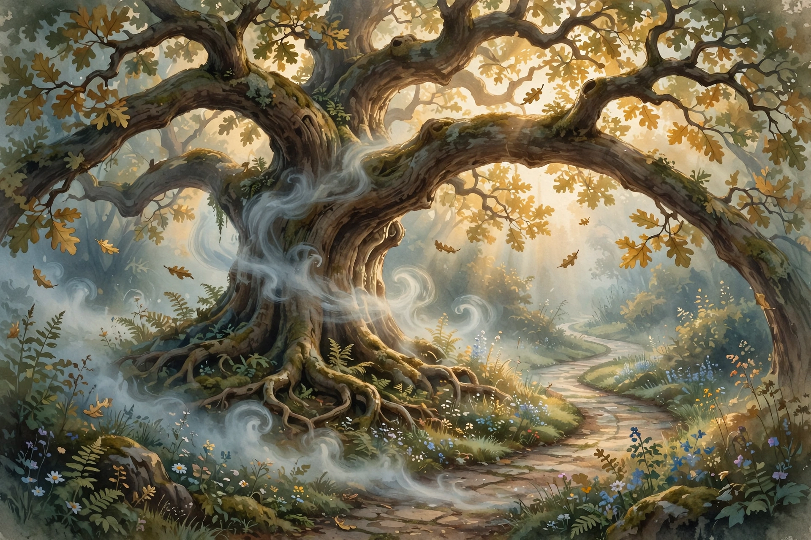

# Lesson 01 — Figurative and Connotative Meanings: What It Really Says

**Student goal:** I can tell what figurative language literally says from
what it means, and I can explain a word's connotations in context.
**Time:** 40–50 minutes · **Unit:** [U02](../README.md) · **Session 1 of 18**
**Standards:** RL.7.4, L.7.5.a

## Materials

- Notebook; two colored pencils (one for **literal** words, one for
  **figurative** words)
- The generated illustration
  [personification-oak-watch.png](../assets/personification-oak-watch.png)

## Readiness check (5 minutes)

Read this sentence: *"The classroom was a zoo this morning."* Ask: Did the
learner's classroom literally contain animals? Accept: no — it was loud and
chaotic. The sentence says one thing and means another. Writers do this on
purpose; today you learn to read on both levels at once.

## Explicit teaching (12 minutes)

**Literal vs. figurative meaning.** The *literal* meaning is what the words
actually describe. The *figurative* meaning is what the writer *suggests* by
comparing one thing to another. Three workhorse comparisons:

- **Simile** — compares two unlike things with *like* or *as*: "brave as a
  lion."
- **Metaphor** — compares two unlike things directly, saying one thing *is*
  another: "He is a lion in debate." No *like* or *as* — the comparison is
  stronger because it isn't softened.
- **Personification** — gives human qualities to something non-human: "The
  wind whispered through the cracks." Wind can't whisper — whispering is a
  human action — so the reader pictures something quiet and secretive.

**Connotation vs. denotation.** A word's *denotation* is its dictionary
definition; its *connotation* is the feeling or association it carries.
*Childlike* and *childish* both denote "like a child," but *childlike*
connotes innocence and wonder while *childish* connotes immaturity and
silliness. Poets choose words for their connotations, and you must read for
the feeling, not just the definition.

## Anchor poem — "Fog" by Carl Sandburg (1916; public domain)

> The fog comes
> on little cat feet.
>
> It sits looking
> over harbor and city
> on silent haunches
> and then moves on.

Margin glosses: *harbor* — a sheltered place where ships dock; *haunches* —
an animal's hind legs and hips (how a cat sits).

## Worked example 1 — personification and connotation

*"The fog comes / on little cat feet."* Literally, fog has no feet — that's
**personification** (giving fog the cat's way of moving). The figurative
meaning: fog arrives quietly, the way a cat pads into a room unnoticed. Now
the connotation check: "little" connotes something small, gentle, almost
tender — not threatening. If Sandburg had written "on heavy boots," the
denotation (arrival) would be the same but the connotation would flip to
force and menace. **So the word choice tells you the poem's attitude: the
fog is a quiet visitor, not an invader.**

## Worked example 2 — extended comparison

*"It sits looking / over harbor and city / on silent haunches / and then
moves on."* The cat comparison continues across the whole poem — that makes
it an **extended metaphor** (one comparison stretched over several lines).
"Looking" is personification again: fog doesn't look. The effect: the city
is being *watched* by something calm and patient, and then — like a cat
bored with the view — the fog simply "moves on." A common error is to call
"sits looking" a simile; there is no *like* or *as*, so it is a metaphor
carried by personification.

## Illustration activity — "The Tree That Keeps Watch" (15 minutes)

Look at the generated illustration
[personification-oak-watch.png](../assets/personification-oak-watch.png):

*Caption: AI-generated illustration of an old oak whose branches reach like
protective arms over a garden path at dawn. Used for the personification
activity in Lesson 01.*

1. **Guided (with the adult):** Name three things in the image that look
   like something a person would do. (Branches reaching like arms; the tree
   "keeping watch" over the path; mist curling as if the tree is breathing
   or thinking.)
2. Write two personification sentences about the tree, e.g., "The old oak
   stood guard over the path all night." Underline the human action word.
3. **Connotation choice:** Which feels closer to the picture — "The tree
   *loomed* over the path" or "The tree *watched over* the path"? Both
   denote a tree above a path. Explain which connotation fits and why.
4. **Exit check:** In one sentence, explain what "The fog comes on little
   cat feet" means — and say whether the fog is frightening or gentle,
   using one connotation clue from the poem.

**Text-only alternative (everything needed to answer is here):** The picture
shows a huge old oak tree at dawn. Its thick branches bend down over a
winding garden path the way a person's arms might reach to shelter
something. Morning mist curls around the trunk, golden light shines through
golden-green leaves, and small flowers grow at the tree's base. Nothing in
the picture is a real place; it is an imagined scene.

## Independent practice (10 minutes)

Read "Hope is the thing with feathers" by Emily Dickinson (1891; public
domain). Margin gloss: *perches* — sits, like a bird on a branch; *gale* —
a very strong wind; *abash* — embarrass or make ashamed; *chillest* — coldest.

> "Hope" is the thing with feathers —
> That perches in the soul —
> And sings the tune without the words —
> And never stops — at all —
>
> And sweetest — in the Gale — is heard —
> And sore must be the storm —
> That could abash the little Bird
> That kept so many warm —
>
> I've heard it in the chillest land —
> And on the strangest Sea —
> Yet — never — in Extremity,
> It asked a crumb — of me.

1. The poem's big comparison is a metaphor: hope is compared to what?
   (A bird — "the thing with feathers.")
2. Find two examples of **personification** in the poem. For each, name the
   human quality and what non-human thing receives it.
3. "Sweetest" and "sore" in stanza 2: what does each word connote, and why
   does the contrast matter for the poem's meaning?
4. **Error-analysis task:** A classmate says the poem is *literally* about
   a bird. Explain in two sentences why that reading fails, citing one
   line.

## Supports and extension

- **Support:** If the poem feels dense, read only stanza 1 first and answer
  questions 1–2; the adult reads the rest aloud.
- **Alternate mode:** Draw the literal picture (a real bird) and the
  figurative picture (hope as a feeling) side by side, then label which
  lines each drawing comes from.
- **Extension:** Write a four-line stanza that personifies a different
  weather event (rain, thunder, snow) the way Sandburg personified fog —
  then explain your connotation choices in one sentence.

## Teacher note

Likely misconception: learners label *any* vivid description as
personification. Insist on the test — "Could a non-human thing literally do
this?" If yes (a river "runs" — rivers do flow), it is not personification.
Answer-key reference: [answer-key.md](../answer-key.md) § Lesson 01.
