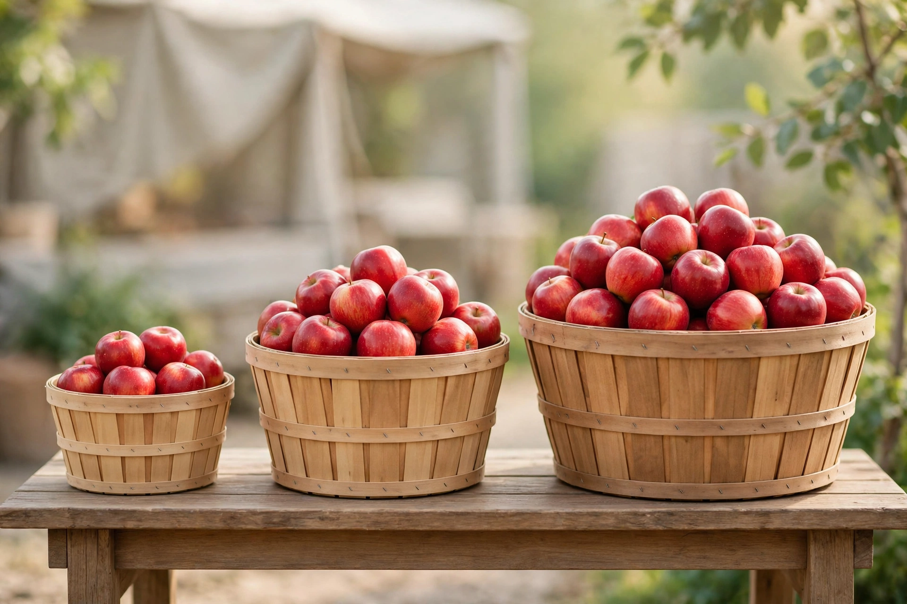

# Lesson 02 — Rates with Unlike Units and Unit Conversions

**Goal:** You will compute and compare rates whose two quantities use
different units, and convert rates between unit systems.
**Time:** 45 minutes · **Materials:** paper, pencil, ruler, calculator for checking only
**Unit:** [Unit 02](../README.md) · **Objective 1** · **Standard 7.RP.A.1**

## Readiness check (3 min)

1. A car travels 150 miles in 3 hours. Unit rate? Include units.
2. How many feet are in 1 mile? How many seconds in 1 hour?
3. Which is a better deal: $4 for 10 apples or $5 for 12 apples? (Estimate first.)

## Teaching

Rates get interesting when the units differ on the two sides: dollars per
pound, miles per hour, words per minute, people per square mile. The
method is the same as Lesson 01 — divide — but now you must track *both*
units through the division, and sometimes convert one unit system to
another first.

**Converting a rate.** To change miles per hour to feet per second, replace
each unit with an equivalent: 1 mile = 5280 feet, 1 hour = 3600 seconds.

**Worked example 1.** A sprinter runs 100 meters in 12.5 seconds. What is
the speed in meters per second? In kilometers per hour?

100 ÷ 12.5 = 8 m/s. For km/h: 8 meters per second means 8 × 3600 = 28800
meters per hour = 28.8 km/h. Reason check: 8 m/s is a fast sprint
(about 18 mph — elite), so 28.8 km/h is consistent. ✓

**Worked example 2.** A car travels at 60 miles per hour. What is that in
feet per second?

60 miles/hour = (60 × 5280 feet) / (3600 seconds) = 316800/3600 = 88 ft/s.
The seconds cancel to leave feet per second. Reason check: 88 ft/s × 60 =
5280 ft/min = 1 mile/min = 60 mph. ✓ (This is worth memorizing: 60 mph is
exactly 88 ft/s.)

**Worked example 3.** Two juice deals: 64 fl oz for $4.80, or 96 fl oz
for $6.72. Which is the better value?

Unit prices: 4.80 ÷ 64 = $0.075 per fl oz; 6.72 ÷ 96 = $0.07 per fl oz.
The 96-oz bottle is cheaper per ounce — even though its sticker price is
higher. The unit rate, not the total, decides "better deal."

## Image activity — the apple stand

Look at the market illustration below (AI-generated teaching image).

*Caption: AI-generated illustration of an apple stand with small, medium,
and large baskets. The baskets' prices and weights are given in the table
below — the image shows relative size only.*

The stand's sign (not shown) lists:

| Basket | Weight | Price |
|---|---|---|
| Small | 2 lb | $3.40 |
| Medium | 5 lb | $7.50 |
| Large | 8 lb | $11.20 |

**Text-only alternative:** the table above carries every number the
activity needs; the image shows only that the baskets come in three
visibly different sizes.

**Task.** Compute the unit price ($ per lb) for each basket, rank the
baskets from best to worst value, and answer: does the biggest basket
always win? Write one sentence explaining what the unit rates told you
that the sticker prices did not.

## Guided practice (with hints)

**G1.** A train covers 330 miles in 5.5 hours. Speed in mph?
*Hint: 330 ÷ 5.5. Try 33 ÷ 0.55 × 10 — or just divide.*
**G2.** Convert 45 mph to feet per second.
*Hint: follow Worked example 2's pattern: (45 × 5280)/3600.*
**G3.** A 12-oz box of cereal costs $3.60; a 20-oz box costs $5.60. Which
is the better value, and by how many cents per ounce?

## Independent practice

**I1.** A cyclist rides 26 miles in 1.5 hours. Speed in mph (one decimal)?
**I2.** A faucet drips 3/4 gallon in 2 hours. Gallons per hour?
**I3.** Convert 100 km/h to meters per second. (1 km = 1000 m.)
**I4.** Olive oil: 500 mL for $6.50 vs. 750 mL for $9.00. Better value?
**I5.** A printer prints 240 pages in 8 minutes. Pages per minute? Then
convert to pages per hour.
**I6.** **Explain your reasoning.** A store sells "2 pounds for $5" and
"5 pounds for $11." A friend says the second deal is better because
$11 ÷ $5 = 2.2 and 5 ÷ 2 = 2.5, and 2.5 > 2.2. Is the reasoning valid?
Compute the actual unit prices and give the correct verdict with units.

## Application

A road trip is 420 miles. Your car gets 28 miles per gallon and gas costs
$3.40 per gallon. (a) How many gallons will the trip use? (b) What is the
fuel cost? (c) What is the cost *per mile*? Show each unit rate with its
units.

## Exit check

A recipe's sauce costs $2.40 for 12 fl oz. A larger jar costs $3.90 for
20 fl oz. Which is the better value per fluid ounce? By how much per
fluid ounce? What does your answer mean in plain words?

## Supports and extension

- **Reading access:** circle both units in each problem before dividing;
  write the "per" sentence first ("dollars per pound").
- **Alternate response:** use a double number line — mark both quantities
  on parallel lines and read off the "per 1" value.
- **Extension:** research (adult help) the actual 100 m world-record time
  (~9.58 s) and compute that speed in km/h. Compare with Worked example 1.

## Teacher note

Misconception: "bigger package = better deal" — the image activity is
built to break it (see answer key: the large basket wins here, but only
the unit rates prove it; the project later shows bulk discounts that
*break* proportionality). Conversion errors usually come from multiplying
when they should divide — have learners track units as fractions and
cancel. Answer key: [../answer-key.md](../answer-key.md#lesson-02).
