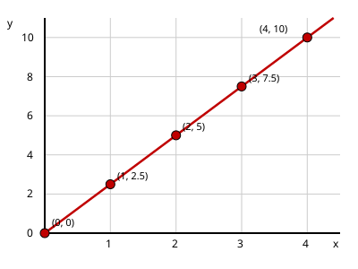

# Lesson 04 — Graphs of Proportional Relationships

**Goal:** You will graph proportional relationships and use the
"straight line through the origin" test to judge proportionality.
**Time:** 45 minutes · **Materials:** paper, pencil, ruler, graph paper
**Unit:** [Unit 02](../README.md) · **Objective 2** · **Standard 7.RP.A.2.a**

## Readiness check (3 min)

1. Plot the points (0, 0), (1, 3), (2, 6). What do you notice?
2. What is the origin? What are its coordinates?
3. From Lesson 03: is the table (2, 6), (3, 9), (5, 15) proportional?

## Teaching

Every row of a table is an **ordered pair** (x, y) you can plot. When the
relationship is proportional, something beautiful happens: all the points
lie on a single **straight line**, and that line passes through the
**origin** (0, 0).

Why the origin? If 0 of the first quantity means 0 of the second — 0 cups
of lemon juice need 0 cups of water; 0 pounds of apples cost $0 — the
point (0, 0) must satisfy the relationship. A flat fee breaks this: 0
miles in the taxi still "costs" the $3 pickup fee, so (0, 0) is not on
its graph.

**The graph test:** plot the pairs. If they lie on a straight line that
passes through (0, 0), the relationship is proportional. If the points
are not on one straight line, *or* the line misses the origin, it is not.

Study this graph (deterministic SVG — exact coordinates, not an
approximation):

*Caption: exact plot of the proportional relationship y = 2.5x. Every
plotted point lies on one straight line through the origin (0, 0).*

**Worked example 1.** Graph the lemonade table from Lesson 03:
(2, 6), (3, 9), (5, 15), plus (0, 0) and (1, 3). The points line up on a
straight line through the origin → **proportional** (matches the table
test).

**Worked example 2.** Graph the taxi table: (0, 3), (1, 5), (2, 7),
(3, 9). The points form a straight line, but it crosses the y-axis at
(0, 3), **not** the origin → **not proportional** (matches the table
test). A straight line alone is not enough — it must go through (0, 0).

**Worked example 3.** Points (1, 2), (2, 5), (3, 9): these do not lie on
one straight line at all → **not proportional**, no matter what.

## Guided practice (with hints)

**G1.** Plot (0, 0), (2, 5), (4, 10), (6, 15). Straight line through the
origin? Verdict?
*Hint: use a ruler — lay it along the points.*
**G2.** Plot the gym-fee table from Lesson 03 (I3): (0, 20), (1, 50),
(2, 80), (3, 110). Straight line? Through the origin? Verdict?
*Hint: include the (0, 20) point — 0 months still costs the signup fee.*
**G3.** A table shows (1, 4), (2, 8), (3, 12). Without plotting, predict:
will the graph be a straight line through the origin? Then plot to check.

## Independent practice

**I1.** Plot (0, 0), (1, 6), (2, 12), (3, 18). Verdict + one-sentence reason.
**I2.** Plot (0, 5), (1, 9), (2, 13), (3, 17). Verdict + one-sentence reason.
**I3.** Plot (0, 0), (1, 3), (2, 7), (3, 12). Verdict + one-sentence reason.
**I4.** The point (4, 10) is on a proportional graph. Name two other
points that must also be on it (besides the origin), and explain why.
**I5.** A learner says "my graph is a straight line, so the relationship
is proportional." Give a counterexample (points or story) proving the
statement is incomplete, and state the complete test.
**I6.** **Explain your reasoning.** Two graphs both pass through the
origin. Graph A is a straight line; Graph B curves upward, getting
steeper. Which one could show a proportional relationship? Why can't the
other?

## Application

A farmer's market sells honey at $6 per pint. (a) Make a table for
0, 1, 2, 3, 4 pints. (b) Plot the points. (c) A second stand charges a
$2 jar deposit plus $5 per pint of honey. Plot (0, 2), (1, 7), (2, 12),
(3, 17) on the same axes in a different color. (d) Which stand is
proportional? For 4 pints, which is cheaper — and does "proportional"
mean "cheaper"?

## Exit check

You are given four points: (0, 0), (2, 7), (4, 14), (6, 21). (a) Are
they on a straight line through the origin? (b) What is the unit rate?
(c) Predict the y-value for x = 10 without plotting, and explain your
method.

## Supports and extension

- **Reading access:** label every plotted point with its coordinates in
  pencil; say "over x, up y" aloud while plotting.
- **Alternate response:** the adult plots the learner's dictated points;
  the learner judges straightness with a ruler and gives the verdict.
- **Extension:** graph y = 2x and y = 2x + 3 on the same axes. Describe
  in words how the "+3" moves the line, and connect it to the taxi's $3
  fee.

## Teacher note

Two classic errors: (1) "straight line ⟹ proportional" (forgetting the
origin — hammer with the taxi/gym examples); (2) refusing to plot (0, 0)
because "nothing happens at zero" — insist it is always a testable
point. The SVG is exact: points (0,0), (1,2.5), (2,5), (3,7.5), (4,10)
on y = 2.5x. Answer key: [../answer-key.md](../answer-key.md#lesson-04).
