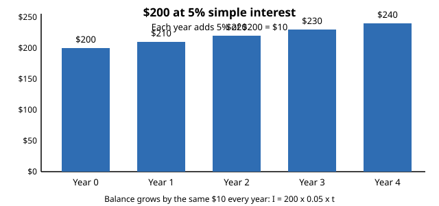

# Lesson 04 — Simple Interest

**Goal:** You will compute simple interest with I = Prt, find the
total amount, and explain simple interest as the same dollar growth
every period.
**Time:** 45 minutes · **Materials:** paper, pencil, calculator for checking only
**Unit:** [Unit 03](../README.md) · **Objective 4** · **Standard 7.RP.A.3**

## Readiness check (3 min)

1. Find 4% of $500.
2. How many years is 6 months? How many years is 18 months?
3. If a balance grows by $20 every year, what is it after 3 years
   starting from $500?

## Teaching

**Simple interest** is interest paid only on the original amount,
called the **principal** (P). The **interest rate** (r) is a percent
per year, written as a decimal. The time (t) is in **years**. The
formula is:

> I = P × r × t, and total amount A = P + I.

Because the interest each year is always r × P — the same dollars
every year — simple interest is a proportional relationship: interest
grows in direct proportion to time. Doubling the time doubles the
interest. This is different from compound interest, where interest
itself earns interest; this unit covers simple interest only.

**Worked example 1.** Deposit $500 at 4% simple interest for 3 years.
How much interest is earned, and what is the total?

I = 500 × 0.04 × 3 = 20 × 3 = **$60**. Total A = 500 + 60 = **$560**.
Year by year: $500 → $520 → $540 → $560. The same $20 every year. ✓

**Worked example 2.** Deposit $1,200 at 5% simple interest for 2 years.
Find the interest and the total.

I = 1200 × 0.05 × 2 = 60 × 2 = **$120**. Total = 1200 + 120 =
**$1,320**. Reason check: 5% of 1200 is 60 per year; two years is 120. ✓

**Worked example 3.** A $800 deposit earns $96 in simple interest over
3 years. What was the annual rate?

I = Prt, so 96 = 800 × r × 3 = 2400r. Then r = 96 ÷ 2400 = 0.04 =
**4%**. Check: 800 × 0.04 × 3 = 96. ✓
And a months example: $400 at 6% for 6 months. Convert first: 6 months
= 0.5 years. I = 400 × 0.06 × 0.5 = **$12**.

## Chart activity — the same dollars every year

*Caption: Deterministic chart (hand-built, exact values) of $200 at 5%
simple interest. Each year adds 5% of $200 = $10 — the same dollars
every year.*

**Text-only alternative (the same data):**

| Year | Balance |
|---|---|
| 0 | $200 |
| 1 | $210 |
| 2 | $220 |
| 3 | $230 |
| 4 | $240 |

**Activity.** (a) Verify the year-4 balance with I = Prt. (b) What
would the balance be after 10 years? (c) If the rate doubled to 10%,
what would each year's growth be? Explain in one sentence why doubling
the rate doubles the yearly growth.

## Guided practice (with hints)

**G1.** Deposit $300 at 3% simple interest for 4 years. Find the
interest and the total.
*Hint: 3% of 300 is 9 per year.*

**G2.** Deposit $2,000 at 2.5% simple interest for 2 years. Find the
interest.
*Hint: 2.5% = 0.025.*

**G3.** Deposit $600 at 5% simple interest for 6 months. Find the
interest.
*Hint: convert 6 months to years first.*

## Independent practice

**I1.** Deposit $900 at 4% simple interest for 5 years. Find the
interest and the total.
**I2.** Deposit $1,500 at 6% simple interest for 3 years. Find the
interest.
**I3.** Deposit $250 at 8% simple interest for 9 months. Find the
interest.
**I4.** Compare: $1,000 at 3% for 4 years vs. $1,000 at 4% for 3 years.
Which earns more interest? Show both computations.

## Applied task

You save $1,000 in an account paying 5% simple interest per year. How
many years until you have earned $150 in interest? Show the equation
you solve, and check your answer by computing the interest for that
many years.

## Exit check

Deposit $400 at 5% simple interest for 2 years. What is the interest?
Show the substitution into I = Prt.
