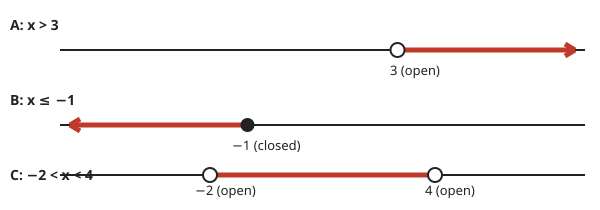

# Lesson 06 — Inequalities and Their Graphs

**Goal:** You will solve inequalities of the forms px + q > r
or px + q < r, graph the solution set, and interpret it in
context.
**Time:** 45 minutes · **Materials:** paper, pencil, ruler, calculator for checking only
**Unit:** [Unit 04](../README.md) · **Objective 4** · **Standard 7.EE.B.4.b**

## Readiness check (3 min)

1. Is 5 > 4 true? Is 5 < 4 true?
2. On a number line, where would you put all numbers greater than 4?
3. Solve 2x + 3 = 11. How would the answer change if the sign were >?

## Teaching

An **inequality** compares two expressions with >, <, ≥, or ≤
instead of =. Its **solution set** is usually many numbers, not
one: x > 4 means every number greater than 4. We **graph** a
solution set on a number line: an **open circle** on the
boundary means the boundary is *not* included (>, <); a
**closed circle** means it *is* included (≥, ≤). An arrow shows
the direction the solutions continue.

Solve an inequality almost exactly like an equation — with one
crucial exception, the **flip rule**: when you multiply or
divide both sides by a **negative** number, reverse the
inequality sign. Why? Because multiplying by −1 reverses order:
3 < 5, but −3 > −5. If you forget the flip, test a value: it
will fail, and the test will catch you.

Two checks for every inequality: (1) the boundary value must
make the two sides equal (for > and <, it must *not* satisfy
the inequality); (2) one test value inside the solution set
must satisfy it, and one outside must not.

*Caption: Deterministic diagrams (exact, not AI-generated).
Top: x > 3 — open circle at 3, arrow right. Middle: x ≤ −1 —
closed circle at −1, arrow left. Bottom: −2 < x < 4 — open
circles at −2 and 4, segment between them.*

**Text-only alternative (the three graphs, in words):** Graph A:
open circle at 3, arrow to the right (x > 3). Graph B: closed
circle at −1, arrow to the left (x ≤ −1). Graph C: open circles
at −2 and 4, thick segment between them (−2 < x < 4).

**Worked example 1.** Solve 2x + 3 > 11 and graph the solution.

Subtract 3: 2x > 8. Divide by 2 (positive — no flip): x > **4**.
Graph: open circle at 4, arrow right.
Checks: boundary x = 4 gives 11, and 11 > 11 is false — correct,
4 is not a solution. Test x = 5: 13 > 11 true. ✓ Test x = 3:
9 > 11 false. ✓

**Worked example 2.** Solve −3x + 6 ≤ 21 and graph the solution.

Subtract 6: −3x ≤ 15. Divide by −3 — **flip**: x ≥ **−5**.
Graph: closed circle at −5, arrow right.
Checks: boundary x = −5 gives 21 ≤ 21 true — correct, −5 is a
solution. Test x = 0: 6 ≤ 21 true. ✓ Test x = −6: 24 ≤ 21
false. ✓ Without the flip you would get x ≤ −5, and the test
x = 0 would expose the error.

**Worked example 3.** Solve 5 − x < 2.

Subtract 5: −x < −3. Divide by −1 — **flip**: x > **3**.
Check: x = 4 gives 1 < 2 true. ✓ Boundary x = 3 gives 2 < 2
false — correct, 3 is not a solution.

**Words that signal inequalities:** "at most" means ≤; "at
least" means ≥; "fewer than" means <; "more than" means >;
"no more than" means ≤; "under" means <. Always translate the
words before solving — and after solving, translate the answer
back: if the variable counts whole objects, a solution like
n ≤ 6.7 means at most 6 whole objects.

## Guided practice (with hints)

**G1.** Solve x + 7 < 15 and describe its graph.
*Hint: no multiplication or division needed — no flip.*

**G2.** Solve 3x − 2 ≥ 10 and describe its graph.
*Hint: dividing by positive 3 — no flip; is the circle open
or closed?*

**G3.** Solve −2x > 6 and describe its graph.
*Hint: dividing by −2 — flip!*

## Independent practice

**I1.** Solve 4x + 1 < 17 and describe its graph.
**I2.** Solve 2x − 5 ≥ 9 and describe its graph.
**I3.** Solve −x + 3 > 8 and describe its graph.
**I4.** Solve 3(x − 2) ≤ 12 and describe its graph.

## Applied task

You have $60. You buy a $12 book, then as many $8 games as you
can afford without going over $60. Write the inequality, solve
it, graph it, and answer in a sentence: how many games at most?
Explain why the answer must be a whole number even though the
inequality alone allows decimals.

## Exit check

Solve −4x < 20. State whether the circle is open or closed,
which way the arrow points, and check with x = 0 and x = −6.

## Supports and extension

- **Reading/language access:** list the signal words (at most,
  at least, fewer than, more than) on the board before solving.
- **Alternate response mode:** build the graph with a strip of
  paper and a coin for the circle (open = coin beside the mark,
  closed = coin on the mark) before drawing it.
- **Extension:** solve −2(x + 3) > 10 and graph it; explain
  where the flip happens in each route (divide-first flips
  once; distribute-first flips at the division step).
  (Answer in the key.)

## Teacher note

Likely misconceptions: forgetting the flip; using a closed
circle for > or <; graphing the arrow in the wrong direction;
reporting a decimal answer for a whole-object count. Answers:
see [answer key](../answer-key.md), Lesson 06.
