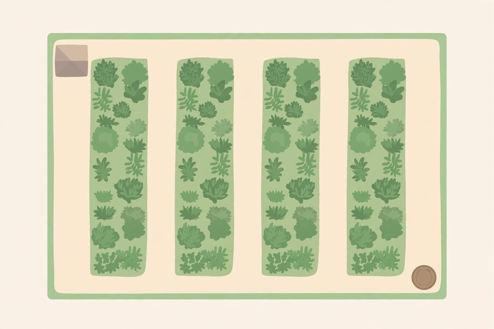

# Lesson 01 — Scale Drawings: Actual Lengths

**Goal:** You will read a scale, compute actual lengths from a scale
drawing, and compute drawn lengths from actual lengths.
**Time:** 45 minutes · **Materials:** paper, pencil, ruler
**Unit:** [Unit 05](../README.md) · **Objective 1** · **Standard 7.G.A.1**

## Readiness check (3 min)

1. A map says 1 cm = 10 km. A road is drawn 2 cm long. How long is
   the real road? (Multiply: 2 × 10 = 20 km.)
2. Write 3.5 × 5 as a decimal multiplication and compute it.
3. A rectangle is 6 m long and 4 m wide. What is its perimeter?

## Teaching

A **scale drawing** is a drawing in which every length is changed by
the same factor. The **scale** tells you the factor, written as
"drawing length = actual length" — for example, **1 cm = 2 m** means
every 1 cm on the drawing stands for 2 m in real life. The scale is a
proportional relationship: drawn and actual lengths are in proportion,
with the constant of proportionality given by the scale.

Two directions, one idea:

> actual length = drawn length × scale factor
>
> drawn length = actual length ÷ scale factor

If the scale is 1 cm = 2 m, the scale factor is 2 m per cm. A line
drawn 9 cm long stands for 9 × 2 = 18 m. A real length of 10 m would
be drawn 10 ÷ 2 = 5 cm long. The most common mistake in this unit is
using the wrong direction — multiplying when the problem asks for the
drawing, or dividing when it asks for the real thing. Ask first:
"Am I going from the page to the world, or from the world to the
page?" Page → world multiplies. World → page divides.

Two warnings before you start. First, keep the units straight: the
drawing unit (cm, inches) and the actual unit (m, ft, km) are
different, and the answer takes the actual unit. Second, **angles are
never scaled**: a 50° angle in a scale drawing is 50° in the real
figure. Only lengths change; angle measures stay exactly the same.

**Worked example 1.** A hiking map uses the scale 1 cm = 5 km. A trail
is drawn 3.5 cm long. How long is the real trail?

Page → world, so multiply: 3.5 cm × 5 km per cm = **17.5 km**.
Reason check: 3 cm would be 15 km and 4 cm would be 20 km, so 3.5 cm
should be between 15 and 20 km — 17.5 km is. ✓

**Worked example 2.** The garden plan below uses the scale 1 cm = 2 m.
The drawing table (not the screen image — print size varies, so all
drawn lengths are given in the table) says each planting bed is drawn
9 cm long and 2 cm wide. How long and wide is a real bed?

Length: 9 × 2 = **18 m**. Width: 2 × 2 = **4 m**. A real bed is
18 m by 4 m.
Reason check: the bed is drawn much longer than wide (9 cm vs. 2 cm),
so the real bed should be much longer than wide too — 18 m vs. 4 m
is. ✓

*AI-generated illustration of a community garden plan. The picture
shows the layout only — four beds, a shed, and a compost bin. Every
number for this activity comes from the table below, not from
measuring the picture.*

| Feature (garden plan) | Drawn length on the plan |
|---|---|
| Whole garden, long side | 12 cm |
| Whole garden, short side | 8 cm |
| Each planting bed | 9 cm long, 2 cm wide |
| Shed | 2 cm by 2 cm |
| Compost bin | 1 cm across (landmark only — no computation) |

Scale for the whole activity: **1 cm = 2 m**.

**Worked example 3.** A blueprint uses the scale 1 in = 3 ft. (a) A
wall is drawn 4.5 in long. How long is the real wall? (b) A window is
really 6 ft wide. How wide is it drawn?

(a) Page → world, multiply: 4.5 × 3 = **13.5 ft**.
(b) World → page, divide: 6 ÷ 3 = **2 in**.
Reason check: the drawn wall (4.5 in) is longer than the drawn window
(2 in), and the real wall (13.5 ft) is longer than the real window
(6 ft) — the order is preserved, as a scale drawing requires. ✓

## Guided practice (with hints)

**G1.** A floor plan uses 1 cm = 4 m. A room is drawn 6 cm long. How
long is the real room?
*Hint: page → world, so multiply 6 by the scale factor 4.*

**G2.** A model uses 1 in = 2 ft. A shelf is drawn 7.5 in long. How
long is the real shelf?
*Hint: 7.5 × 2; keep the answer in feet.*

**G3.** A garden bed is really 36 m long. The plan scale is 1 cm = 6 m.
How long is the bed drawn?
*Hint: world → page, so divide 36 by 6.*

## Independent practice

**I1.** A map uses 1 cm = 8 km. Two towns are drawn 5.5 cm apart. How
far apart are they really?
**I2.** A dollhouse plan uses 1 cm = 3 m. A table is drawn 2.5 cm
long. How long is the real table?
**I3.** A fence is really 54 ft long. The drawing scale is 1 in = 9 ft.
How long is the fence drawn?
**I4.** Use the garden table above (scale 1 cm = 2 m). (a) How long
and wide is the whole real garden? (b) How long is each side of the
real shed?

## Applied task

A floor plan uses 1 cm = 1 m. A rug is drawn 3 cm long and 2 cm wide.
(a) What are the rug's real length and width? (b) A friend says the
rug is 5 m long in real life "because 3 + 2 = 5." Explain the friend's
error in one or two sentences.

## Exit check

A scale drawing uses 1 cm = 7 m. A path is drawn 4 cm long. What is
the path's actual length? Show the multiplication.

## Teacher note

Likely misconception: adding the scale factor to the drawn length
(3 cm + 2 m = 5) instead of multiplying, and dividing when the
problem asks for the actual length. The direction question — page to
world or world to page — is the fix; drill it before the practice
bank. Answers: see the [answer key](../answer-key.md#lesson-01).
