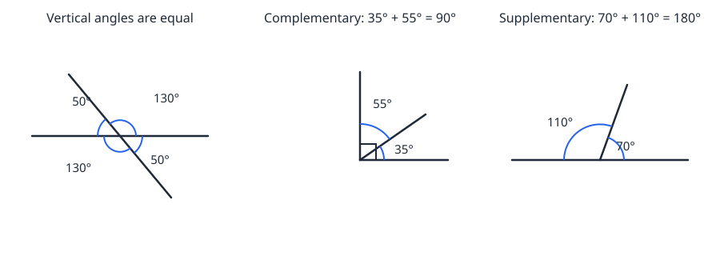

# Lesson 04 — Angle Pairs

**Goal:** You will identify complementary, supplementary, vertical,
and adjacent angles and find unknown angle measures from those facts.
**Time:** 45 minutes · **Materials:** paper, pencil, protractor
**Unit:** [Unit 05](../README.md) · **Objective 3** · **Standard 7.G.B.5**

## Readiness check (3 min)

1. 90 − 38 = ? (52.) 180 − 38 = ? (142.)
2. Two angles add to 180°. One is 100°. What is the other? (80°.)
3. Sketch two lines crossing. How many angles meet at the crossing
   point? (Four.)

## Teaching

An **angle** is formed by two rays sharing a vertex. Four
relationships between pairs of angles do most of the work in this
unit. Learn the pairs by what they **add to** or by **where they
sit**:

- **Complementary angles** add to **90°** — one right angle.
  ("Complement" and "corner": a right-angle corner.) If one angle is
  35°, its complement is 90° − 35° = 55°.
- **Supplementary angles** add to **180°** — one straight angle.
  ("Supplement" and "straight": both start with S.) If one angle is
  70°, its supplement is 180° − 70° = 110°.
- **Vertical angles** are the **opposite** angles formed when two
  lines cross. They are **equal**. If one is 50°, the angle opposite
  it is also 50° — and the two angles beside it are each
  180° − 50° = 130°.
- **Adjacent angles** share a vertex and a side, and sit next to each
  other. On their own they can add to anything — what matters is
  *what they sit on*: adjacent angles on a straight line are
  supplementary (they add to 180°); adjacent angles in a right angle
  are complementary (they add to 90°).

*Deterministic diagram (exact values, hand-built). Left: two lines
cross — opposite (vertical) angles are equal, 50° = 50° and
130° = 130°. Middle: a right angle split into 35° and 55° — the parts
are complementary, 35° + 55° = 90°. Right: a straight line split into
70° and 110° — the parts are supplementary, 70° + 110° = 180°.*

| Panel | What you see | Fact |
|---|---|---|
| Left | Two lines cross | Vertical angles equal: 50° opposite 50°, 130° opposite 130° |
| Middle | A 90° angle split by a ray | Complementary: 35° + 55° = 90° |
| Right | A 180° straight angle split by a ray | Supplementary: 70° + 110° = 180° |

**Worked example 1.** Find the complement and the supplement of 38°.

Complement: 90° − 38° = **52°**. Supplement: 180° − 38° = **142°**.
Reason check: the complement must be smaller than the supplement
(because 90° < 180°), and 52° < 142° is. ✓

**Worked example 2.** Two lines cross. One angle is 75°. Find the
other three angles.

The angle opposite the 75° angle is vertical to it, so it is **75°**.
Each angle adjacent to it sits on a straight line with it, so each is
180° − 75° = **105°**. The four angles are 75°, 105°, 75°, 105° —
and they add to 360°, as all angles around a point must. ✓

**Worked example 3.** In the diagram's right panel, the 110° angle is
known and the other angle is unknown. What is it?

The two angles sit on a straight line, so they are supplementary:
unknown = 180° − 110° = **70°**. This matches the diagram — and the
name to use is "supplementary," because the pair adds to 180°.

## Guided practice (with hints)

**G1.** What is the complement of 64°?
*Hint: 90° − 64°.*

**G2.** What is the supplement of 123°?
*Hint: 180° − 123°.*

**G3.** Two lines cross and one angle is 84°. What is the vertical
angle? What is each adjacent angle?
*Hint: vertical means opposite and equal; adjacent means on a straight
line with it.*

## Independent practice

**I1.** Find the complement and the supplement of 17°.
**I2.** Two angles are vertical. One measures 128°. What is the other?
What is each adjacent angle?
**I3.** Two adjacent angles sit on a straight line. One is 47°. What
is the other?
**I4.** A right angle is split into two parts. One part is 41°. What
is the other part? Which word describes the pair?

## Applied task

A shelf bracket forms a right angle split into two angles. The larger
angle is twice the smaller angle. Find both angles. (Set up the
addition first: smaller + larger = 90°.)

## Exit check

Two angles are supplementary. One is 118°. What is the other? Write
the subtraction you used.

## Teacher note

Likely misconception: calling *any* two angles that sit next to each
other "supplementary" — adjacent is about position, supplementary is
about the sum (180°). Drill the two questions: "What do they add to?"
and "What do they sit on?" The vertical-vs-adjacent confusion is the
Session 8 clinic topic. Answers: see the
[answer key](../answer-key.md#lesson-04).
