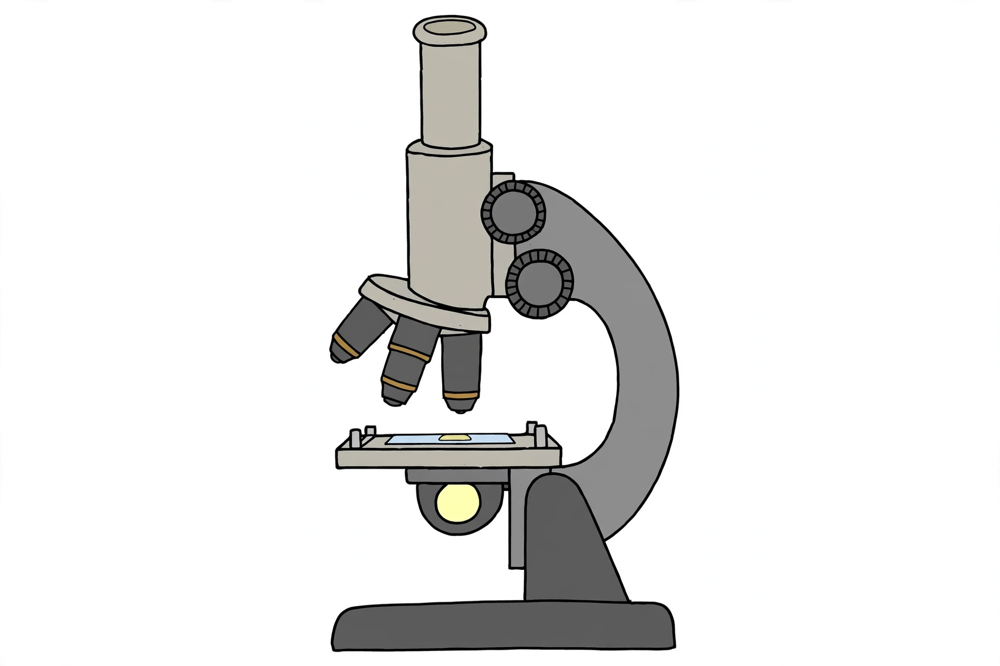

# Lesson 03 — The Microscope and the Discovery of Cells

**Goal (student-readable):** I can name the main parts of a light
microscope, describe how to focus a slide safely, compute total
magnification, and explain why cells must be magnified to be seen.
**Time:** 45–50 minutes · **Materials:** the generated illustration
`assets/microscope-parts-illustration.png` (or a real microscope),
the scale diagram `assets/cell-size-scale.svg`, notebook, pencil.

## Readiness check (5 min)

Hold your thumb at arm's length next to a distant tree. Your thumb
covers the whole tree — but the tree is obviously bigger. What does
this tell you about judging size by eye? (Answer: apparent size
depends on distance; eyes alone cannot settle questions of true size.
Instruments that change apparent size — like microscopes — let us
study things too small to judge directly.)

## Teaching

A **compound light microscope** uses two sets of lenses to magnify
tiny things: the **eyepiece** (the lens you look through, usually
10×) and the **objective lenses** mounted on a rotating
**nosepiece** (usually 4×, 10×, and 40×). **Total magnification** is
their product:

> total magnification = eyepiece power × objective power

So 10× eyepiece × 4× objective = **40×**; with the 10× objective it is
**100×**; with the 40× objective it is **400×**. The specimen sits on
a glass **slide** on the **stage**; light shines up from below (the
**light source**/**diaphragm**), through the specimen, into the
lenses. **Coarse focus** moves the stage in big steps; **fine focus**
moves it in tiny steps for a sharp image. You hold it by the
**arm** and **base**, with two hands.

**Focusing safely, step by step:**

1. Start with the **lowest-power** objective (4×) clicked into place.
2. Place the slide on the stage and clip it down.
3. Looking from the **side** (never through the eyepiece while moving
   the stage up), use coarse focus to raise the stage until the
   objective is close to — but never touching — the slide.
4. Look through the eyepiece and use coarse focus to move the stage
   **down** until the image appears, then fine focus to sharpen.
5. Center what you want to see, then rotate to the next objective and
   **only use fine focus** from here on — the higher-power lenses sit
   closer to the slide and coarse focus can crack it.

Why must cells be magnified at all? A typical human cheek cell is
about 60 micrometers across — a **micrometer (µm)** is one-thousandth
of a millimeter. Your eye can resolve details down to roughly 100 µm
(about the width of a human hair). Most cells are far smaller than
that. Look at the scale diagram
[assets/cell-size-scale.svg](../assets/cell-size-scale.svg): a virus
(~100 nm) is ten thousand times smaller than a grain of sand; a
bacterium (~2 µm) is still fifty times smaller than what your eye can
resolve. Without magnification, the entire world of cells is
invisible — which is why no one knew cells existed until microscopes
were invented.

**How the microscope revealed cells — the evidence story:**

- **1665 — Robert Hooke** examined thin slices of cork under a
  compound microscope and saw tiny box-like compartments. He called
  them "cells" (from the Latin *cella*, "small room"). He was looking
  at empty plant cell walls — but he had found the unit.
- **1670s — Anton van Leeuwenhoek** ground single lenses that
  magnified up to ~270× and saw living "animalcules" — bacteria,
  protozoa — moving in drops of water. Cells were not just structure;
  some were whole living creatures.
- **1838–1839 — Matthias Schleiden** (plants) and **Theodor Schwann**
  (animals) concluded that *all* plants and animals are made of cells.
- **1855 — Rudolf Virchow** added the final tenet: *Omnis cellula e
  cellula* — all cells come from pre-existing cells.

Together these form **cell theory**: (1) all living things are made
of one or more cells; (2) the cell is the basic unit of structure and
function in life; (3) all cells come from pre-existing cells. Notice
that each tenet was *earned* — by better lenses, more observations,
and other scientists checking the work. That is Lesson 01's evidence
story playing out across two centuries.

**If no microscope is available:** use printed verified micrographs
(see the [resource pack](../resource-pack.md)) — real microscope
photographs taken by scientists. Read them exactly as you would a live
view: note the magnification, the scale bar, and what structures you
can actually see vs. what you infer.

> **AI illustration note:** the microscope diagram in this lesson is an
> AI-generated illustration, clearly labeled as such in
> [assets/README.md](../assets/README.md). It is a diagram for a
> labeling activity, not a photograph of a real instrument and not a
> record of any observation.

*Caption: AI-generated illustration of a compound light microscope
(unlabeled). Activity: label the eyepiece, nosepiece, objective
lenses, stage, slide, light source, coarse and fine focus knobs, arm,
and base.*

> **Text alternative (use instead of the image if you prefer):** A
> compound light microscope has: an eyepiece tube at the top (10×); a
> rotating nosepiece below it holding three objective lenses (4×, 10×,
> 40×); a flat stage with clips holding a glass slide under the
> objectives; a light source beneath the stage; a curved arm connecting
> to a heavy base; and two focus knobs on the side — the larger coarse
> focus and the smaller fine focus. Label each part on your own sketch
> or on a printout of the illustration.

## Worked examples

**Example 1.** A microscope has a 10× eyepiece. What is the total
magnification with each objective: 4×, 10×, 40×?

Multiply: 10 × 4 = **40×**; 10 × 10 = **100×**; 10 × 40 = **400×**.
Reason check: the high-power view is ten times more magnified than
the low-power view (400 ÷ 40 = 10), and it shows a smaller area in
more detail — magnification trades field of view for detail. A common
error is adding the powers (10 + 40 = 50×); multiplication is correct
because each lens magnifies the image the previous lens made.

**Example 2.** A learner says, "I'll start with the 40× objective to
find the specimen faster." What is wrong with this plan? Give the
correct first step.

Two problems: at 400× the field of view is tiny, so finding the
specimen is *harder*, and the 40× lens sits very close to the slide,
so coarse focusing risks cracking it. Correct plan: start at the
lowest power (40× total), focus, center the target, then rotate up to
higher powers using only fine focus.

**Example 3.** A cheek cell is about 60 µm across. How many cheek
cells, laid side by side, would span 1 millimeter?

1 mm = 1,000 µm. 1,000 ÷ 60 ≈ **16–17 cells**. Reason check: a
millimeter is visible as a small-but-real distance on a ruler, and it
takes about sixteen cells to cross it — so one cell is far below what
the eye can resolve as an object. This is the arithmetic behind "cells
must be magnified."

## Guided practice (with hints)

1. Label the parts on the microscope illustration (or your own
   sketch): eyepiece, nosepiece, objective lenses, stage, slide, light
   source, coarse focus knob, fine focus knob, arm, base.
2. Compute total magnification for: (a) 10× eyepiece + 4× objective;
   (b) 10× eyepiece + 40× objective. *(Hint: multiply, don't add.)*
3. A bacterium is 2 µm long; the eye resolves about 100 µm. How many
   times smaller than the eye's limit is the bacterium?
4. List the three tenets of cell theory in your own words, and name
   the scientist (or pair) associated with each step of the story.
   *(Hint: Hooke saw the boxes; Leeuwenhoek saw them alive;
   Schleiden/Schwann generalized; Virchow added "from cells.")*

## Independent practice

5. Write the five-step safe-focusing sequence from memory, in order.
6. An onion skin cell is about 300 µm long. How many would fit across
   1 mm? Show the division.
7. Error analysis: "Leeuwenhoek's microscope proved that all living
   things are made of cells." What is historically inaccurate, and
   what did his observations actually contribute?

## Application

If you have a microscope: prepare an onion-skin wet mount (adult
supervises; optional iodine stain handled by the adult only), focus
from low to high power, and sketch what you see at 100×, labeling the
cell wall outlines. If not: study two printed micrographs from the
resource pack, record the magnification and scale bar of each, and
sketch what you observe, distinguishing observed structures from
inferred ones.

## Exit check

Explain in three to four sentences why the invention of the microscope
was necessary for cell theory — connecting scale (µm vs. what the eye
resolves) to at least one historical observation.

## Supports, extensions, and teacher note

- **Reading/language access:** vocabulary cards for the ten part
  names; learners may match terms to the illustration before writing.
- **Alternate response mode:** the labeling activity may be done
  orally ("point to the part that holds the slide") with the adult
  confirming.
- **Extension:** research how an electron microscope differs (no
  light; electrons; ~10,000,000× possible) and why it cannot view
  living cells.
- **Teacher note — likely misconception:** learners think "more
  magnification is always better." Emphasize the trade-off: higher
  power = smaller field, less depth, darker image. Also watch for
  "the microscope makes things bigger" without the idea that it
  reveals *structure invisible otherwise*.
  **Answer-key reference:** [answer key, Lesson 03](../answer-key.md#lesson-03).
