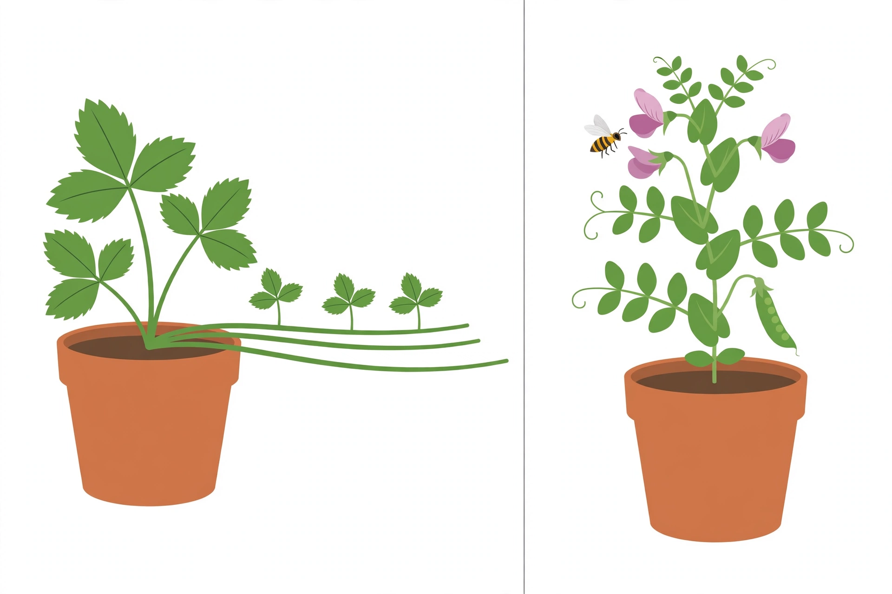

# Lesson 01 — Two Ways to Make Offspring

**Goal (student-readable):** I can compare asexual and sexual
reproduction, explain why one gives identical genetic information
and the other gives variation, and give a plant and an animal
example of each.
**Time:** 45–50 minutes · **Materials:** notebook, pencil, the
two-ways illustration below.

## Readiness check (5 min)

A gardener snaps off a piece of a spider plant, puts it in water,
and soon it grows roots of its own. A second gardener plants seeds
from a flower. Which new plant is more likely to be genetically
identical to its parent — the cutting or the seedling? Write your
prediction and one reason. (You will check it against evidence
below.)

## Teaching

**Reproduction** is how living things make new living things
(**offspring**). There are two main ways, and the difference that
matters most is not how many babies there are — it is where the
offspring's genetic information comes from.

In **asexual reproduction**, one parent makes offspring on its own.
The parent copies its genetic information, and each offspring gets
that same copy. Barring a rare copying change (a mutation, taught in
Lesson 03), asexual offspring carry **identical genetic
information** to the parent and to each other. They are not
necessarily identical in every visible way — a cutting grown in
poor light may still grow weakly (Lesson 05 explains why) — but
their inherited instructions start out the same.

In **sexual reproduction**, two parents each contribute genetic
information, and the offspring gets a combination — part from each
parent. Because each offspring gets a different combination (Lesson 02
shows how the halving and recombining works, and Lesson 04 models it
with Punnett squares), sexual offspring carry **genetic variation**:
they resemble both parents, but they are not copies of either one,
and siblings differ from each other.

*Caption: AI-generated illustration of two ways plants reproduce.
Left: a strawberry plant sends out runners that grow into new
plantlets. Right: a flowering pea plant is visited by a bee, and a
pea pod is forming. Activity: use the two panels to argue which
panel shows asexual reproduction and which shows sexual
reproduction, citing two visible differences.*

**Text alternative (same activity, no image needed):** Panel A: one
strawberry plant in a pot grows long horizontal stems (runners)
along the soil; where each runner touches the soil, a small new
plantlet grows that looks exactly like the parent plant. No flower,
bee, or seed is involved. Panel B: a pea plant has pink flowers; a
bee visits a flower; later, a green pod full of peas grows on the
same plant. The peas inside the pod grew from seeds, and each seed
carries combined genetic information from two parents. Answer the
same questions from this description: which panel is asexual, which
is sexual, and what two visible differences prove it?

### Worked example 1 — Reading the illustration

*Question:* Which panel shows asexual reproduction, and how do you
know?

*Reasoning:* In the left panel there is only one parent plant, and
the new plantlets grow directly out of it through runners — no
second plant, no flower, no seed. One parent plus direct growth
means the plantlets are copies of the parent's genetic information:
asexual reproduction. In the right panel a bee visits a flower and a
pod of seeds forms. Flowers, pollinators, and seeds are the sexual
route in plants: genetic information from two parents combines in
the seeds. So the right panel shows sexual reproduction. The two
visible differences that prove it are (1) one parent vs. a flower
that needs pollen from another flower, and (2) plantlets growing
from the parent's own stems vs. seeds in a pod.

### Worked example 2 — Asexual in animals, sexual in animals

*Question:* A sea anemone splits into two anemones. Two dogs have a
litter of puppies. Which offspring are genetically identical, and
which vary — and why?

*Reasoning:* The split anemone is asexual reproduction: one parent
divides, so both anemones carry the same genetic information (again,
barring mutation). The puppies are sexual reproduction: each puppy
gets a combination of genetic information from both parents, and
each puppy gets a different combination, so the litter varies — in
coat, size, and other traits — even though all the puppies share the
same two parents. The rule is the same in plants and animals: one
parent copying itself gives identical information; two parents
combining gives variation.

A common error is to think "asexual" means "no parent" or "weaker."
Neither is true. Asexual reproduction still has a parent — exactly
one — and in a stable environment, making identical copies quickly
can be a very successful strategy. Its weakness is different: if the
environment changes, or a disease arrives, identical offspring all
share the same vulnerability, because none of them carries a
different combination that might resist it. That trade-off is the
benefit of variation, and it is the question Unit 05 returns to.

## Guided practice (with the adult or a partner)

1. Name the two panels of the illustration in your own words, then
   state for each: how many parents, and whether the offspring's
   genetic information is identical or varied.
2. A potato plant grows new plants from pieces of its underground
   stem ("eyes"). A rose grower crosses two rose varieties and
   plants the seeds. Sort each case as asexual or sexual, and give
   one reason for each sorting.
3. Explain in two sentences why two strawberry plantlets from the
   same runner are genetically identical, while two pea seeds from
   the same pod are not.
4. A learner says, "Sexual reproduction is better because it makes
   more offspring." Correct the error: what does sexual
   reproduction actually give that asexual reproduction does not,
   and what does asexual reproduction do faster?

## Independent practice

5. Write a 4–6 sentence comparison of asexual and sexual
   reproduction covering: number of parents, source of genetic
   information, identical vs. varied offspring, and one example of
   each from plants or animals. (This is the revised legacy
   reproduction-assignment example task; a keyed model answer is in
   the answer key.)
6. Give one benefit of genetic variation in a changing environment,
   in two sentences, using a plant or animal example that is not
   the strawberry or the pea.

## Applied task

Look at the illustration again and write a caption of your own (two
sentences) for the panel you did *not* describe in Worked example 1.
Your caption must name the reproduction type and state what the
offspring's genetic information will be like, with one visible
detail as evidence.

## Exit check

In one sentence each: (a) define asexual reproduction; (b) define
sexual reproduction; (c) state which one produces variation and why.

## Supports and extensions

- **Reading/language access:** the words *asexual* ("a-" = without,
  here "without two parents combining") and *sexual* ("two parents
  combining") are built from their parts in the teaching above; a
  learner may answer orally or by labeling the two panels.
- **Alternate response mode:** draw the two panels from the text
  alternative instead of writing the comparison, labeling parents,
  offspring, and "same" vs. "mixed" information.
- **Extension:** find one more real example of asexual reproduction
  (for example, a bacterium dividing, a hydra budding, or a gardener
  taking cuttings) and explain why it fits the "one parent, copied
  information" rule.

## Teacher note

Watch for "asexual = no parent" and "variation = looking different
because of the environment" (environment is Lesson 05; variation
here means differences in inherited information). Full guidance and
keys are in the teacher guide and answer key; do not read the key
aloud before learners attempt the exit check.
