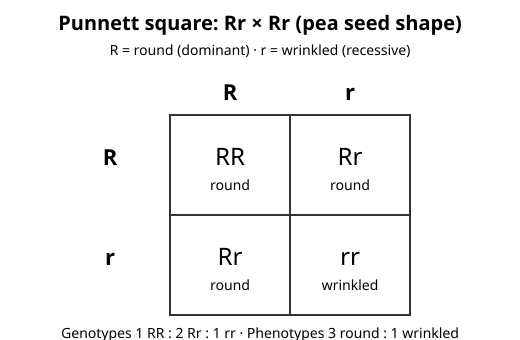

# Lesson 04 — Predicting with Punnett Squares

**Goal (student-readable):** I can build a Punnett square for a
single-gene pea trait, read off genotype and phenotype ratios, and
explain why the square gives probabilities, not guarantees.
**Time:** 45–50 minutes · **Materials:** notebook, pencil, R/r
allele cards or two coins, the Punnett diagram below.

## Readiness check (5 min)

Toss one coin 10 times. Did you get exactly 5 heads? Toss two coins
together 10 times. Did you get exactly 5 "one head, one tail"
results? Write your counts. Probability describes a group of trials,
not a single toss — and this lesson's squares work the same way.

## Teaching

An **allele** is one version of a gene. Pea seed shape is controlled
by one gene with two alleles: **R** (round) and **r** (wrinkled).
**R is dominant**: one copy of R is enough for round seeds.
**r is recessive**: wrinkled seeds appear only with two copies
(rr). An organism's allele pair is its **genotype**; its visible
trait is its **phenotype**. So:

- Genotype RR → phenotype round (homozygous dominant: two same
  dominant alleles)
- Genotype Rr → phenotype round (heterozygous: one of each; the
  dominant allele shows)
- Genotype rr → phenotype wrinkled (homozygous recessive: two same
  recessive alleles)

A **Punnett square** predicts the genotypes of offspring from two
parents. Write one parent's alleles across the top and the other
parent's down the side, then fill each box by combining its row and
column alleles. Each box is one equally likely offspring genotype.

*Caption: Deterministic diagram (not generated art) of the Rr × Rr
Punnett square. Text alternative: the four boxes read, row by row,
RR (round), Rr (round), Rr (round), rr (wrinkled).*

**This is a simplified single-gene model.** Most real traits are
influenced by many genes plus the environment (Lesson 05), and some
pea traits in real breeding do not follow this clean pattern. The
square is a teaching model for how inheritance probabilities work,
not a claim that every trait behaves this simply.

### Worked example 1 — RR × rr (both parents pure)

*Question:* Cross a round-seeded RR plant with a wrinkled-seeded rr
plant. What genotypes and phenotypes do the offspring have?

*Reasoning:* Top alleles: R, R. Side alleles: r, r. Every box
combines R with r: Rr, Rr, Rr, Rr. Genotypes: 4/4 Rr (100%).
Phenotypes: every offspring carries one dominant R, so 4/4 round
(100%), 0 wrinkled. Note the surprise beginners miss: two parents
that look completely different (round vs. wrinkled) have offspring
that all look like one parent — because the dominant allele masks
the recessive one in the heterozygous offspring. The wrinkled allele
is not gone; it is carried, hidden, into the next generation.

### Worked example 2 — Rr × Rr (the diagram cross)

*Question:* Cross two heterozygous round-seeded plants (Rr × Rr).
What are the genotype and phenotype ratios?

*Reasoning:* Top alleles: R, r. Side alleles: R, r. Boxes: RR, Rr,
Rr, rr (see the diagram). Genotypes: 1 RR : 2 Rr : 1 rr — as
fractions, 1/4 RR, 2/4 (1/2) Rr, 1/4 rr. Phenotypes: RR is round,
both Rr are round, rr is wrinkled: 3 round : 1 wrinkled, or 75%
round and 25% wrinkled. In a group of 40 such offspring, you would
*expect* about 30 round and about 10 wrinkled — "about," not
exactly, because each offspring is an independent chance event, like
a coin toss.

### Worked example 3 — Rr × rr (a test cross)

*Question:* Cross a heterozygous round plant (Rr) with a wrinkled
plant (rr). What are the ratios?

*Reasoning:* Top alleles: R, r. Side alleles: r, r. Boxes: Rr, Rr,
rr, rr. Genotypes: 2 Rr : 2 rr, simplified to 1 Rr : 1 rr (50% each).
Phenotypes: 1 round : 1 wrinkled (50% each). This cross is useful
because it reveals the hidden allele: if any wrinkled offspring
appear, the round parent must have been carrying r. A learner who
writes "all round because round is dominant" has forgotten that
dominance hides an allele only when the offspring actually receives
it — here half the offspring receive no R at all.

## Guided practice (with the adult or a partner)

1. Build the Rr × Rr square with allele cards (or coins: heads = R,
   tails = r, one coin per parent). Fill all four boxes and read
   off the genotype ratio.
2. Build the Rr × rr square the same way. State the phenotype ratio
   as a ratio, a fraction, and a percentage.
3. A learner writes the Rr × Rr phenotype ratio as "1 round : 3
   wrinkled." Identify the error (which genotype was misread?) and
   give the correct ratio with the box count.
4. In a group of 80 offspring from Rr × Rr parents, how many
   wrinkled offspring are expected? Show the multiplication, and
   explain in one sentence why the real count might be 17 or 23
   instead of exactly your answer.

## Independent practice

5. Cross RR × Rr. Give the genotype ratio and the phenotype ratio,
   with the four boxes shown.
6. A wrinkled-seeded plant (rr) is crossed with a round-seeded plant
   of unknown genotype. One offspring is wrinkled. What must the
   round parent's genotype be? Explain in two sentences. (Hint:
   where could the offspring's second r have come from?)

## Applied task

Run the coin-toss simulation: toss two coins together 40 times
(one coin = parent A's allele, the other = parent B's; heads = R,
tails = r). Record each pair as RR, Rr, or rr, then count how many
offspring would be round and how many wrinkled. Compare your counts
with the Rr × Rr expectation (30 round, 10 wrinkled) and write two
sentences explaining any difference. Your simulation models the
cross; it does not change the square's probabilities.

## Exit check

(a) A plant is Rr. What is its phenotype, and why?
(b) Rr × Rr gives what phenotype ratio? (c) In one sentence,
explain why a Punnett square cannot guarantee the traits of one
particular seed.

## Supports and extensions

- **Reading/language access:** color the R cards one color and the
  r cards another; say each box aloud as "R from this parent, r
  from that parent" while filling it.
- **Alternate response mode:** build the squares with cards or
  coins and photograph or sketch the layout instead of writing the
  grid, labeling each box's genotype and phenotype.
- **Extension:** a plant's seeds are all round, but it is crossed
  with rr and some offspring are wrinkled. Work out the parent's
  genotype from that evidence alone, and explain why the first
  observation (all round) could not settle it.

## Teacher note

Watch for "dominant = more common" (dominance is about expression
in a heterozygote, not frequency), "the square predicts this one
seed," and forgetting that Rr is round. Full guidance and keys are
in the teacher guide and answer key.
