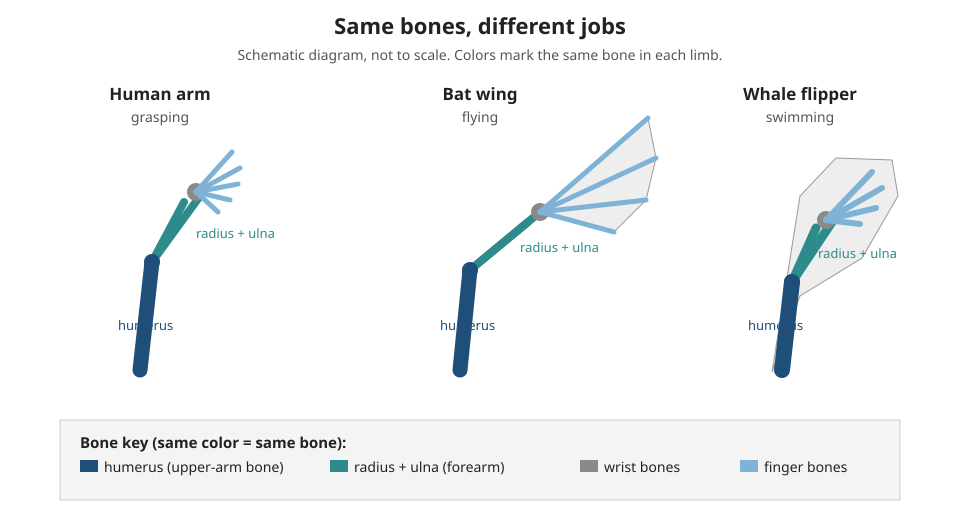

# Lesson 02 — Same Bones, Different Jobs

**Goal (student-readable):** I can explain how anatomical
similarities and differences show evolutionary relationships, and
tell homologous, analogous, and vestigial structures apart.
**Time:** 45–50 minutes · **Materials:** notebook, pencil, the
forelimb diagram below.

## Readiness check (5 min)

Look at your own arm: upper arm, forearm, wrist, fingers. Now
think of a bat's wing and a whale's flipper. Which of the three
do you think has the most bones in common with your arm — the
bat's wing or the whale's flipper? Write your prediction and one
reason. (The answer may surprise you: it is both.)

## Teaching

If living things share common ancestors, their bodies should
carry the fingerprints of that shared history — and they do.
Anatomical similarities and differences among modern organisms,
and between modern and fossil organisms, let scientists infer
evolutionary relationships. Three kinds of structure tell the
story.

A **homologous structure** is a body part that different species
share because they inherited it from a common ancestor, even
though it now does different jobs. The classic example is the
forelimb of vertebrates (animals with backbones): a human arm, a
bat wing, a whale flipper, and a mole's digging forelimb all
contain the same bones in the same order — one upper-arm bone
(the **humerus**), two forearm bones (the **radius** and
**ulna**), wrist bones, and finger bones. The bones are
different sizes and shapes, and the jobs differ — grasping,
flying, swimming, digging — but the plan is the same, because
all four inherited it from the same ancient four-limbed ancestor.

*Caption: Deterministic diagram of homologous forelimbs. The
human arm, bat wing, and whale flipper share the same bone plan —
humerus, radius and ulna, wrist bones, finger bones — in
different shapes for different jobs. Activity: name one bone
that appears in all three limbs, and state the job each limb
does.*

**Text alternative (same activity, no image needed):** All three
limbs contain the same four bone groups in the same order from
shoulder to tip: one humerus (upper-arm bone), two forearm bones
(radius and ulna), a set of small wrist bones, and finger bones.
In the human arm the finger bones are short and the hand grasps;
in the bat wing the finger bones are very long and stretched skin
forms the wing; in the whale flipper the bones are short and
thick inside a paddle. Answer the same questions from this
description: name one bone that appears in all three limbs, and
state the job each limb does.

An **analogous structure** is the opposite pattern: body parts
that do a similar job but did *not* come from a common ancestor
with that structure. A bird's wing and an insect's wing both fly,
but a bird wing is built from bones and feathers while an insect
wing is a thin sheet of cuticle with no bones at all. Similar job,
different origin — the similarity comes from doing the same job
in the air, not from shared ancestry. Analogous structures do not
show a close relationship; they show that similar environments
can shape similar solutions.

A **vestigial structure** is a body part that has shrunk or lost
most of its original function as a species changed over time.
Whales carry small hip and leg bones buried inside their bodies —
leftovers of the hind legs their land-dwelling ancestors walked
on. Flightless birds such as ostriches have wings they cannot fly
with; the wings are still used for balance and display, but not
for flight. Humans have a tailbone (the coccyx), the remnant of a
tail our distant ancestors had. Vestigial structures are not
"useless" — they may keep small jobs — but their shrunken form
only makes sense as a leftover of an ancestor that used them
fully.

Fossils add the time dimension. **Tiktaalik**, a fossil animal
about 375 million years old found in 2004 on Ellesmere Island
in Arctic Canada, is a **transitional form**: it has the scales,
gills, and fin rays of a fish, *and* the neck, shoulders, sturdy
wrist bones, and thick ribs of a four-legged land animal. It
shows the step between swimming fish and walking tetrapods
(four-legged vertebrates). **Archaeopteryx**, about 150 million
years old, mixes feathers and wings like a bird with teeth, a
long bony tail, and clawed fingers like a dinosaur. Transitional
forms are not "half-finished" animals — each was a complete
animal in its own time — they are forms that display a mix of
features from an older group and a newer group.

### Worked example 1 — Reading the forelimb diagram

*Question:* The diagram shows a human arm, a bat wing, and a
whale flipper. What is the evidence that the three share a common
ancestor, and what does the diagram *not* prove?

*Reasoning:* All three limbs contain the same bones in the same
order — humerus, radius and ulna, wrist bones, finger bones —
even though the limbs do different jobs. If each limb had been
designed separately for its job, there would be no reason for a
whale's swimming paddle to contain finger bones, or for a bat's
wing to contain a wrist. The shared plan is best explained by
inheritance from a common four-limbed ancestor, with each lineage
reshaping the same bones. What the diagram does *not* prove is
*when* the ancestor lived or exactly which species it was — for
that, the fossil record (Lesson 01) and other evidence are
needed. The diagram supports the relationship; it does not date
it.

### Worked example 2 — Homologous or analogous?

*Question:* Sort each pair as homologous or analogous, with one
reason: (a) a dolphin's flipper and a shark's fin; (b) a
dolphin's flipper and a human arm.

*Reasoning:* (a) Analogous. Both steer and push through water,
but the dolphin flipper is built from arm bones (humerus,
radius, ulna, finger bones) while the shark fin is cartilage
with fin rays and no arm bones — similar job, different origin.
(b) Homologous. Both contain the same arm-bone plan in the same
order, inherited from a common four-limbed ancestor, even though
one swims and the other grasps. The test is always the same:
same underlying structure means homologous; same job with a
different structure means analogous.

A common error is to sort by job alone: "both fly, so they must
be related." Job alone proves nothing — check the structure. The
other common error is to call a vestigial structure "proof an
animal is broken." A whale's tiny hip bones are not a defect;
they are history written in bone.

## Guided practice (with the adult or a partner)

1. Name the four bone groups in the forelimb diagram, in order
   from shoulder to tip.
2. Explain in two sentences why a bat wing and a human arm are
   homologous even though one flies and the other grasps.
3. Sort each pair as homologous or analogous, with one reason:
   (a) a butterfly wing and a bird wing; (b) a cat's front leg
   and a dog's front leg.
4. A whale has small hip bones inside its body. Is that a
   homologous, analogous, or vestigial structure? Explain in one
   sentence.

## Independent practice

5. Write a 5–7 sentence explanation of how Tiktaalik supports
   the idea that four-legged animals descended from fish. Name
   two fish features and two land-animal features of Tiktaalik,
   and state what "transitional form" means.
6. A learner says, "Archaeopteryx proves birds came from
   dinosaurs because it looks like both." Improve the claim: what
   exactly does the mix of features show, and what would it take
   to show the relationship more firmly? (Hint: one fossil is a
   clue; the pattern across many fossils is the evidence.)

## Applied task

Draw a simple family tree in your notebook with three branches:
human, bat, whale. Mark the shared ancestor at the base and label
the shared forelimb plan on the trunk. Then add a fourth branch
for a bird, and write one sentence explaining why the bird's wing
belongs on the tree as a homologous forelimb — and why an insect
wing does not belong on this tree at all.

## Exit check

In one sentence each: (a) define a homologous structure;
(b) define an analogous structure; (c) give one example of a
vestigial structure and what it is a leftover of.

## Supports and extensions

- **Reading/language access:** *homologous* ("homo-" = same,
  "same structure") and *analogous* ("similar job, different
  origin") are built from their parts in the teaching above; a
  learner may answer orally or by labeling the diagram.
- **Alternate response mode:** trace the three limbs from the
  diagram and color the same bone the same color in each, instead
  of writing the comparison.
- **Extension:** find one more homologous pair (for example, a
  horse's front leg and a human arm) and one more analogous pair
  (for example, a cactus spine and a rose thorn — both protect,
  different origins), and explain each sorting.

## Teacher note

Watch for job-only sorting ("both fly, so related") and for
"vestigial = useless." The forelimb diagram is schematic: bone
counts in the fingers are simplified, and the lesson says so.
Tiktaalik facts are checked in the resource pack (Berkeley
Understanding Evolution, 2006 announcement; fossils found 2004).
Full guidance and keys are in the teacher guide and answer key;
do not read the key aloud before learners attempt the exit check.
