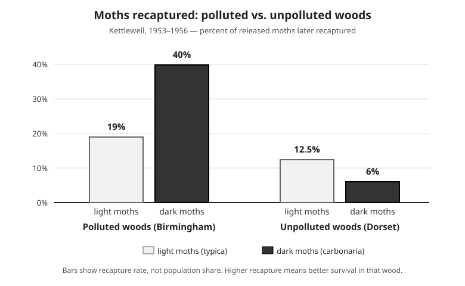

# Lesson 03 — How Natural Selection Works

**Goal (student-readable):** I can explain natural selection in
four steps and use moth data to show how a trait becomes more or
less common in a population.
**Time:** 45–50 minutes · **Materials:** notebook, pencil, the
Kettlewell chart below.

## Readiness check (5 min)

In a field of green grass, would a bright red beetle or a green
beetle be easier for a bird to spot? Which one is more likely to
live long enough to have offspring? Write your prediction and one
reason. (You will test this idea with real moth data below.)

## Teaching

**Natural selection** is the process by which heritable traits
that help individuals survive and reproduce in a particular
environment become more common in a population over generations.
It has four steps, and all four must happen:

1. **Variation exists.** Individuals in a population differ in
   heritable traits — the peppered moth comes in a light,
   speckled form (*typica*) and a dark form (*carbonaria*); the
   dark form is caused by a gene, so it is inherited (Unit 04:
   variation comes from sexual reproduction and mutation).
2. **Some variations help survival and reproduction.** In a
   particular environment, one variant survives better or has
   more offspring. On soot-darkened tree trunks, dark moths are
   harder for birds to see; on clean, lichen-covered trunks,
   light moths are harder to see.
3. **Differential survival and reproduction.** More dark moths
   survive on dark trunks, so more dark moths reproduce — and
   their offspring tend to be dark, because the trait is
   heritable.
4. **Trait frequencies shift over generations.** Because dark
   moths leave more offspring, the *percentage* of dark moths in
   the population rises. The population changes; no individual
   moth changes color.

The peppered moth is the classic case. Before the Industrial
Revolution, almost all peppered moths in England were light: the
dark form was very rare. As coal-burning factories blackened tree
trunks with soot and killed the light-colored lichens, dark moths
became common in industrial areas — by 1895, about **98%** of
the moths around Manchester were dark. When clean-air laws
reduced pollution from the 1950s on, the light form came back:
in many places today it is again the common form. The advantage
flipped when the environment flipped.

*Caption: Deterministic chart of Kettlewell's 1953–1956
release–recapture experiments. In polluted woods, dark moths
were recaptured about twice as often as light moths; in
unpolluted woods, the pattern reversed. Activity: state which
form survived better in each wood, and what that shows about
camouflage.*

**Text alternative (same activity, no image needed):** In
Kettlewell's experiments, moths were released in two woods and
later recaptured in traps. Polluted woods near Birmingham: 19%
of released light moths were recaptured, and 40% of released
dark moths were recaptured. Unpolluted woods in Dorset: 12.5%
of light moths and 6% of dark moths were recaptured. Answer the
same questions from these numbers: which form survived better in
each wood, and what does that show about camouflage?

The British ecologist Bernard Kettlewell tested the camouflage
explanation in 1953–1956 by releasing equal numbers of light and
dark moths in polluted woods near Birmingham and in unpolluted
woods in Dorset, then trapping them again. The chart shows the
result: the camouflaged form was recaptured about twice as often
in each wood. Later researchers questioned his methods, but a
seven-year follow-up experiment by Michael Majerus (2001–2007)
confirmed the pattern. Recapture rate is used here as a stand-in
for survival: a moth that is eaten cannot be recaptured.

The same mechanism works in the wild without pollution. On the
Galápagos island of Daphne Major, Peter and Rosemary Grant
studied medium ground finches for decades. In the drought of
1977, small soft seeds ran out and only large hard seeds were
left; finches with deeper, stronger beaks could crack them, so
they survived and reproduced better, and the next generation's
average beak was measurably deeper. The environment — a drought —
did the selecting; no finch chose to grow a deeper beak, and no
single finch's beak changed. The population changed.

### Worked example 1 — Reading the Kettlewell chart

*Question:* In each wood, which form survived better, and what
does that show?

*Reasoning:* In the polluted woods, 40% of dark moths were
recaptured but only 19% of light moths — dark moths were
recaptured about twice as often (40 ÷ 19 ≈ 2.1), so dark moths
survived better there. In the unpolluted woods, 12.5% of light
moths were recaptured but only 6% of dark moths — light moths
were recaptured about twice as often (12.5 ÷ 6 ≈ 2.1), so light
moths survived better there. The advantage flips with the
environment, which is exactly what the camouflage explanation
predicts: the form that matches the tree trunks is harder for
birds to see, so it survives and reproduces more.

### Worked example 2 — Trait frequencies over time

*Question:* Suppose a Manchester-area moth population has 1,000
moths. Before industrialization, about 1% are dark. By 1895,
about 98% are dark. How many dark moths are there at each time,
and what changed — the moths, or the population?

*Reasoning:* Before industrialization: 1% of 1,000 = 10 dark
moths (and 990 light). By 1895: 98% of 1,000 = 980 dark moths
(and 20 light). The number of dark moths rose from 10 to 980 —
but no individual moth changed color. What changed is the
*population*: dark moths survived and reproduced more on
soot-darkened trunks, so each generation had a higher percentage
of dark moths. That is what "the trait became more common" means:
a change in the percentage, over generations, caused by
differences in survival and reproduction. **Fitness** in this
sense means survival *and* reproduction — not strength, speed,
or size on their own.

A common error is to say "the moths evolved darker wings because
they needed to hide." Need does not cause change: the dark form
already existed in the population (rarely) before the soot
arrived. The soot only changed *which* form survived better.
Another error is to say "the light moths turned dark." Individuals
do not change their inherited traits during their lives;
populations change across generations as trait frequencies shift.

## Guided practice (with the adult or a partner)

1. State the four steps of natural selection in your own words,
   in order.
2. Use the chart: in the polluted woods, how many times more
   often were dark moths recaptured than light moths? Show the
   division (40 ÷ 19).
3. Explain in two sentences why the light form became common
   again after clean-air laws reduced the soot.
4. A learner says, "During the drought, the finches' beaks grew
   deeper so they could eat the hard seeds." Correct the error:
   what actually changed, and when?

## Independent practice

5. Write a 5–7 sentence explanation of the peppered-moth change
   using all four steps of natural selection. Include the 98%
   figure and the idea that the advantage flipped when the
   environment changed.
6. A population of 500 beetles has 100 green beetles (20%) and
   400 brown beetles (80%). After birds eat many green beetles
   on brown soil, the next generation has 40 green beetles out
   of 500 (8%). Calculate the change in the green percentage and
   explain in two sentences what the numbers show.

## Applied task

Imagine a beach where light sand is replaced by dark volcanic
sand after an eruption. A population of light and dark mice lives
there. Predict which form will become more common over the next
ten generations, and write the prediction as a three-sentence
claim-evidence-reasoning paragraph: claim (which form rises),
evidence (what the moth case shows about camouflage and
survival), reasoning (why the same logic applies to the mice).

## Exit check

In one sentence each: (a) state the four steps of natural
selection in short form; (b) state what "fitness" means here;
(c) state whether individuals or populations evolve, and why.

## Supports and extensions

- **Reading/language access:** *differential* ("different")
  survival is built from its parts in the teaching above; a
  learner may answer orally or by pointing at the chart bars.
- **Alternate response mode:** act out the four steps with paper
  moths (dark and light) on a dark cloth, removing the visible
  ones, instead of writing the explanation.
- **Extension:** research antibiotic resistance as modern natural
  selection (bacteria that survive an antibiotic reproduce, so
  resistance spreads) and write a four-step explanation for it.

## Teacher note

Watch for "need causes change" and "individuals evolve." The
chart numbers are Kettlewell's published recapture percentages
(verified 2026-11-07); the 98% Manchester figure is from 1895
records. The beetle numbers in independent practice are a
labeled fictional practice dataset, not field data — the lesson
says so in the answer key. Full guidance and keys are in the
teacher guide and answer key; do not read the key aloud before
learners attempt the exit check.
