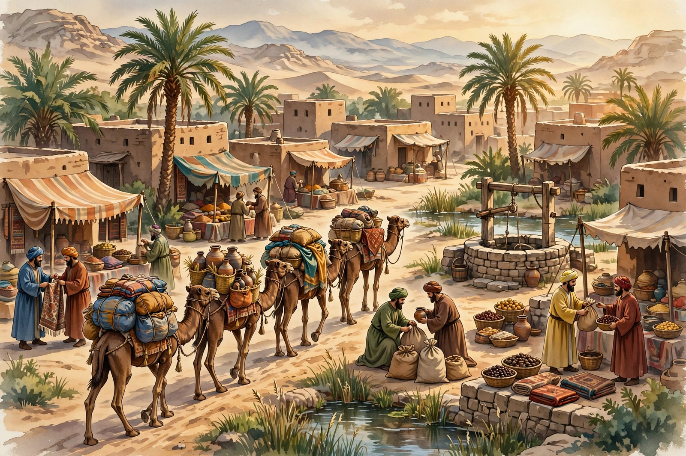

# Lesson 02 — Source Kinds of the Medieval World

**Unit:** [U01 — Medieval Geography: Sources and Historical Inquiry](../README.md) · **Week 3**
**Time:** ~45 minutes · **Session:** 3 of 16

## Goal

You will **classify** medieval sources by kind — map, traveler's account,
artifact, coin, chronicle, or secondary interpretation — **detect** what
each kind cannot tell us, and **spot a modern reconstruction** that is not a
historical source at all.

## Materials

- Inquiry notebook and pencil
- The market image below
  ([silk-road-oasis-market.png](../assets/silk-road-oasis-market.png) — an
  **AI-generated illustration**, not a historical source)

*AI illustration generated 2026 for this lesson — a modern reconstruction,
not historical evidence. Alt text: painterly scene of a desert oasis market;
three loaded camels in the foreground; merchants in long robes trading
cloth, pottery, and sacks of goods at stalls; a stone well with a wooden
frame; palm trees; flat-roofed clay-brick buildings; hazy mountains
behind.*

**Text-only alternative:** The image shows a busy desert market that never
existed: in the foreground three camels carry packs and baskets; merchants
in long robes trade folded cloth, pottery jars, and tied sacks; a stone
well with a wooden hoist stands near palm trees; flat-roofed clay-brick
buildings and hazy mountains fill the background. Everything in it was
imagined by an image generator in 2026. You can answer every question in
this lesson from this paragraph instead of the picture.

## Readiness check (5 minutes)

1. Name the five source kinds from Lesson 01.
2. Which kind would tell you what a medieval traveler *saw*?
3. Which kind would tell you what a medieval city *looked like* from above?

## Teaching

### Part A — What each kind can and cannot tell us

Every source kind is strong at some questions and blind at others. Knowing
the blindness is as important as knowing the strength.

**Worked example 1 — a coin.**
A silver coin stamped with a ruler's name and a date is found in a market
town far from where it was minted.

- **Kind:** artifact — specifically a coin.
- **It CAN tell us:** someone with authority to mint coins existed at that
  date; the coin traveled (so trade or contact reached this town).
- **It CANNOT tell us:** what the town was like, what people believed, or
  why the coin came here — a coin cannot say whether it arrived with a
  merchant, a soldier, or a thief. Its **limitation** is silence about
  context.

**Worked example 2 — a traveler's account.**
A merchant writes: *"The market of Samarkand sells paper, silk, and glass
from three lands."*

- **Kind:** traveler's account (a primary source — written at the time).
- **It CAN tell us:** what one visitor noticed and thought worth writing.
- **It CANNOT tell us:** whether he exaggerated (merchants impress readers),
  what he never visited, or what locals thought of him. Its
  **limitation** is viewpoint: one pair of eyes, with interests.

The same treatment applies to every kind: **maps** show where but not why;
**chronicles** give sequence but carry the writer's loyalties; **artifacts**
prove making but not meaning; **secondary interpretations** (a textbook
chapter, a museum essay) organize sources but add the author's own
argument — always check what sources *it* cites.

### Part B — The reconstruction test

Now study the market image at the top of this lesson. List three things you
observe in it. Then read this carefully:

**That image was generated by an AI in 2026. No medieval person ever saw
that market, because that market never existed.** It is a
**modern reconstruction** — useful for imagining, useless for proving. It
cannot answer *any* historical question, because it is not a leftover from
the past; it is a leftover from last week.

This is the reconstruction test you will use all year:

1. **When was it made?** If the answer is "long after the events," it is
   not a primary source.
2. **What was it made from?** If it was made from imagination (or from
   other pictures) rather than from observation of the real past, it proves
   nothing about the past.
3. **What CAN it do?** It can prompt questions (*"Did oasis markets have
   wells like that?"*) — and each question must then be answered from real
   sources.

A museum diorama, a film scene, and an AI illustration all fail the test
the same way. Pretty is not the same as true.

## Guided practice (with hints)

*Do these with the adult. Hints are in italics.*

1. Classify each by kind, then name one thing it CAN and one thing it
   CANNOT tell us:
   a. A 1375 map of the known world drawn on Majorca (the Catalan Atlas).
   b. A brass bowl dug up in Timbuktu with Arabic writing around the rim.
   c. A chapter in your textbook titled "The Mongol Peace."
   
   *Hint: ask "was it made at the time?" — the textbook chapter was not.
   That makes it a secondary interpretation, and its limitation is that it
   inherits its sources' blind spots plus adds the author's argument.*

2. Apply the reconstruction test to the market image in this lesson, in
   your own words: when was it made, what was it made from, and what is one
   historical question it CANNOT answer?
   
   *Hint: "What did 13th-century Samarkand look like?" is unanswerable
   from this image — the image shows no real place at all.*

3. A classmate says, "This painting proves medieval markets were busy and
   colorful." Using the reconstruction test, explain the flaw in two
   sentences.
   
   *Hint: the claim is about the real past; the evidence is from 2026.*

## Independent practice

4. For each of the five medieval source kinds (map, traveler's account,
   artifact, coin, chronicle), write one question it answers WELL and one
   question it CANNOT answer. (10 answers total.)
5. Write a two-sentence "museum label" for the market image that a museum
   could honestly display next to it. It must state what the image is and
   what it is not.

## Application

6. **Source-kind audit.** Choose your compelling question from Lesson 01.
   List your three supporting questions; for each, name the single BEST
   source kind to start with and one limitation you will have to work
   around. (Example: "traveler's account — but only one viewpoint, so I
   will need a second, independent source: **corroboration**.") 

## Exit check

7. Your friend finds a cool picture online labeled "medieval Baghdad, 900
   CE." List the two questions you would ask before using it as evidence,
   and explain what answer would disqualify it.

## Supports, alternate response modes, extensions

- **Reading/language access:** the adult reads the worked examples aloud;
  the kind names stay on the word wall with a one-line strength and a
  one-line blindness each.
- **Alternate response:** classification may be done by sorting printed
  cards into six labeled boxes; the exit check may be answered orally.
- **Extension:** find one real museum object online (adult previews;
  [British Museum collection](https://www.britishmuseum.org/collection) is
  a starting point) and write its kind, one thing it proves, and one thing
  it cannot prove.

## Teacher note

**Likely misconception:** learners will call the AI image "a primary
source because it shows the past." Do not soften this: the image is from
2026, full stop. The discomfort is the lesson — much of what looks
"historical" online is reconstruction. Revisit this moment in U02 when the
first real medieval sources appear. **Answer-key reference:**
[answer-key.md](../answer-key.md) §L02.
