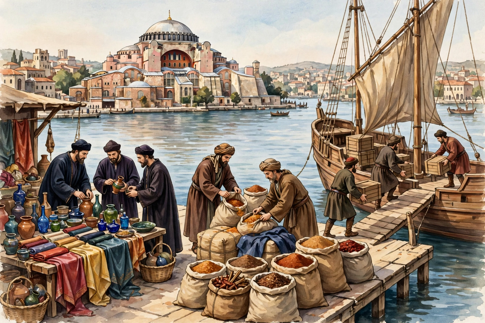

# Lesson 03 — Mediterranean Exchange: Trade, Translation, and Ideas

**Unit:** [U02 — Byzantine, Islamic, and Mediterranean societies](../README.md) · **Week 8**
**Time:** ~45 minutes · **Session:** 5 of 16

## Goal

You will explain how the Mediterranean Sea connected Byzantine, Islamic,
and Latin Christian societies through trade and translation, and you will
classify one exchange as change, continuity, or both — with evidence.

## Materials

- Inquiry notebook and pencil
- The outline map from Lesson 02 (add new ports today)

## Readiness check (5 minutes)

Answer aloud or in the notebook:

1. Lesson 02 traced numerals and paper across cultures. Name the three
   stops on each journey, in order.
2. A sea can divide people or connect them. What decides which — the
   water, or what people build on it?
3. Why would a Christian merchant in Venice want a trade treaty with a
   Muslim ruler in Alexandria? What would each side gain?

Question 3 is today's lesson: faith divided these societies, and profit
connected them. The two facts lived side by side for centuries — sometimes
in the same harbor, on the same day.

## Teaching

### Part A — The sea as a highway

The medieval Mediterranean was a highway. Its cargo list: **grain** from
Egypt and Sicily, **silk** and **spices** from the east, **timber** for
ships, **glass** and **ceramics**, and — by the later Middle Ages —
**paper**. Honesty requires one more manifest entry: **enslaved people
were also traded** on these routes, captured in war or bought from raiders.
A history of Mediterranean exchange that leaves them out has a hole in it.

Two Italian city-states rode this highway best. **Venice** and **Genoa**
were **maritime republics** — cities governed as republics whose wealth
came from the sea. They signed trade treaties with Byzantine emperors AND
with Muslim rulers, because a merchant's faith did not have to match his
customer's. Their fondachi — merchant quarters with warehouses, chapels,
and consuls — dotted Alexandria, Constantinople, and Acre.

Geography wrote the rules (D2.Geo.5, 6, 7). **Straits** funneled ships past
Constantinople and Gibraltar; **winds** dictated sailing seasons — miss the
summer winds and you waited a year; **coastlines** decided where harbors
could exist. Port cities built identities around what the routes demanded:
Venice, a city of warehouses and the great Arsenal shipyard; Alexandria, a
city of customs houses and brokers; Constantinople, the tollbooth between
two seas. Land routes fed sea routes: caravans crossed Asia, rested at
**caravanserai** — roadside inns with courtyards, stables, and guarded
storerooms — and unloaded at ports where the galleys waited.

Contact was not always peaceful. The **Crusades (1095–1291)** — Latin
Christian military expeditions to the eastern Mediterranean — were both
conflict and contact. Crusaders fought Muslim armies, but they also traded
in Levantine ports, hired local guides, copied siege techniques, and
carried home tastes for sugar and spices. Diplomacy ran alongside war. And
in **1204**, contact turned catastrophic: the **Fourth Crusade**, diverted
by Venetian interests and Byzantine palace politics, sacked
Constantinople — the Christian city it sailed past on its way to fight
Muslims. Lesson 05 gives you two perspectives on that sack.

**Worked example 1 — following a sack of pepper.** Trace one sack of black
pepper from Alexandria to Venice. At each stop: *who handles it, and what
changes hands?*

1. **Alexandria.** An Egyptian broker buys the sack from a Red Sea caravan
   master. Money changes hands; the customs house takes its duty. The sack
   gains an Arabic label and a tax stamp.
2. **The galley.** A Venetian merchant buys it under Venice's treaty with
   Egypt's ruler and loads it with a hundred others. What changes hands:
   *risk.* If pirates take the ship, he loses everything — so he sells
   shares in the voyage, like insurance.
3. **The open sea.** For weeks the sack is cargo riding the summer winds
   north. Nobody buys or sells it — but sailors' wages, the ship's wear,
   and bribes at every strait silently add to its price.
4. **Venice.** Unloaded at the Rialto, weighed by official weighers, taxed
   again, and sold to a German merchant for the journey over the Alps. By
   Nuremberg, that sack may cost ten times its Alexandria price.

*What the trace reveals: the pepper never changed, but its PRICE did — at
every step, someone added work, risk, or tax. Trade is not goods moving;
it is value added by every pair of hands. That is why middlemen got rich,
why rulers taxed ports, and why controlling a strait (Lesson 01) was worth
a fortune.*

**Common error:** "Venice got rich from spices," as if the sea handed them
over. Venice got rich from *position* — treaties, ships, warehouses, and
the willingness to trade with anyone — plus the winds and straits that made
its position pay.

### Part B — Translation: the other cargo

Ideas crossed the sea as surely as pepper. The great translation zone was
Spain: in **Toledo**, in the **12th century**, scholars — most famously
**Gerard of Cremona** — rendered Arabic works into Latin: Aristotle's
logic, Ptolemy's astronomy, Avicenna's medicine, al-Khwarizmi's algebra. A
Christian scholar might work beside a Jewish intermediary turning Arabic
into the vernacular, then into Latin — a three-person chain, like the
pepper's chain of hands. In **Norman Sicily**, King **Roger II**'s court
was another crossing: Greek, Arabic, and Latin scholars side by side, and
the geographer **al-Idrisi** drew his world map there in **1154**.

Technologies rode the same routes west:

- **Papermaking** reached Europe via **al-Andalus** and Sicily in the
  **12th–13th centuries**; by the **13th century**, **Fabriano**, Italy,
  made its own paper — improving it with watermarks.
- **Hindu-Arabic numerals** arrived with Fibonacci's *Liber Abaci*
  (**1202**) — the Lesson 02 journey, landing in a merchant's handbook.
- The **astrolabe**, the **lateen sail** (a triangular sail letting ships
  tack against the wind), and the **magnetic compass** all moved west
  through Mediterranean contact — each making the next voyage safer.
- **Crops** moved too: **sugar, citrus, rice, and cotton** traveled west
  with Islamic agriculture, transforming what Europeans grew and ate.

**Worked example 2 — change, continuity, or both? Paper arrives in
Europe.** Classify with evidence — the routine Lesson 04 makes official.

- **Continuity:** the *need* did not change. Europeans in 1100 and 1300
  both needed to write — charters, accounts, prayers, books. Paper answered
  an old hunger.
- **Change:** the *material* changed everything around the need. Parchment
  (animal skin) was durable and ruinously expensive; paper was cheap. When
  Fabriano's mills made paper abundant, books got cheaper, more students
  owned texts, bureaucracies wrote more down. Who could afford books
  changed — and when that changes, who can learn changes.
- **Verdict: BOTH** — continuity of purpose, change of material and
  consequence. *The frame to copy: "This was continuity in [what stayed
  the same] and change in [what became different], because [evidence]."*

**Common error:** classifying by feeling ("paper seems like a big deal, so
change") instead of evidence. The frame forces you to name WHAT stayed the
same and WHAT changed — two respects, two pieces of evidence. A label
without evidence is an opinion in costume.

### Part C — Whose eyes? Reading the harbor picture

Study this illustration of a Constantinople harbor market. It was
**generated by AI for this unit** — it is an imagined reconstruction, not
a historical source, and it proves nothing about the real medieval world.
That is exactly why it is useful: it lets us practice perspective on a
picture before we practice it on real sources in Lesson 05.

*AI illustration (not a historical source): an imagined 12th-century
Constantinople harbor market — Byzantine officials, Venetian merchants,
and Muslim traders at the waterfront, with Hagia Sophia across the water.
See [assets/README.md](../assets/README.md) for the generation record.*

**Text-only alternative:** if you cannot view the image, use this
inventory — every question below is answerable from it: waterfront stalls
with silk cloth, pottery, and glassware; sacks of grain and spice being
weighed; a wooden ship with a lateen sail being unloaded crate by crate;
robed figures trading, inspecting goods, and recording; the great domed
Hagia Sophia across the water.

**Worked example 3 — two pairs of eyes on one picture.** The same picture
is two different pictures depending on who looks.

- **A Byzantine customs official** notices: the tax stamps on the crates,
  whether the Venetian ship paid its harbor dues, the volume of spice
  sacks (more sacks = more revenue). His question is *"what is owed to
  the emperor?"* — he sees the harbor as a revenue machine.
- **A Venetian ship captain** notices: the depth at the dock, the price
  of pepper in the sacks, which broker is buying, how fast his crew is
  unloading. His question is *"will this voyage pay?"* — he sees the
  harbor as a gamble.

Same water, same stalls — different spotlights, because different
positions. Now the historian's discipline: **name two things this picture
can never tell us.** It cannot tell us what year it is (the artist
imagined it); it cannot tell us what anyone *thought* (faces show poses,
not minds); it cannot tell us whether this market was typical or
exceptional. A reconstruction can train your eyes. It cannot give you
evidence.

*The move to copy: describe what each viewer would notice, name the
question driving their attention, then state what no viewer of the picture
could know.*

## Guided practice (with hints)

*Do these with the adult. Hints are in italics.*

0. **Whose eyes?** Look at the harbor illustration (or its text
   alternative). (a) List three details you observe. (b) Write two
   sentences as the Byzantine customs official: what does he notice, and
   what question drives him? (c) Write two sentences as the Venetian
   captain. (d) Name two things the picture cannot tell us, no matter how
   hard we look.
   
   *Hint: for (b) and (c), re-read Worked example 3 — each viewer has a
   question: "what is owed?" vs. "will this voyage pay?" For (d),
   remember U01's reconstruction test: pretty is not the same as true.*

1. Add to your map: Venice, Genoa, Toledo, Sicily, Alexandria, Acre. Draw
   the pepper route as a dashed line, labeling each stop with who handled
   the sack.
   
   *Hint: four stops — Alexandria's broker and customs, the Venetian
   merchant's galley, the open sea (no hands, but added cost), Venice's
   weighers and tax men.*

2. Why would Roger II *want* Greek, Arabic, and Latin scholars at one
   court? Give two reasons — one about ruling, one about knowledge.
   
   *Hint: ruling — his kingdom held all three peoples; what does a king
   gain by addressing each in its own learned language? Knowledge — what
   happens when three scholarly traditions argue in one room?*

3. Name one technology from Part B and explain in two sentences how it made
   the NEXT exchange easier — how one voyage's cargo becomes the next
   voyage's tool.
   
   *Hint: try the compass or the lateen sail. What does a safer or faster
   voyage let merchants do that they couldn't before?*

## Independent practice

4. Write your own "sack of pepper" trace for Byzantine silk traveling from
   Constantinople to a buyer in Cairo. Four stops minimum; at each, name
   who handles it and what changes hands (money, tax, risk, work).
5. Using the frame from Worked example 2, classify the arrival of
   **Hindu-Arabic numerals** in Europe as change, continuity, or both.
   Name the continuity and the change, each with one piece of evidence
   from Lessons 02–03.
6. A **caravanserai** keeper near Alexandria writes: "This week: 40 camels,
   silk for Venice, pilgrims for Mecca, soldiers for the governor." In
   three sentences, explain what this one ledger line reveals about how
   land routes and sea routes, faith and trade, overlapped in a single
   courtyard.

## Application

7. **Treaty logic.** You are a Venetian envoy in 1200 negotiating with
   Alexandria's ruler. Write the three clauses you would insist on (think:
   safety, taxes, a place to stay), with one sentence each on why Venice
   needs it. Then add one sentence on what the Alexandrian ruler gains —
   treaties have two sides.

## Exit check

8. In your own words: how did the Mediterranean connect three civilizations
   that disagreed about faith — and what is the difference between
   classifying an exchange as "change" versus "both"?

## Supports, alternate response modes, extensions

- **Reading/language access:** the adult reads the pepper trace aloud,
  pausing at each stop for the learner to name who handled the sack;
  **maritime republic**, **lateen sail**, **caravanserai**, and
  **astrolabe** join the word wall.
- **Alternate response:** the learner may act out the pepper trace at four
  labeled stations around the room, handing a real (or drawn) sack from
  broker to merchant to weigher; the change/continuity frame may be a
  two-column chart.
- **Extension:** research the Venetian Arsenal — how it built galleys on
  something like an assembly line centuries before factories — and connect
  it to today's lesson in a paragraph: what does mass-producing ships say
  about how seriously Venice took trade?

## Teacher note

**Likely misconception:** learners file the Crusades under "war" and trade
under "peace" in separate boxes — or assume faith differences made
exchange impossible. Press the harbor evidence: the same Venetians who
fought in 1204 held trade treaties before and after; Toledo's translators
worked while armies marched. Conflict and contact were simultaneous, not
sequential. **Answer-key reference:** [answer-key.md](../answer-key.md)
§L03.
