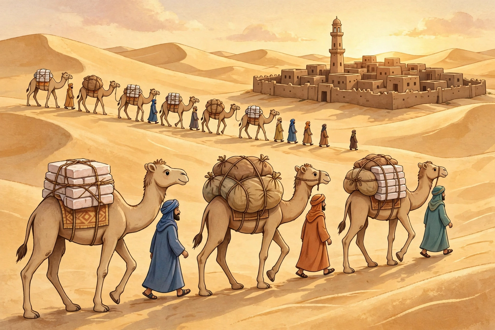

# Lesson 01 — West African Kingdoms and the Gold–Salt Trade

**Unit:** [U03 — African Kingdoms: Trade, Knowledge, and Cultural Exchange](../README.md) · **Week 11**
**Time:** ~45 minutes · **Session:** 1 of 16

## Goal

You will explain the West African gold–salt trade: what moved, in which
direction, through which cities — and why the desert, savanna, and forest
zones made that trade necessary.

## Materials

- Notebook and pencil
- The generated caravan image below (or its text-only alternative)
- The unit's trade-network schematic
  ([../assets/african-trade-networks-schematic.svg](../assets/african-trade-networks-schematic.svg))

## Readiness check (5 minutes)

Answer aloud or in the notebook:

1. In U01 you learned that a **trade corridor** is a long-used route along
   which goods, people, and ideas moved. Name one corridor from U01.
2. Why would a place with no salt mines still need salt every day?
   (Hint: think about food and about bodies working in heat.)
3. Why would a place with gold mines still want cloth, books, and horses
   from far away?

If question 2 is shaky, say it plainly now: *salt preserves food and
replaces what sweat loses — in a hot climate it is not a luxury, it is a
daily need.* That need is the engine of this lesson.

## Teaching

### Part A — Three zones, three offerings

West Africa in this period is best understood as three bands running
roughly east to west. In the north lies the **Sahara**, the world's
largest hot desert — almost no rain, but with salt mines, including the
famous one at **Taghaza**, where workers cut salt into slabs. South of
the desert lies the **Sahel** and then the **savanna**, grassland good
for herding cattle and growing grain; this is where farming kingdoms and
their capitals grew. Further south lies the **forest zone**, wet and
wooded, where gold was mined.

No single zone had everything. The desert had salt but little food. The
savanna had grain and cattle but little salt. The forest had gold but
needed salt and wanted cloth and manufactured goods. Trade was not a
luxury here — it was how each zone got what it lacked. That is the
geography behind the gold–salt trade: **salt traveled south out of the
desert; gold traveled north out of the forest; and savanna cities in
between grew rich by controlling the meeting point.**

**Worked example 1 — why the route runs where it runs.** A merchant in
Taghaza has salt but needs grain. A miner in the forest zone has gold
but needs salt. They cannot simply meet halfway in empty desert: there
is no food or water there. So both travel to a savanna-edge city like
Timbuktu or Gao, where grain is sold, wells are dug, and a king's
soldiers keep the market safe. The city grows not because it mines
anything, but because it sits where the zones meet and the roads cross.
*That* is why Timbuktu and Gao appear on every trade map of this period:
geography put them at the junction, and kings kept the junction working.

**Worked example 2 — reading the caravan image.** Look at the
illustration (AI illustration — a generic trading town, not a real
place):

*Caption: AI illustration — a generic Saharan trading town approached
by a camel caravan. This is an artist's reconstruction for observation
practice, not a photograph or a historical source.*

Ask three questions of it, in order: (1) *What do I observe?* — camels
carrying white slabs and cloth bundles, robed walkers, a walled town
with a tall tower. (2) *What can I infer?* — the white slabs are most
likely salt, because salt was cut into slabs at desert mines and carried
by camel; the town's wall and tower suggest a settled, organized place
worth protecting. (3) *What can this image not tell me?* — which town
this is, which century it is, what is inside the bundles, or whether any
real caravan looked exactly like this. An illustration can start a
question; it cannot answer one by itself. That discipline — observe,
infer, name the limit — is the U01 toolkit, reused.

*Text-only alternative:* "A caravan of camels crosses dunes toward a
walled town. The nearest camels carry stacks of white slabs (salt) and
large cloth bundles. Robed people walk beside the camels. The town has
flat-roofed mud-brick houses, a surrounding wall, and one tall tower (a
minaret). The picture does not say which town this is, when it is, or
what is inside the bundles." Every question below can be answered from
this paragraph.

### Part B — Three kingdoms, one trade

Three great kingdoms rose in turn over the same trade, each controlling
the routes for a time:

- **Ghana** (flourishing by about 800 CE, fading in the 1200s). Its
  kings grew rich by taxing trade: gold and salt passing through the
  kingdom paid a royal tax on entry and again on departure, and the king
  kept a share of gold nuggets. Its best-known capital site is Koumbi
  Saleh. Ghana did not mine the gold itself — it controlled the roads
  the gold traveled on.
- **Mali** (rising in the 1230s under Sundiata, greatest under Mansa
  Musa, who reigned 1312–1337). Mali conquered the gold-producing
  regions as well as the trade cities, so it controlled both the mines
  and the roads. Mansa Musa's hajj — the pilgrimage to Mecca — in 1324
  made Mali famous across the Islamic world: Arabic chroniclers reported
  that he traveled with so much gold that his spending in Cairo lowered
  the value of gold there for years. Treat the size of his caravan as
  chroniclers' report, not a counted census: sources disagree on the
  numbers, and the unit gives no single figure.
- **Songhai** (rising under Sunni Ali, 1464–1492; reaching its greatest
  extent under Askia Muhammad, 1493–1528). Songhai's capital was Gao,
  and its cities Timbuktu and Djenné were both markets and centers of
  learning. Askia Muhammad organized provinces with governors, kept the
  trade routes guarded, and supported scholars — the same combination of
  tax, protection, and learning that had made his predecessors rich.

Notice the pattern across all three: a king's wealth came less from
owning a mine than from **taxing movement and protecting it**. A route
that was unsafe carried nothing; a route that was safe and taxed fairly
carried everything. That is why the same cities keep reappearing under
different kings: the geography of the zones did not change when the
dynasty did.

### Part C — What kings did with the wealth

Wealth paid for armies, mosques, palaces, and — crucially for Lesson 02
— scholars and books. Mansa Musa, returning from his hajj, brought
scholars and an architect with him and supported building in Timbuktu,
including the Djinguereber mosque. A kingdom that could pay teachers
could keep records, train judges, and attract travelers — and travelers
carried news, ideas, and books in both directions. Trade moved goods;
the people who moved with the goods moved culture too. Keep that
sentence for Lesson 02: **cultural exchange rode on trade routes.**

## Guided practice (10 minutes)

With the adult, work these aloud before writing:

1. Point to Taghaza, Timbuktu, and Gao on the schematic. Trace salt's
   journey south and gold's journey north with your finger.
2. A classmate says, "Ghana was rich because it had gold mines." Use
   Part B to correct the claim in one sentence: Ghana taxed trade; the
   mines lay further south.
3. The image shows a walled town. Give one observation, one inference,
   and one thing the image cannot prove about that town.

## Independent practice (10 minutes)

1. Write the three zones (desert, savanna, forest) and one good each
   zone offered to trade.
2. For each kingdom — Ghana, Mali, Songhai — write its capital or
   best-known city and one way its king made money from trade.
3. Explain in two or three sentences why Timbuktu sat where it did: what
   did its location give traders that the open desert could not?
4. **Error analysis:** A textbook sentence reads, "Mansa Musa was the
   richest king in history, with 60,000 people in his caravan." What is
   wrong with stating the caravan number as fact? (Answer in the key's
   terms: sources disagree; chroniclers' reports are not a census.)

## Application

You are a savanna-city market inspector in 1400. A caravan arrives from
the north carrying salt; another arrives from the south carrying gold.
Write four rules for your market: two that keep traders safe, and two
that collect the king's tax fairly. Explain in one sentence each why a
trader would rather pay your tax than avoid your city.

## Exit check

Without looking back: name the direction salt traveled, the direction
gold traveled, and one city where they met. Then name one thing trade
carried besides goods.

## Supports

- **Reading access:** the adult reads Part B aloud while the learner
  follows the schematic with a finger; zone names are color-coded on a
  hand-drawn strip (desert = yellow, savanna = green, forest = dark
  green).
- **Alternate response mode:** the exit check may be answered orally,
  by pointing on the schematic, or by drawing arrows on it.
- **Language access:** "tax" is glossed as "a payment the king requires
  for using his roads and markets"; "caravan" as "a traveling group."

## Extensions

- Compare this trade with the Silk Road corridors from U01: what is
  similar (junction cities, protection, taxes) and what is different
  (camels vs. ships and pack animals, desert vs. mountain and steppe)?
- Research question for the adult to vet: what do modern archaeologists
  at Koumbi Saleh actually find, and what can ruins not tell us about
  Ghana's kings? Bring one finding and one limit to Session 2.

## Teacher note

Likely misconceptions: (1) "Ghana mined gold" — correct to
trade-taxation; (2) "the Sahara was empty" — it held salt mines, oases,
and towns, and crossing it took organization; (3) caravan numbers from
chronicles treated as exact counts — teach source disagreement
explicitly. Answer-key reference: [answer-key.md](../answer-key.md),
Lesson 01.
